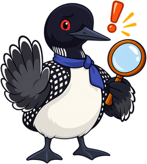
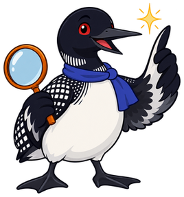

# Accuracy and Currency

## Summary

Teaches teachers to score accuracy and currency by fact checking, evaluating citations, spotting outdated content and broken links, and deciding when expert review is needed. It is the first of the quality-metric chapters and relies on the rubric from the previous chapters. After this chapter you can check a resource's facts and citations, find outdated content and broken links, and record the evidence for an accuracy score.

## Concepts Covered

This chapter covers the following 14 concepts from the learning graph:

| Concept | Concept Impact Score |
|---------|-----------------------|
| Accuracy Metric | 198 |
| Currency Metric | 11 |
| Factual Error | 6 |
| Fact Checking | 3 |
| Source Citation | 191 |
| Primary Source | 3 |
| Secondary Source | 2 |
| Citation Quality | 1 |
| Outdated Content | 8 |
| Publication Date | 2 |
| Revision History | 1 |
| Link Rot | 4 |
| Broken Link Check | 3 |
| Expert Review | 2 |

## Prerequisites

This chapter builds on concepts from:

- [Chapter 3: The Ten-Metric Rubric and Scoring](../03-ten-metric-rubric-scoring/index.md)

---

!!! mascot-welcome "A Confident Sentence Is Not a True One"
    { class="mascot-admonition-img" }
    A resource can be well written, nicely designed, and wrong. This chapter teaches you to check the facts, follow each citation back to its source, and test the links, so that your first quality score rests on evidence and not on how sure the text sounds. Let's dive in and check the evidence!

The first quality metric in the ten-metric rubric asks one question: are the facts correct and up to date? It sounds simple, and it is the metric where a careless reviewer does the most damage. Readers trust a resource that sounds certain, and a text that sounds certain is not always right. A reviewer's job is to ask what each important sentence rests on.

This chapter splits the metric into its two halves. Accuracy asks whether the facts were correct when written. Currency asks whether they are still correct now. You will learn to check a sample of facts, to follow citations back to their sources, to judge whether a citation really supports a claim, to spot content that has aged, to test links, and to decide when you need an expert. The last section combines all of it into a score.

## The Accuracy Metric

The **accuracy metric** is the half of the first quality metric that asks whether the facts in a resource are correct. A fact here means any claim that can be checked against a source: a date, a number, a definition, a name, a quotation, a procedure, or a step in a calculation. Pictures make claims too, because a caption or a labeled diagram states something that can be right or wrong. Accuracy does not cover opinions or teaching choices, which other metrics score.

No reviewer can check every claim in a resource. The method is to check a **sample**. Pick at least 10 checkable facts, spread across the resource's sections, and favor the kinds of claims that are likeliest to be wrong or most costly if they are: numbers, dates, names, and statements about cause. For each fact record where it appears, the source you checked it against, and the result, which is match, mismatch, or not checkable. Report the sample size with the score, since "9 of 10 matched" says more than "mostly accurate".

Check each fact against a reliable source that is independent of the resource. Checking against another copy of the same text proves nothing, because copied errors spread.

**Worked example: a 10-fact sample for Watershed Basics.** The reviewer reads the three sections, picks ten claims that can be checked, and checks each against a reliable source. The river, the lake, and the agency are made up for this book, and the table labels the data illustrative.

| # | Where | Claim in the resource | Checked against | Result |
|---|---|---|---|---|
| 1 | Section 1 | A watershed is an area of land that drains to a common outlet. | A national water agency's glossary | Match |
| 2 | Section 1 | Rain that falls on a watershed flows downhill to streams, lakes, or the sea. | The agency's introduction to watersheds | Match |
| 3 | Section 1 | A large watershed can contain many smaller watersheds. | The agency's introduction | Match |
| 4 | Section 2 | The Clearwater River is 410 miles long. | The State Water Agency's current river data page | **Mismatch:** the page now gives 398 miles, and the text uses an older figure |
| 5 | Section 2 | The Clearwater River drains about 6,000 square miles. | The State Water Agency's river data page | Match |
| 6 | Section 2 | The Clearwater River flows into Lake Marlow. | The state atlas | Match |
| 7 | Section 3 | Groundwater stored in underground layers is called an aquifer. | A geological survey glossary | Match |
| 8 | Section 3 | Wetlands can slow floodwater and filter pollutants. | The agency's wetlands page | Match |
| 9 | Section 3 | Many rivers are fed in part by springs. | The geological survey's water pages | Match |
| 10 | Section 3 | Paved surfaces increase runoff. | The agency's runoff page | Match |

Nine of the ten facts match. The mismatch is a figure that was right once and has since been corrected, so it is both an accuracy finding and a currency finding. The final section of this chapter shows how that single fact affects the score.

### Factual Error

A **factual error** is a statement in a resource that is false, because it disagrees with reliable evidence about what is true. Errors come in several kinds, and naming the kind tells the reviewer what to record and the author what to fix.

| Kind | What it looks like |
|---|---|
| Wrong fact | A claim that is simply false, such as the wrong number of chambers in a human heart |
| Wrong number or unit | A correct fact with a wrong figure, such as milliliters written as liters |
| Misattributed quote | A real statement credited to the wrong person |
| Outdated statement | A claim that was true once and is no longer |
| Unsupported claim | A claim that offers no evidence, so no one can tell |
| Misleading simplification | A claim that is true as far as it goes and leaves out something that changes the meaning |

An error is **serious** when a learner could take away a false or outdated fact, and **minor** when it does not mislead, as with a misspelled name. A disagreement among experts is not an error. If reliable sources differ, record the claim as contested and say so, instead of marking it wrong.

**Worked example: classifying five findings.**

| Finding | Kind | Severity |
|---|---|---|
| The text says water boils at 90 degrees Celsius at sea level. | Wrong number or unit | Serious |
| A famous quotation is credited to the wrong person in a footnote. | Misattributed quote | Minor |
| The text gives a river's length from an older survey. | Outdated statement | Serious |
| A statistic appears with no source. | Unsupported claim | Not yet known, until someone checks it |
| The text says plants get their food from the soil and never mentions sunlight. | Misleading simplification | Serious |

The first MicroSim of the chapter trains this distinction. It shows eight short reports of errors, and for each one you choose the kind of error it describes.

#### Diagram: Error Type Sorter

Error Type Sorter

Type: microsim
**sim-id:** error-type-sorter 
**Library:** p5.js 
**Status:** Specified 
**Bloom Level:** Analyze 
**Bloom Verb:** distinguish 
**Learning Objective:** The learner will distinguish six kinds of factual error by choosing the kind that each of eight error reports describes, with at least 7 of 8 correct on the first attempt.

**Prerequisites:** Factual Error, The Accuracy Metric (both defined in this chapter above this block).

**Evidence of Mastery:** For each report the learner chooses one of six kinds. A choice is correct when it matches the Correct kind column in Content. Mastery is at least 7 of 8 correct on the first attempt. Reading the kind definitions is exploration, not evidence.

**Misconceptions:** (1) An outdated statement is a wrong fact. (2) A claim with no source is false. (3) A simplification is never an error.

**Instructional Rationale:** Distinguishing kinds of error is an Analyze-level action, and the six kinds overlap in everyday speech. Eight reports that each isolate one kind make the learner attend to what exactly is wrong.

**Content:**

The six kinds: Wrong fact, Wrong number or unit, Misattributed quote, Outdated statement, Unsupported claim, Misleading simplification.

The eight reports:

| # | Report shown to the learner | Correct kind | Why (shown as feedback) |
|---|---|---|---|
| 1 | A reading says the human heart has three chambers. | Wrong fact | The claim is false: the human heart has four chambers. |
| 2 | A lab page tells students to measure 5 liters where its own source says 5 milliliters. | Wrong number or unit | The fact is right and the unit is wrong. |
| 3 | A history page credits a famous speech to the wrong speaker. | Misattributed quote | A real statement is credited to the wrong person. |
| 4 | A technology page tells students to use a program that was discontinued in 2019. | Outdated statement | The advice was sound when written and no longer works. |
| 5 | A health page says studies prove a diet works and cites nothing. | Unsupported claim | No evidence is offered, so no one can tell whether it is true. |
| 6 | A science page says plants get their food from the soil and never mentions sunlight. | Misleading simplification | It is partly true and leaves out what changes the meaning. |
| 7 | A math page says the area of a rectangle is its length plus its width. | Wrong fact | The formula is false: area is length times width. |
| 8 | A page quotes statistics from a recent study that is ten years old. | Outdated statement | The statistics were current once and are old now. |

**Provenance:** The reports are illustrative cases written for this chapter, and the sim labels them "illustrative examples". The kinds follow the chapter section "Factual Error". The product named in report 4 is not named in the sim.

**Rules:** Each report has exactly one correct kind. Reports 1 and 7 are Wrong fact, and reports 4 and 8 are Outdated statement.

**Learner Activity:**

1. The learner reads one report and sees the six kinds.
2. The learner may open the kind definitions. Opening them does not change the score.
3. The learner chooses a kind, and the choice is committed.
4. The sim shows whether it was correct and the Why text.
5. After report 8 the sim shows the summary.

**Feedback:** 8 reports in a shuffled order, one attempt each. Correct: "Correct: [kind]. [Why]". Incorrect: "Not quite. This is [kind]. [Why]". The summary shows "[n] of 8 correct on the first attempt". At 7 or more it adds "You can name the error." Below 7 it lists the Why text of each missed report.

**Starting State:** The first report, the six kinds, and the definitions closed. The question shown is "What kind of error is this?"

**Chapter Anchors:** The chapter lists six kinds of factual error: wrong fact, wrong number or unit, misattributed quote, outdated statement, unsupported claim, and misleading simplification.

### Fact Checking

**Fact checking** is the process of testing a claim by tracing it to a reliable source and comparing the two. The process has six steps:

1. Pick the claim, and write down its exact words.
2. Decide what would count as a reliable source for that kind of claim.
3. Find the source, preferably the original and not a copy.
4. Compare the claim and the source word for word and number for number.
5. Record the result as match, mismatch, or not addressed by the source.
6. Cite where you looked, so another reviewer can repeat the check.

The result "not addressed" matters. A source that does not mention a claim neither supports nor contradicts it, and a reviewer who counts silence as support will pass claims that were never checked.

!!! mascot-thinking "Silence Is Not Support"
    { class="mascot-admonition-img" }
    A source that never mentions a claim has not confirmed it. Count "not addressed" as its own result, and never as a match.

The MicroSim below practices the comparison step. It shows a short source and eight claims, and for each claim you decide whether the source supports it, contradicts it, or does not address it.

#### Diagram: Fact Check Matcher

Fact Check Matcher

Type: microsim
**sim-id:** fact-check-matcher 
**Library:** p5.js 
**Status:** Specified 
**Bloom Level:** Evaluate 
**Bloom Verb:** judge 
**Learning Objective:** The learner will judge whether a source supports, contradicts, or does not address each of eight claims, with at least 7 of 8 correct on the first attempt.

**Prerequisites:** Fact Checking, Factual Error, The Accuracy Metric (all defined in this chapter above this block).

**Evidence of Mastery:** For each claim the learner commits one of three verdicts. A verdict is correct when it matches the Correct verdict column in Content. Mastery is at least 7 of 8 correct on the first attempt. Rereading the source is exploration, not evidence.

**Misconceptions:** (1) A claim the source does not mention is supported. (2) A claim that looks similar to the source is supported. (3) A small number difference can be ignored.

**Instructional Rationale:** Judging a claim against a source is an Evaluate-level action that fact checking depends on. Including claims that the source does not address, and claims that differ by one digit, teaches the learner to read the source closely and to count silence separately.

**Content:**

The source, shown at all times (a made-up fact sheet): "Lake Marlow Fact Sheet, State Water Agency, 2025. Lake Marlow covers 14 square kilometers. Its deepest point is 31 meters. The lake is fed by the Clearwater River and two smaller streams. Fishing is permitted year-round. Swimming is permitted from June to September. The lake was formed by a glacier about 12,000 years ago."

The three verdicts: Supported, Contradicted, Not addressed.

The eight claims:

| # | Claim shown to the learner | Correct verdict | Why (shown as feedback) |
|---|---|---|---|
| 1 | Lake Marlow covers 14 square kilometers. | Supported | The source states this figure. |
| 2 | The deepest point of Lake Marlow is 13 meters. | Contradicted | The source says 31 meters, and the claim swaps the digits. |
| 3 | The Clearwater River feeds Lake Marlow. | Supported | The source names it as one of the inflows. |
| 4 | Swimming is allowed all year. | Contradicted | The source says swimming is permitted from June to September. |
| 5 | Lake Marlow is home to rainbow trout. | Not addressed | The source does not name any fish species. |
| 6 | The lake was formed by a glacier. | Supported | The source says so. |
| 7 | Lake Marlow is the largest lake in the state. | Not addressed | The source gives the lake's area and does not compare it with other lakes. |
| 8 | The lake has three inflows. | Supported | The source lists the river and two smaller streams, which makes three. |

**Provenance:** The lake, the agency, and the fact sheet are made up for this chapter, and the sim labels them "illustrative example". No claim in the sim is a statement about a real place.

**Rules:** Each claim has exactly one correct verdict. Four claims are Supported, two are Contradicted, and two are Not addressed. A claim is Supported only when the source states it or a direct count or calculation from the source gives it.

**Learner Activity:**

1. The learner sees the source and one claim.
2. The learner chooses Supported, Contradicted, or Not addressed, and the choice is committed.
3. The sim shows whether it was correct and the Why text, and highlights the part of the source that decides it.
4. After claim 8 the sim shows the summary.

**Feedback:** 8 claims in a shuffled order, one attempt each. Correct: "Correct: [verdict]. [Why]". Incorrect: "Not quite. This is [verdict]. [Why]". The summary shows "[n] of 8 correct on the first attempt". At 7 or more it adds "You can compare a claim with a source." Below 7 it lists the Why text of each missed claim.

**Starting State:** The source and claim 1 or the first claim in the shuffled order, with the three verdicts. The question shown is "Does the source support this claim?"

**Chapter Anchors:** The chapter's fact-checking steps end with the three results: match, mismatch, and not addressed by the source. The chapter says silence is not support.

## Source Citation

A **source citation** is a reference that tells the reader where a claim came from, in enough detail that the reader can find the source. Citations do three jobs. They let a reviewer check a claim. They let a learner go deeper. And they give credit to the people whose work the resource builds on. A claim with no citation asks the reader to trust the author, and a reviewer cannot score trust.

Citations appear in three common places. An *inline citation* sits beside the claim, as a number or a short author-and-year mark. A *footnote* puts the reference at the bottom of the page. A *reference list* collects all the references at the end. The form varies with the citation style, but a complete reference always carries the same parts: the author, the year, the title, the publisher or journal, a link or identifier, and, for web pages, the date you accessed it.

Not every sentence needs a citation. A claim needs one when it states a statistic, a date, a quotation, a finding of research, or anything a reasonable reader might doubt. Common knowledge and the author's own explanations do not.

Citations also form chains. A textbook cites a review article, the review cites a study, and the study reports the original measurement. An error can enter at any link. A reviewer who stops at the first link has checked the textbook's summary, and has not checked the evidence. The further back you trace a claim, the more you can trust the check.

**Worked example: tracing one claim back.** A resource says "Wetlands filter pollutants." The reviewer follows the chain.

| Step | Source | What it says | Is it the original? |
|---|---|---|---|
| 1 | The resource's footnote 4 | Cites a textbook | No |
| 2 | The textbook | Says wetlands filter pollutants and cites a review | No |
| 3 | The review article | Summarizes several studies of wetland filtering | No |
| 4 | One of those studies | Reports measurements of pollutant levels before and after water passed through a wetland | Yes |

The claim is supported by the study at the end of the chain. A reviewer who stopped at step 2 would have found only that a textbook agreed with the resource. The next MicroSim shows the parts of a single reference. Six numbered markers point to the parts that a reviewer checks.

#### Diagram: Anatomy of a Source Citation

Anatomy of a Source Citation

Type: infographic
**sim-id:** citation-anatomy 
**Library:** html 
**Status:** Specified 
**Bloom Level:** Remember 
**Bloom Verb:** identify 
**Learning Objective:** The learner will identify the six parts of a complete reference from a description of each part's look, with at least 5 of 6 correct on the first attempt.

**Prerequisites:** Source Citation, Fact Checking (both defined in this chapter above this block).

**Evidence of Mastery:** In quiz mode the learner clicks the marker that matches a visual hint. A click is correct when it matches the marker named in the Hint column of Content. Mastery is at least 5 of 6 correct on the first attempt. Hovering in explore mode is exploration, not evidence.

**Misconceptions:** (1) A link alone is a complete citation. (2) The year is the date the reader accessed the page. (3) The publisher is the same as the author.

**Instructional Rationale:** Identifying the parts of a reference is a Remember-level task, and an illustration of one entry shows how the parts sit together. The quiz asks the learner to recognize a part from its place and look.

**Content:**

The illustration is a text-free flat drawing of one entry in a reference list on a printed page. The entry is made of separate bars on two lines: a short bar for a name, a small bar inside parentheses, a long bar that is drawn as slanted italic text, a medium bar, an underlined bar that looks like a link, and a small bar with a calendar icon beside it. The six markers:

| # | Label | Hint (describes the look, not the name) | Description | Tip |
|---|---|---|---|---|
| 1 | Author | The short bar at the start of the entry. | The person or organization that created the work, and the first thing a reviewer checks for expertise. | An entry with no author needs extra checking, because no one is accountable for the claim. |
| 2 | Year | The small bar inside parentheses after the author. | The year the work was published, which a reviewer compares with the claim's age. | Compare the year with how fast the topic changes. |
| 3 | Title | The long slanted bar in the middle of the first line. | The name of the work, which lets a reader search for it. | A title that does not match the claim is a warning sign. |
| 4 | Publisher or journal | The medium bar after the title. | The organization or periodical that published the work, which says something about review and reliability. | A reference work from a government agency or a university press has usually been reviewed. |
| 5 | Link or identifier | The underlined bar on the second line. | A web address or a persistent identifier, so a reader can open the source. | Test the link, and note the date you tested it. |
| 6 | Date accessed | The small bar with a calendar icon at the end. | The date the citing author last saw the page, which matters because web pages change. | A page accessed years ago needs a fresh check. |

**Provenance:** The six parts follow the chapter section "Source Citation". The illustration is synthetic, and the sim labels the entry "illustrative example". The sim states that citation styles order the parts differently.

**Rules:** Each hint matches exactly one marker. The illustration contains no text, so every label comes from the table above. Markers are numbered 1 to 6 in the order of the table.

**Learner Activity:**

1. In explore mode the learner hovers or clicks a marker and reads its label, description, and tip.
2. In quiz mode the sim shows a hint.
3. The learner clicks the marker they think the hint describes.
4. If the first click is wrong, the sim says so and lets the learner try once more. If the second click is also wrong, the sim reveals the marker and its description.
5. After all 6 hints the sim shows the summary.

**Feedback:** 6 hints in a shuffled order, two attempts each. Only a correct first click counts as evidence. Correct: "Correct: [label]. [Description]". First wrong click: "Not quite. Look again at the hint: [hint]". Second wrong click: "This is [label]. [Description]". The summary shows "[n] of 6 correct on the first attempt". At 5 or more it adds "You can read a reference." Below 5 it lists the labels of the missed parts.

**Starting State:** The illustration with six numbered markers, explore mode active, and the prompt "Hover a marker to see what it is."

**Chapter Anchors:** The chapter says a complete reference carries the author, the year, the title, the publisher or journal, a link or identifier, and for web pages the date accessed.

### Primary Source

A **primary source** is original evidence from the time or the person being described: a measurement, a document, a photograph, an interview, a dataset, or a first report of research. A primary source is the closest you can get to the thing itself. A census table is a primary source for the population on the census date. A lab notebook entry is a primary source for what the experimenter measured.

### Secondary Source

A **secondary source** describes, summarizes, or interprets primary sources. Textbooks, review articles, news stories about research, and histories are secondary sources. Encyclopedias and similar reference works also summarize other sources, and some classification schemes call them tertiary. This book treats them as secondary. Secondary sources are useful, because they gather and explain. They are also one step removed, so an error in the summary can hide the original evidence. For important claims, a reviewer follows a secondary source back to a primary one.

The MicroSim below is a sorting practice. Each of ten sources supports a stated claim, and you decide whether it is a primary or a secondary source for that claim.

#### Diagram: Primary or Secondary Source Sorter

Primary or Secondary Source Sorter

Type: microsim
**sim-id:** source-type-sorter 
**Library:** p5.js 
**Status:** Specified 
**Bloom Level:** Understand 
**Bloom Verb:** classify 
**Learning Objective:** The learner will classify each of ten sources as a primary or a secondary source for the claim it supports, with at least 9 of 10 correct on the first attempt.

**Prerequisites:** Primary Source, Secondary Source, Source Citation (all defined in this chapter above this block).

**Evidence of Mastery:** For each source the learner commits one of two bins. A placement is correct when it matches the Correct bin column in Content. Mastery is at least 9 of 10 correct on the first attempt. Reading the definitions is exploration, not evidence.

**Misconceptions:** (1) Anything old is a primary source. (2) A website is always a secondary source. (3) A source is primary or secondary in itself, whatever the claim.

**Instructional Rationale:** Classifying a source is an Understand-level action, and the same document can be primary for one claim and secondary for another. Giving the claim with each source teaches the learner to ask what the source is evidence of.

**Content:**

The two bins: Primary source (original evidence from the time or person described) and Secondary source (describes, summarizes, or interprets primary sources).

The ten sources:

| # | Claim | Source shown to the learner | Correct bin | Why (shown as feedback) |
|---|---|---|---|---|
| 1 | The town had 4,200 residents in 1990. | A census table from 1990 | Primary source | It is the original count. |
| 2 | The town had 4,200 residents in 1990. | A textbook paragraph that summarizes the 1990 census | Secondary source | It describes the census and is not the census. |
| 3 | The dam was built with two spillways to handle floods. | A recorded interview with the engineer who designed the dam | Primary source | It comes from the person who made the decision. |
| 4 | The dam was built with two spillways to handle floods. | A magazine article about that interview | Secondary source | It reports what someone else said. |
| 5 | The temperature in trial 3 was 22 degrees Celsius. | The scientist's lab notebook entry for trial 3 | Primary source | It records the measurement when it was made. |
| 6 | Teenagers benefit from later school start times. | A review article that summarizes thirty studies | Secondary source | It summarizes research done by others. |
| 7 | The flood water reached the second step of the library. | A photograph taken at the library during the flood | Primary source | It is a record made at the time. |
| 8 | The flood water reached the second step of the library. | A history book about the flood | Secondary source | It interprets records of the flood. |
| 9 | The river's peak flow was recorded on 12 April. | The original data file from the river gauge | Primary source | It is the instrument's own record. |
| 10 | The river is the main water supply for the county. | An encyclopedia entry about the river | Secondary source | It summarizes other sources. |

**Provenance:** The claims and sources are illustrative cases written for this chapter, and the sim labels them "illustrative examples". The definitions follow the chapter sections "Primary Source" and "Secondary Source".

**Rules:** Each source has exactly one correct bin, five per bin. The bin depends on the source's relation to the stated claim.

**Learner Activity:**

1. The learner sees one claim with its source and the two bins.
2. The learner places the source in a bin, and the placement is committed.
3. The sim shows whether it was correct and the Why text.
4. After source 10 the sim shows the summary.

**Feedback:** 10 sources in a shuffled order, one attempt each. Correct: "Correct: [bin]. [Why]". Incorrect: "Not quite. This is a [bin]. [Why]". The summary shows "[n] of 10 correct on the first attempt". At 9 or more it adds "You can tell original evidence from a summary." Below 9 it lists the Why text of each missed source.

**Starting State:** The first source with its claim, the two bin definitions, and two empty bins. The question shown is "Is this source original evidence or a summary of it?"

**Chapter Anchors:** The chapter says an encyclopedia is treated as a secondary source, and that a census table is a primary source for the population on its date.

### Citation Quality

**Citation quality** is how well a citation supports the claim it is attached to. A citation can exist and still be poor. Four questions test it:

- **Relevant:** does the source actually address this claim?
- **Reliable:** do its author and publisher have expertise, and does the work show how it knows?
- **Retrievable:** can a reader find the source, through a working link or complete details?
- **Current:** is the source recent enough for a claim that changes?

A citation that fails any of the four is a weaker support than it looks, and the reviewer notes which one failed.

!!! mascot-warning "A Citation That Exists May Not Support the Claim"
    { class="mascot-admonition-img" }
    A real source with a working link can still say nothing about the claim beside it, and AI agents are known to produce references that look right and are not. Open the source and read the line that supports the claim, and record that you did.

The MicroSim below is a quality check. Each of six citations is attached to the same claim, and for each one you mark which of the four questions it fails.

#### Diagram: Citation Quality Checker

Citation Quality Checker

Type: microsim
**sim-id:** citation-quality-checker 
**Library:** p5.js 
**Status:** Specified 
**Bloom Level:** Evaluate 
**Bloom Verb:** assess 
**Learning Objective:** The learner will assess six citations for the same claim by marking exactly which of four quality criteria each fails, with at least 5 of 6 judged correctly on the first attempt.

**Prerequisites:** Citation Quality, Source Citation, Primary Source, Secondary Source (all defined in this chapter above this block).

**Evidence of Mastery:** For each citation the learner marks the failed criteria, or marks none. A judgment is correct when the marked set equals the Failed criteria column in Content exactly. Mastery is at least 5 of 6 correct on the first attempt. Reading the criteria is exploration, not evidence.

**Misconceptions:** (1) A citation with a link is always good. (2) A recent source is always reliable. (3) A source that exists supports the claim.

**Instructional Rationale:** Assessing a citation against explicit criteria is an Evaluate-level action. Six citations for one claim, with different mixes of failures, force the learner to apply each criterion separately.

**Content:**

The claim shown at all times: "Lake Marlow's deepest point is 31 meters." The four criteria: Relevant, Reliable, Retrievable, Current. A criterion is met when: the source states the depth (Relevant); the author or publisher is an agency, a reviewed publication, or a reference work with a stated method (Reliable); the link works or full details let a reader find the source (Retrievable); and the source is dated within the last five years (Current).

The six citations (all made up):

| # | Citation shown to the learner | Failed criteria | Why (shown as feedback) |
|---|---|---|---|
| 1 | State Water Agency. "Lake Marlow Fact Sheet." 2025. https://example.gov/lake-marlow (link works, and the sheet gives the depth) | None | It states the depth, comes from an agency, can be opened, and is recent. |
| 2 | A blog post titled "Why I Love Lakes," 2019, no link, which never mentions depth | Relevant, Reliable, Retrievable | The post does not state the depth, has no stated method, and cannot be found. |
| 3 | State Water Agency. "Lake Marlow Fact Sheet." 1998. https://example.gov/lake-marlow-1998 (link works, and the sheet gives the depth) | Current | The source is old for a measurement that can be resurveyed. |
| 4 | State Water Agency. "Lake Marlow Fact Sheet." 2025. https://example.gov/old-link (the link returns "page not found") | Retrievable | The source may be good, and the reader cannot reach it. |
| 5 | A student slide deck about lakes, 2025, no author, no link, which states the depth | Reliable, Retrievable | The deck states the depth, and no one is accountable for it and no one can find it. |
| 6 | State Water Agency. "Lake Marlow Survey." 2025. https://example.gov/marlow-survey (link works, and the survey reports area and shoreline length but not depth) | Relevant | The source is reliable and current, and it does not address depth. |

**Provenance:** The claim and citations are made up for this chapter, and the sim labels them "illustrative examples". The criteria follow the chapter section "Citation Quality". The five-year limit for Current is a teaching choice, and the sim labels it "illustrative threshold".

**Rules:** Each citation has a fixed set of failed criteria, and the empty set is valid. A citation is Current when it is dated >= 2021, because the sim's review date is 2026. The criteria are judged independently.

**Learner Activity:**

1. The learner sees the claim, the four criteria, and one citation.
2. The learner marks each criterion that the citation fails, or marks "None fail".
3. The learner presses Check. The sim shows the correct set and the Why text.
4. The learner moves to the next citation, until citation 6 is done.

**Feedback:** 6 citations in the fixed order, one attempt each. Correct: "Correct. [Why]". Incorrect: "Not quite. Failed: [criteria, or none]. [Why]". The summary shows "[n] of 6 correct on the first attempt". At 5 or more it adds "You can judge a citation." Below 5 it lists the Why text of each missed citation.

**Starting State:** The claim, the four criteria with their definitions, and citation 1 with no criteria marked. The question shown is "Which criteria does this citation fail?"

**Chapter Anchors:** The chapter lists the four citation-quality questions as relevant, reliable, retrievable, and current. The chapter says a citation that exists can fail to support the claim.

## The Currency Metric

The **currency metric** is the half of the first quality metric that asks whether the content is still correct and in current use: the facts, figures, practices, software, laws, and links that were right when the resource was written but may have changed since. Accuracy asks about the day of writing, and currency asks about today. A resource can score well on one and badly on the other. A careful 2012 text with no errors on the day it was published can be full of out-of-date statements now.

Content ages at different speeds, so a reviewer matches the amount of checking to how fast the topic moves. The multiplication table does not change, while a software screenshot can change within a year.

**Worked example: how fast does it age?** The table groups six kinds of content by how quickly they go out of date.

| Kind of content | How fast it ages | How often to check |
|---|---|---|
| Basic mathematics and definitions | Very slowly | At each major review |
| The sequence of historical events | Slowly | At each major review |
| Statistics and survey results | Moderately | Every few years, or whenever new data appear |
| Standards, curricula, and guidelines | Moderately | Every few years, and when a standard is revised |
| Software screenshots, prices, and web addresses | Quickly | Every year or more often |
| Laws, policies, and contact details | Quickly | Every year or more often |

### Outdated Content

**Outdated content** is content that was correct when it was written and is no longer correct or in use. It is different from a factual error, because the author did nothing wrong at the time. The reader is harmed all the same. Several signs point to outdated content:

- Dates in the text that are many years old, or the words "recent" and "new" with no date beside them.
- Products, versions, or standards that have been replaced or discontinued.
- Statistics that come from an old dataset for a quantity that changes.
- Screenshots of an interface that has since been redesigned.
- Links to pages that no longer exist, which later sections cover.
- No sign of any update in years, for a topic that moves fast.

**Worked example: reading a short passage for signs of aging.** A reviewer on 12 October 2026 reads this made-up passage: "Our district uses Quizlette 2.0, the newest quiz tool, adopted in 2014. The county has about 52,000 people, according to the 2010 census. To sign in, click the blue Sign On button, shown in the screenshot below."

| Statement | Sign of aging | What to check |
|---|---|---|
| "the newest quiz tool, adopted in 2014" | "Newest" with a date twelve years old | Whether the tool still exists and is still the district's choice |
| "about 52,000 people, according to the 2010 census" | A figure from a dataset that changes | The most recent census figure |
| "click the blue Sign On button" in a screenshot | An interface screenshot | Whether the interface still looks like that |

The MicroSim below practices the same judgment. It shows eight statements read on a review date, and for each one you decide whether it is current, likely outdated, or cannot be judged without checking.

#### Diagram: Outdated Content Spotter

Outdated Content Spotter

Type: microsim
**sim-id:** outdated-content-spotter 
**Library:** p5.js 
**Status:** Specified 
**Bloom Level:** Evaluate 
**Bloom Verb:** judge 
**Learning Objective:** The learner will judge whether each of eight statements read on a stated review date is current, likely outdated, or cannot be judged without checking, with at least 7 of 8 correct on the first attempt.

**Prerequisites:** The Currency Metric, Outdated Content (both defined in this chapter above this block).

**Evidence of Mastery:** For each statement the learner commits one of three bins. A placement is correct when it matches the Correct bin column in Content. Mastery is at least 7 of 8 correct on the first attempt. Reading the signs of aging is exploration, not evidence.

**Misconceptions:** (1) Anything with a date is outdated. (2) Old facts about the past are outdated. (3) A rule written long ago is still in force.

**Instructional Rationale:** Judging currency is an Evaluate-level action that needs a criterion, which is how fast the kind of content changes. Including timeless statements, fast-aging ones, and ones that need a check teaches the learner to match the judgment to the content.

**Content:**

The review date, shown at all times: 12 October 2026. The three bins: Current, Likely outdated, Cannot tell without checking.

The eight statements:

| # | Statement shown to the learner | Correct bin | Why (shown as feedback) |
|---|---|---|---|
| 1 | The Pythagorean theorem says a squared plus b squared equals c squared for a right triangle. | Current | Mathematical results do not age. |
| 2 | In 2014 the district adopted Quizlette 2.0 for all quizzes. (Quizlette was discontinued in 2019.) | Likely outdated | The product has been discontinued, so the advice no longer works. |
| 3 | Photosynthesis takes in carbon dioxide and releases oxygen. | Current | Basic science of this kind changes very slowly. |
| 4 | The county has about 52,000 people (2010 census). | Likely outdated | A population figure from sixteen years before the review date is old for a quantity that changes. |
| 5 | To sign in, click the blue Sign On button at the top right (screenshot from 2015). | Likely outdated | Interface screenshots age quickly. |
| 6 | The United States Declaration of Independence was adopted in 1776. | Current | A historical date does not change. |
| 7 | The state requires 180 days of instruction (the law in effect since 1999). | Cannot tell without checking | Laws can be amended, so the reviewer must check the current law. |
| 8 | The tallest building in the city is Harbor Tower (completed 2008). | Cannot tell without checking | A taller building may have been built since, so the reviewer must check. |

**Provenance:** The statements are illustrative cases written for this chapter, and the sim labels them "illustrative examples". The product, county, law, and building are made up, and the two historical and scientific statements are common knowledge. The rules of thumb follow the chapter section "The Currency Metric".

**Rules:** Each statement has exactly one correct bin. Three statements are Current, three are Likely outdated, and two are Cannot tell without checking. A statement about a quantity that changes is Likely outdated when its source date is > 5 years before the review date.

**Learner Activity:**

1. The learner sees the review date and one statement.
2. The learner places the statement in a bin, and the placement is committed.
3. The sim shows whether it was correct and the Why text.
4. After statement 8 the sim shows the summary.

**Feedback:** 8 statements in a shuffled order, one attempt each. Correct: "Correct: [bin]. [Why]". Incorrect: "Not quite. This is [bin]. [Why]". The summary shows "[n] of 8 correct on the first attempt". At 7 or more it adds "You can read a date and a topic together." Below 7 it lists the Why text of each missed statement.

**Starting State:** The first statement, the review date, and the three bins. The question shown is "Is this statement still current?"

**Chapter Anchors:** The chapter's passage example is read on 12 October 2026 and flags the 2014 product, the 2010 census figure, and the screenshot. The chapter's shelf-life table puts mathematics and definitions at the slow end and screenshots, prices, laws, and contact details at the fast end.

### Publication Date

A **publication date** is the date a resource was first published or last substantially updated. Three dates can appear, and they mean different things. The *published* date is when the resource first appeared. The *updated* date is when it was last changed. The *accessed* date is when a reader last looked at it. A reviewer wants the first two. Where to look: the page's header or footer, the front matter of a book, the file's properties, the repository's commit history, or an archive of the page.

A resource with no date is a currency concern, because no one can tell how old the facts are. An updated date alone does not prove that the content was reviewed. Some websites refresh the date automatically each time the page is served. Look for evidence that the date reflects real revision.

### Revision History

A **revision history** is the record of the changes made to a resource over time, with dates. It is evidence of maintenance. For a resource hosted in a repository, the history is the list of commits from Chapter 4. For a document it may be a changelog or a note at the end. A frequent, recent revision history suggests that someone is looking after the resource. A long gap with no revisions is a signal, and for a fast-aging topic it is a warning.

### Link Rot

**Link rot** is the gradual breaking of web links over time. Sites are reorganized, domains lapse, pages are removed, and addresses change, so a link that worked when the author wrote the resource may lead nowhere years later. A resource full of citations to web pages is exposed to link rot, and the broken links make the citations impossible to check. Authors can reduce the damage by citing stable sources, by using persistent identifiers such as a DOI (a digital object identifier that points to a work wherever it moves), and by saving an archived copy of important pages.

!!! mascot-tip "Cite the Original and an Archive"
    { class="mascot-admonition-img" }
    When you rely on a web page, save an archived copy with a service such as the Internet Archive's Wayback Machine and record both addresses. If the original disappears, the archive keeps your evidence checkable.

### Broken Link Check

A **broken link check** tests every external link in a resource to see whether it still reaches the intended page. Free link-checking tools do the testing automatically, and a reviewer then looks at the failures by hand. Record the date of the test, because a link that works today may fail next month.

A link checker reports a status code, a three-digit number from the web server. The table shows the most common ones and the action each one calls for.

| Result | What it means | What to do |
|---|---|---|
| 200 | The page loaded | Confirm that it is still the cited page, then keep the link |
| 301 | The page moved permanently to a new address | Update the link to the new address |
| 403 | The server refused the tool, though a person may be allowed in | Open the link by hand |
| 404 | The page was not found | Search for the new address, or replace the source |
| 410 | The page is gone for good | Replace the source |
| Timeout | The server did not answer | Try again later, and open it by hand |

A page can also load with code 200 and no longer be the page that was cited, such as a site that sends every old address to its home page. A tool will report success, so a reviewer opens a sample of working links to confirm they lead where they should.

The MicroSim below practices reading link-check results. It shows eight results from a link checker, and for each one you choose the action to take.

#### Diagram: Link Check Results Reader

Link Check Results Reader

Type: microsim
**sim-id:** link-check-reader 
**Library:** p5.js 
**Status:** Specified 
**Bloom Level:** Understand 
**Bloom Verb:** interpret 
**Learning Objective:** The learner will interpret eight link-check results by choosing the action each calls for, with at least 7 of 8 correct on the first attempt.

**Prerequisites:** Link Rot, Broken Link Check, Source Citation (all defined in this chapter above this block).

**Evidence of Mastery:** For each result the learner commits one of three actions. A choice is correct when it matches the Correct action column in Content. Mastery is at least 7 of 8 correct on the first attempt. Reading the status code table is exploration, not evidence.

**Misconceptions:** (1) A 200 result always means the link is good. (2) A 403 result means the page is gone. (3) A timeout means the source is permanently lost.

**Instructional Rationale:** Interpreting a result is an Understand-level action that connects a code to its meaning. Results that look alike but call for different actions teach the learner not to rely on the code alone.

**Content:**

The three actions: Keep, Fix or replace, Check by hand.

The eight results:

| # | Result shown to the learner | Correct action | Why (shown as feedback) |
|---|---|---|---|
| 1 | 200: the page loaded, and it is the cited article. | Keep | The link works and reaches the cited page. |
| 2 | 404: the page was not found. | Fix or replace | The page is missing, so find its new address or replace the source. |
| 3 | 301: the page moved permanently to a new address, which shows the same article. | Fix or replace | Update the link to the new address. |
| 4 | 403: the tool was refused, and the page opens in a browser. | Check by hand | The server blocks tools, so a person must confirm the page. |
| 5 | 200: the page loaded, but it is a site home page and not the cited article. | Fix or replace | The address now leads somewhere else, so the citation no longer works. |
| 6 | 410: the page is gone. | Fix or replace | The server says the page was removed for good. |
| 7 | Timeout: no answer after 30 seconds. | Check by hand | The server may be down for now, so try again later and open it by hand. |
| 8 | 200: the page loaded, but it asks for a paid subscription to read. | Check by hand | The link works, and a reader without a subscription cannot check the claim, so a person must decide. |

**Provenance:** The results are illustrative cases written for this chapter, and the sim labels them "illustrative examples". The status codes follow the chapter section "Broken Link Check".

**Rules:** Each result has exactly one correct action. One result is Keep, four are Fix or replace, and three are Check by hand.

**Learner Activity:**

1. The learner sees one result and the three actions.
2. The learner may open the status code table. Opening it does not change the score.
3. The learner chooses an action, and the choice is committed.
4. The sim shows whether it was correct and the Why text.
5. After result 8 the sim shows the summary.

**Feedback:** 8 results in a shuffled order, one attempt each. Correct: "Correct: [action]. [Why]". Incorrect: "Not quite. The action is [action]. [Why]". The summary shows "[n] of 8 correct on the first attempt". At 7 or more it adds "You can read a link check." Below 7 it lists the Why text of each missed result.

**Starting State:** The first result, the three actions, and the status code table closed. The question shown is "What should the reviewer do with this link?"

**Chapter Anchors:** The chapter's status code table lists 200, 301, 403, 404, 410, and timeout, with the actions keep, update, open by hand, replace, and try again. The chapter says a page that loads with code 200 may not be the cited page.

## Expert Review

An **expert review** is a check of a resource's content by a person with deep knowledge of its subject. A reviewer cannot be an expert in everything, and for some claims an expert's judgment is the only reliable check. Ask for an expert review when the topic is outside your knowledge, when the content bears on health, safety, or law, when claims are contested, or when your sample finds two or more mismatches in ten facts.

Make the request easy to answer. Send the list of claims you could not check, with the exact words and the context, and ask a specific question about each: is this correct, and if not, what is? Record the expert's name, their qualification, the date, and the result in your evidence. An expert's confirmation counts as evidence, and a note that says only "an expert looked at it" does not.

!!! mascot-encourage "Asking an Expert Is Part of the Method"
    { class="mascot-admonition-img" }
    If a claim is beyond what you know, that does not make you a weak reviewer, because careful reviewers say so and ask. You already hand a question to a colleague when it falls outside your subject. Write down the claim, the expert, and the answer, and the score rests on evidence again.

## Scoring Accuracy and Currency

You now have the parts for scoring the metric. The review has six steps. Note the review date. Sample and check at least 10 facts. Trace the claims that carry weight back through their citations. Test all external links. Run the ten checks below. Then count the passes, find the band, and choose the number.

A failed check is **serious** when a learner could take away a false or outdated fact. If a serious check fails, choose the lower number in a two-number band. Otherwise choose the higher one, as in Chapter 3.

| # | Check | Serious if it fails? |
|---|---|---|
| 1 | A sample of at least 10 checkable facts was tested against reliable sources | No |
| 2 | At least 9 of every 10 sampled facts match their sources | Yes |
| 3 | No sampled error teaches a main idea falsely | Yes |
| 4 | Claims that need support carry a citation | No |
| 5 | Cited sources are reliable | No |
| 6 | A publication or update date is shown | No |
| 7 | No outdated fact, figure, or practice appears in the sample | Yes |
| 8 | Cited sources are recent enough for the claims | No |
| 9 | All tested links work | No |
| 10 | A way to report errors is offered | No |

**Worked example: Watershed Basics.** The reviewer applies the checks to the reading from Chapter 3, and the ten-fact sample is the table from the first section of this chapter.

| # | Result | Evidence |
|---|---|---|
| 1 | Pass | Ten facts were checked in sections 1 to 3. |
| 2 | Pass | Nine of ten matched. |
| 3 | Pass | The one mismatch is a river length, not a main idea. |
| 4 | Pass | Every statistic and date carries a citation. |
| 5 | Pass | The citations are to agencies and survey pages. |
| 6 | Pass | The page shows a publication date. |
| 7 | **Fail** | The river-length figure in section 2 is outdated: the text gives 410 miles and the agency now gives 398. |
| 8 | Pass | The cited agency pages were updated within the last five years. |
| 9 | **Fail** | 2 of 14 links return "page not found" (tested 2026-10-12). |
| 10 | Pass | The author's contact address is on the page. |

Eight of ten checks pass, a share of 80 percent, in the 7 to 8 band. Check 7 failed, and it is a serious check, because a learner could memorize the old river length. The reviewer therefore chooses the lower number, **7**, which is the score recorded on the Chapter 3 worksheet. The two broken links are a lesser gap, and the reviewer records both with the date.

The last MicroSim of the chapter is a scoring practice. It shows five resources with their ten check results, and for each one you choose the metric score.

#### Diagram: Accuracy and Currency Scorer

Accuracy and Currency Scorer

Type: microsim
**sim-id:** accuracy-currency-metric-scorer 
**Library:** p5.js 
**Status:** Specified 
**Bloom Level:** Apply 
**Bloom Verb:** apply 
**Learning Objective:** The learner will apply the ten accuracy and currency checks and the Chapter 3 scoring rules to choose the metric score for each of five resources, with at least 4 of 5 scores exactly correct on the first attempt.

**Prerequisites:** The Accuracy Metric, The Currency Metric, Factual Error, Outdated Content, Metric Score, Scoring Descriptor (all defined in this chapter or in Chapter 3 above this block).

**Evidence of Mastery:** For each resource the learner chooses a whole-number score from 0 to 10 after seeing the ten check results. A score is correct when it equals the Correct score column in Content. Mastery is at least 4 of 5 scores correct on the first attempt. Opening the check list and the descriptor table is exploration, not evidence.

**Misconceptions:** (1) Every failed check lowers the score equally. (2) A single serious failure always puts the score in a lower band. (3) The higher number in a band is always correct.

**Instructional Rationale:** Applying a scoring procedure to new cases is an Apply-level task. Five resources that differ in how many checks fail and whether a serious check fails make the learner use every step: count, band, then choose within the band.

**Content:**

The ten checks, each marked serious or not, are those in the chapter's check table. The descriptor bands applied to the share of checks passed: 0% is 0; 1% to 24% is 1 to 2; 25% to 49% is 3 to 4; 50% to 74% is 5 to 6; 75% to 89% is 7 to 8; 90% to 100% is 9 to 10. Within a two-number band, choose the lower number when a serious check failed and the higher number otherwise. A score of 10 requires every check to pass.

The five resources:

| # | Resource | Checks failed | Checks passed | Share | Band | Serious failure? | Correct score | Why (shown as feedback) |
|---|---|---|---|---|---|---|---|---|
| 1 | Open Algebra | None | 10 | 100% | 9 to 10 | No | 10 | Every check passed. |
| 2 | Watershed Basics | 7 and 9 | 8 | 80% | 7 to 8 | Yes, check 7 | 7 | An outdated figure is a serious failure, so the lower number applies. |
| 3 | Clinic Guide | 2 | 9 | 90% | 9 to 10 | Yes, check 2 | 9 | More than one in ten sampled facts did not match, which is serious, so the lower number applies. |
| 4 | Teacher Lab Notes | 6, 9, and 10 | 7 | 70% | 5 to 6 | No | 6 | None of the failed checks is serious, so the higher number applies. |
| 5 | Old Handbook | 2, 3, 4, 5, 7, and 8 | 4 (checks 1, 6, 9, 10) | 40% | 3 to 4 | Yes | 3 | Several serious checks failed, so the lower number applies. |

**Provenance:** The ten checks and the bands follow the chapter section "Scoring Accuracy and Currency" and Chapter 3. The five resources are illustrative cases written for this chapter, and the sim labels them "illustrative examples". Resource 2 is the chapter's worked example.

**Rules:** A score is the band chosen from the share passed, and then the number chosen within the band by the serious-failure rule. Each resource has exactly one correct score. For a band that holds a single number, that number is the score.

**Learner Activity:**

1. The sim shows resource 1 with its ten check results.
2. The learner may open the check list and the descriptor table.
3. The learner chooses a score from 0 to 10, and the choice is committed.
4. The sim shows the count of passes, the band, whether a serious check failed, and the correct score with the Why text.
5. After resource 5 the sim shows the summary.

**Feedback:** 5 resources in the fixed order, one attempt each. Correct: "Correct: [score]. [Why]". Incorrect: "Not quite. [passes] checks passed, which is [share] and the [band] band. [Why]". The summary shows "[n] of 5 correct on the first attempt". At 4 or more it adds "You can score accuracy and currency." Below 4 it lists the Why text of each missed resource.

**Starting State:** Resource 1 with all ten results shown and no score chosen. The question shown is "What accuracy and currency score does this resource earn?"

**Chapter Anchors:** The chapter's worked example for Watershed Basics fails checks 7 and 9, passes 8 of 10, and scores 7, with the lower number chosen because the outdated figure is a serious failure. The chapter says the ten-fact sample has nine matches.

## Key Takeaways

- The **accuracy metric** asks whether facts were correct when written, and the **currency metric** asks whether they are correct now. Together they make the first quality metric.
- Check a sample of at least 10 facts against reliable, independent sources. **Fact checking** records match, mismatch, or not addressed, and silence is never support. A **factual error** is serious when a learner could take away a false or outdated fact.
- A **source citation** lets a reviewer trace a claim. A **primary source** is original evidence and a **secondary source** summarizes it. **Citation quality** asks whether a citation is relevant, reliable, retrievable, and current.
- **Outdated content** was right once. Check the **publication date** and the **revision history**, and match the checking to how fast the topic moves.
- **Link rot** breaks citations, and a **broken link check** finds the failures. Ask for **expert review** when a claim is beyond your knowledge, bears on safety, or fails your sample.

!!! mascot-celebration "You Can Check a Claim to Its Source"
    { class="mascot-admonition-img" }
    You can now check a sample of facts, trace a citation back to its source, spot content that has aged, test the links, and score accuracy and currency with evidence. Every quality score from here on rests on the same habit of asking what a claim stands on.

[See Annotated References](./references.md)
