# MicroSims

This book includes **51 interactive MicroSims** — self-contained, browser-based visualizations you can explore directly. Click any thumbnail to open the MicroSim.

<!-- This gallery is generated by generate-sims-index.py — edits here will be overwritten. -->

  <a href="five-rs-oer/" title="5Rs of OER Workflow" style="display:block;border:1px solid #e3e7ec;border-radius:8px;overflow:hidden;text-decoration:none;color:inherit;box-shadow:0 1px 3px rgba(0,0,0,0.08);">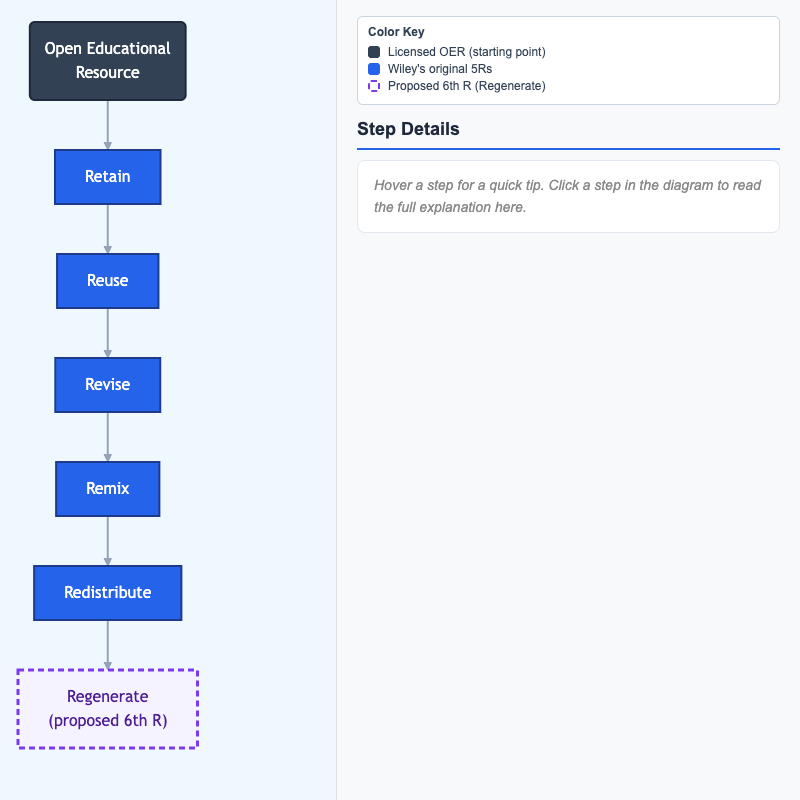5Rs of OER Workflow</a>
  <a href="one-day-workshop-timeline/" title="A One-Day Workshop Timeline" style="display:block;border:1px solid #e3e7ec;border-radius:8px;overflow:hidden;text-decoration:none;color:inherit;box-shadow:0 1px 3px rgba(0,0,0,0.08);">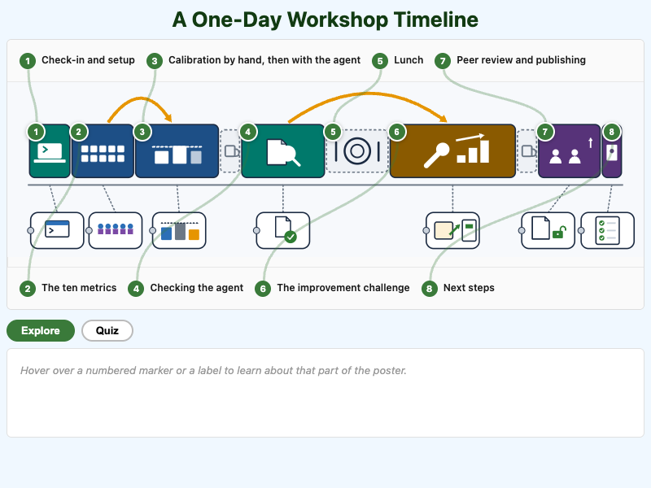A One-Day Workshop Timeline</a>
  <a href="adopt-adapt-create-pathway-chooser/" title="Adopt, Adapt, or Create Pathway Chooser" style="display:block;border:1px solid #e3e7ec;border-radius:8px;overflow:hidden;text-decoration:none;color:inherit;box-shadow:0 1px 3px rgba(0,0,0,0.08);">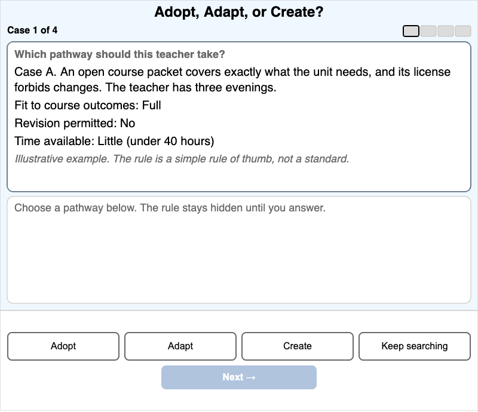Adopt, Adapt, or Create Pathway Chooser</a>
  <a href="agreement-is-not-skill/" title="Agreement Is Not Skill" style="display:block;border:1px solid #e3e7ec;border-radius:8px;overflow:hidden;text-decoration:none;color:inherit;box-shadow:0 1px 3px rgba(0,0,0,0.08);">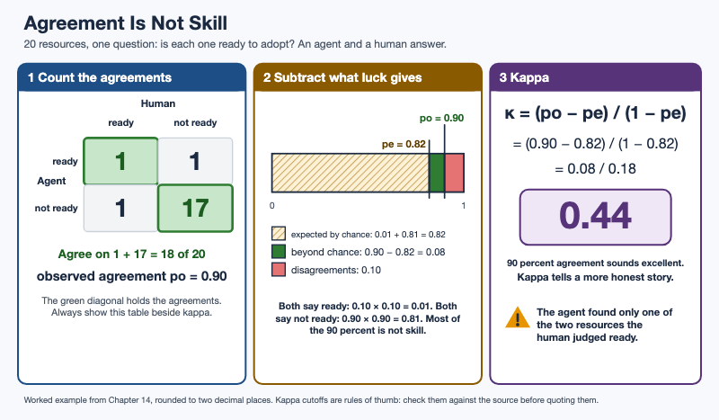Agreement Is Not Skill</a>
  <a href="license-statement-anatomy/" title="Anatomy of a License Statement" style="display:block;border:1px solid #e3e7ec;border-radius:8px;overflow:hidden;text-decoration:none;color:inherit;box-shadow:0 1px 3px rgba(0,0,0,0.08);">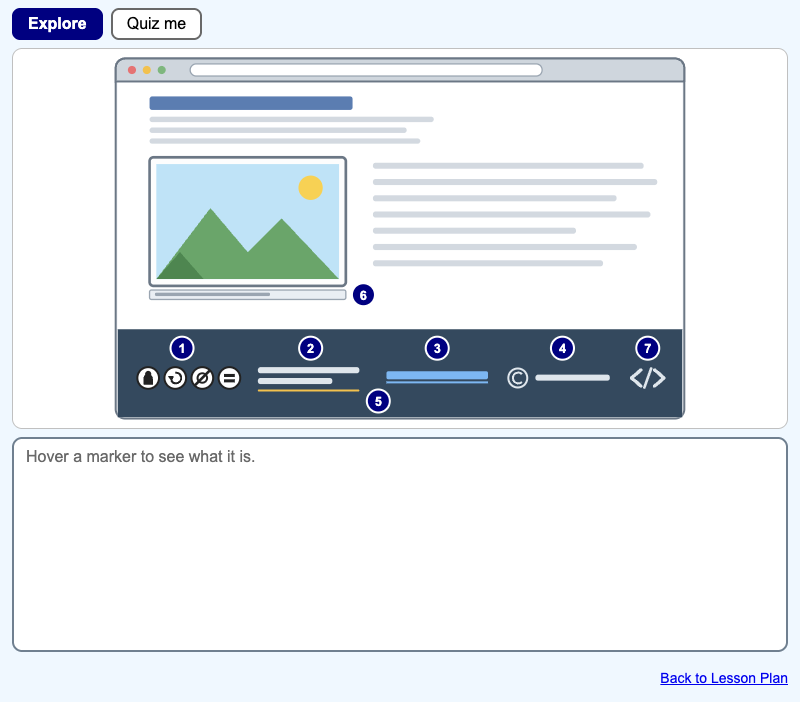Anatomy of a License Statement</a>
  <a href="rubric-worksheet-anatomy/" title="Anatomy of a Rubric Worksheet" style="display:block;border:1px solid #e3e7ec;border-radius:8px;overflow:hidden;text-decoration:none;color:inherit;box-shadow:0 1px 3px rgba(0,0,0,0.08);">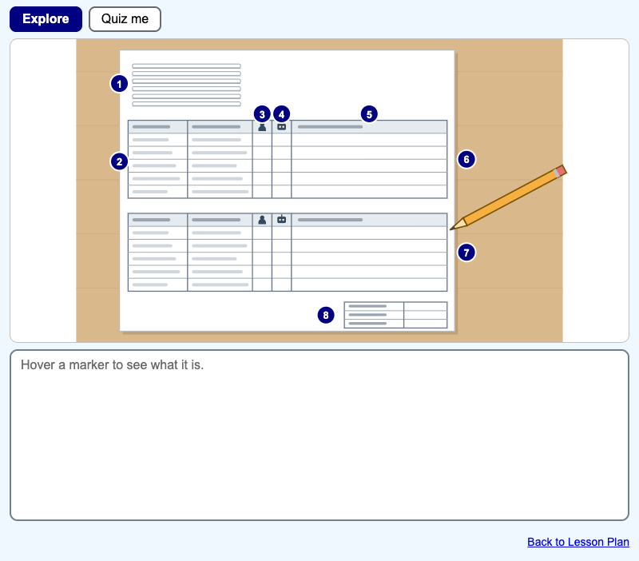Anatomy of a Rubric Worksheet</a>
  <a href="attribution-statement-checker/" title="Attribution Statement Checker" style="display:block;border:1px solid #e3e7ec;border-radius:8px;overflow:hidden;text-decoration:none;color:inherit;box-shadow:0 1px 3px rgba(0,0,0,0.08);">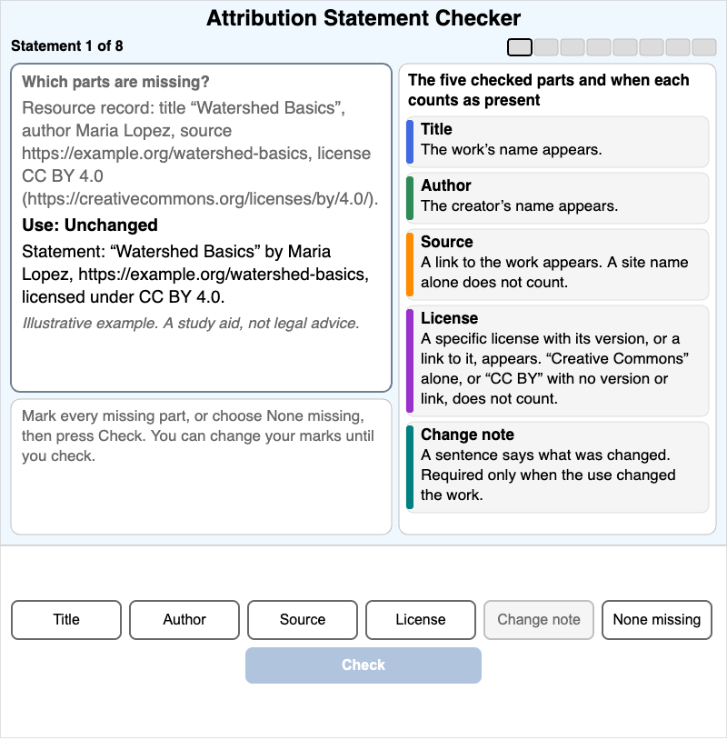Attribution Statement Checker</a>
  <a href="bloom-ladder/" title="Bloom&#x27;s Ladder: Six Levels, Measurable Verbs" style="display:block;border:1px solid #e3e7ec;border-radius:8px;overflow:hidden;text-decoration:none;color:inherit;box-shadow:0 1px 3px rgba(0,0,0,0.08);">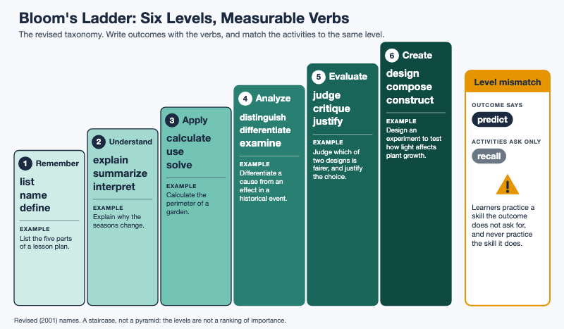Bloom&#x27;s Ladder: Six Levels, Measurable Verbs</a>
  <a href="can-i-publish-my-improved-version/" title="Can I Publish My Improved Version?" style="display:block;border:1px solid #e3e7ec;border-radius:8px;overflow:hidden;text-decoration:none;color:inherit;box-shadow:0 1px 3px rgba(0,0,0,0.08);">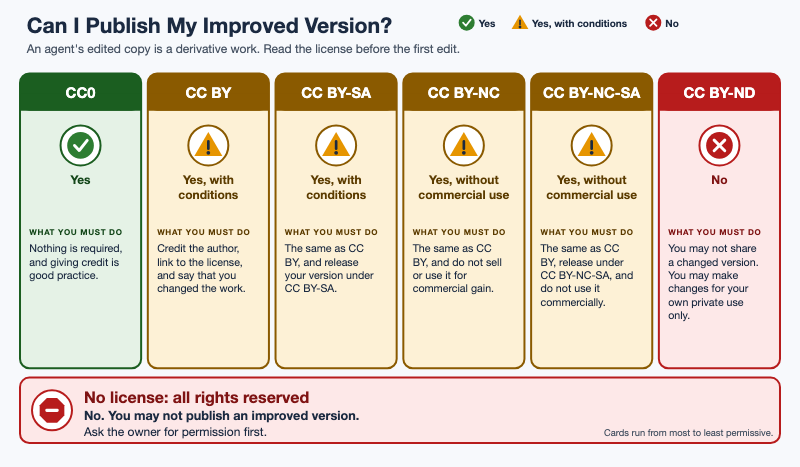Can I Publish My Improved Version?</a>
  <a href="component-in-a-box/" title="Component in a Box" style="display:block;border:1px solid #e3e7ec;border-radius:8px;overflow:hidden;text-decoration:none;color:inherit;box-shadow:0 1px 3px rgba(0,0,0,0.08);">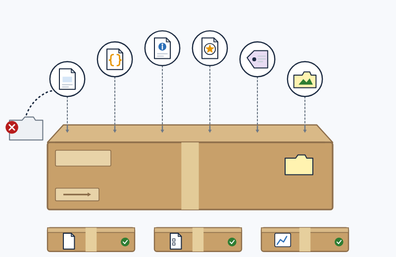Component in a Box</a>
  <a href="cc-element-explorer/" title="Creative Commons Element Explorer" style="display:block;border:1px solid #e3e7ec;border-radius:8px;overflow:hidden;text-decoration:none;color:inherit;box-shadow:0 1px 3px rgba(0,0,0,0.08);">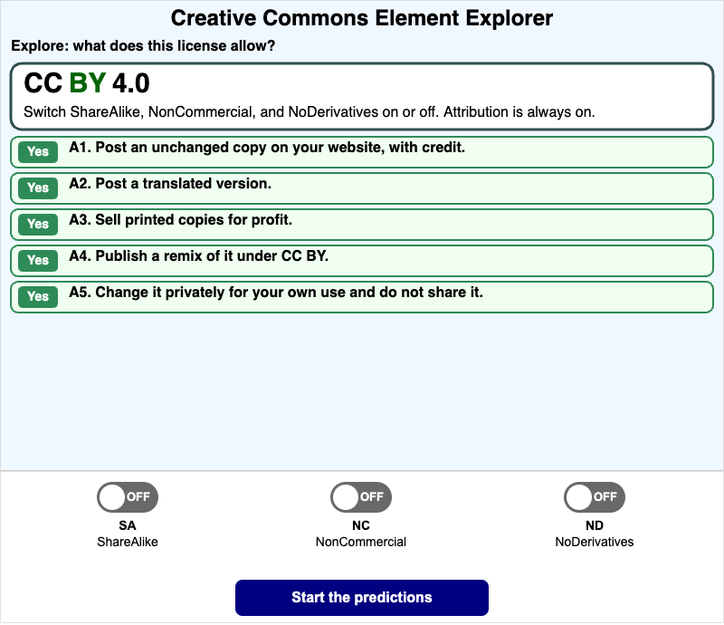Creative Commons Element Explorer</a>
  <a href="cc-license-switches/" title="Creative Commons License Switches" style="display:block;border:1px solid #e3e7ec;border-radius:8px;overflow:hidden;text-decoration:none;color:inherit;box-shadow:0 1px 3px rgba(0,0,0,0.08);">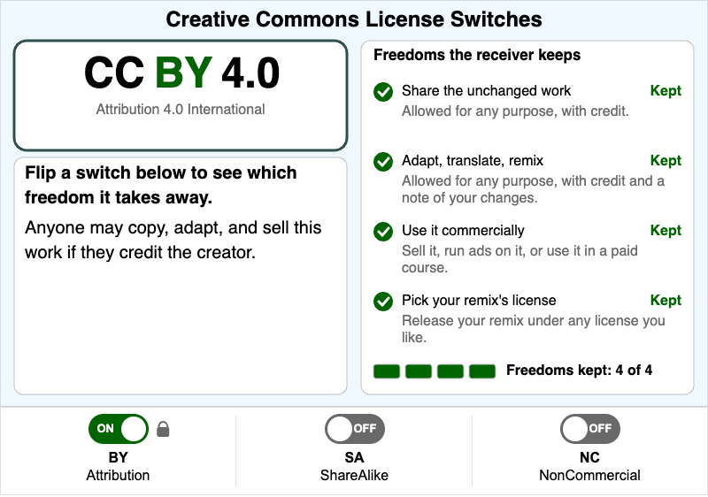Creative Commons License Switches</a>
  <a href="evidence-quality-sorter/" title="Evidence or Opinion Sorter" style="display:block;border:1px solid #e3e7ec;border-radius:8px;overflow:hidden;text-decoration:none;color:inherit;box-shadow:0 1px 3px rgba(0,0,0,0.08);">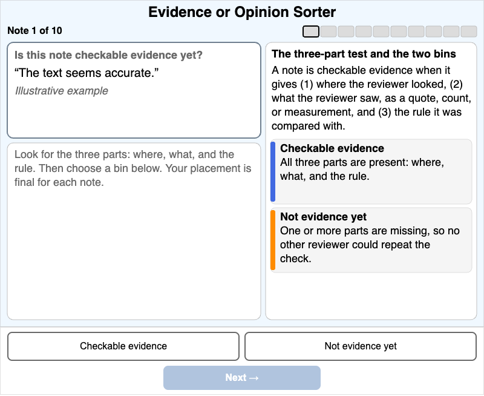Evidence or Opinion Sorter</a>
  <a href="feedback-that-teaches/" title="Feedback That Teaches" style="display:block;border:1px solid #e3e7ec;border-radius:8px;overflow:hidden;text-decoration:none;color:inherit;box-shadow:0 1px 3px rgba(0,0,0,0.08);">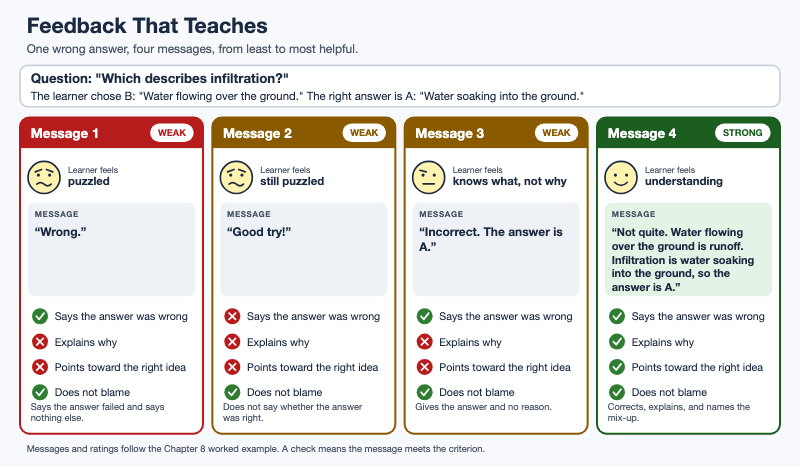Feedback That Teaches</a>
  <a href="five-r-scenario-matcher/" title="Five R Scenario Matcher" style="display:block;border:1px solid #e3e7ec;border-radius:8px;overflow:hidden;text-decoration:none;color:inherit;box-shadow:0 1px 3px rgba(0,0,0,0.08);">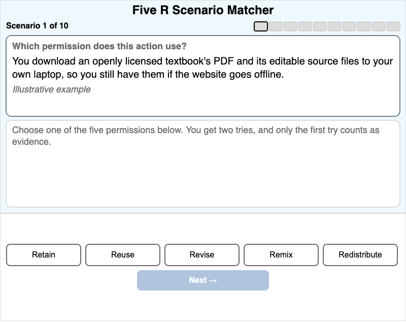Five R Scenario Matcher</a>
  <a href="five-resources-five-shapes/" title="Five Resources, Five Shapes" style="display:block;border:1px solid #e3e7ec;border-radius:8px;overflow:hidden;text-decoration:none;color:inherit;box-shadow:0 1px 3px rgba(0,0,0,0.08);">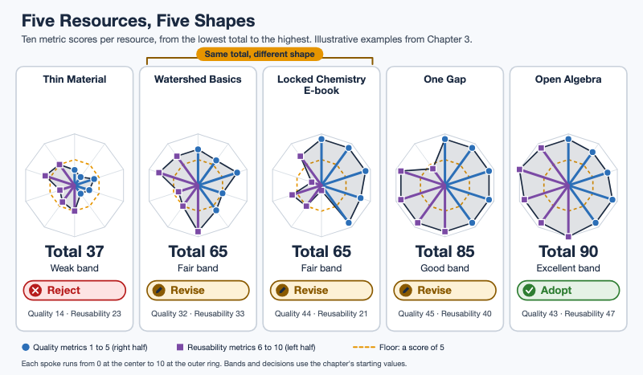Five Resources, Five Shapes</a>
  <a href="five-confounders/" title="Five Ways a Test Can Lie to You" style="display:block;border:1px solid #e3e7ec;border-radius:8px;overflow:hidden;text-decoration:none;color:inherit;box-shadow:0 1px 3px rgba(0,0,0,0.08);">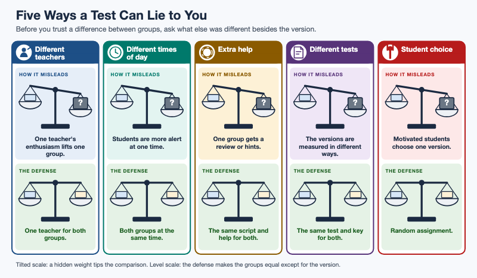Five Ways a Test Can Lie to You</a>
  <a href="claim-source-chain/" title="Following a Claim Back to Its Source" style="display:block;border:1px solid #e3e7ec;border-radius:8px;overflow:hidden;text-decoration:none;color:inherit;box-shadow:0 1px 3px rgba(0,0,0,0.08);">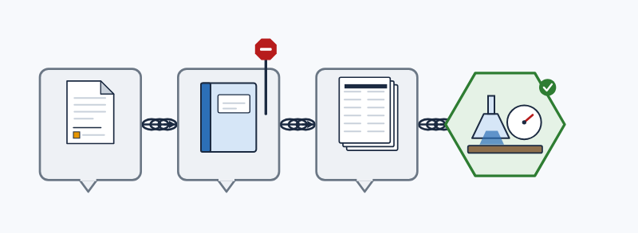Following a Claim Back to Its Source</a>
  <a href="fork-and-pull-request/" title="Fork and Pull Request: Two Lanes, Seven Steps" style="display:block;border:1px solid #e3e7ec;border-radius:8px;overflow:hidden;text-decoration:none;color:inherit;box-shadow:0 1px 3px rgba(0,0,0,0.08);">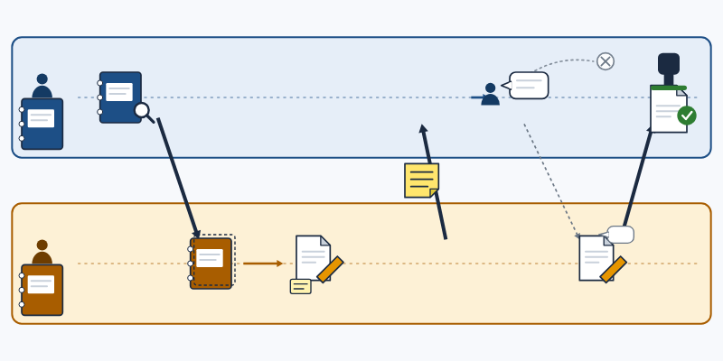Fork and Pull Request: Two Lanes, Seven Steps</a>
  <a href="four-levels-of-training-evaluation/" title="Four Levels of Training Evaluation" style="display:block;border:1px solid #e3e7ec;border-radius:8px;overflow:hidden;text-decoration:none;color:inherit;box-shadow:0 1px 3px rgba(0,0,0,0.08);">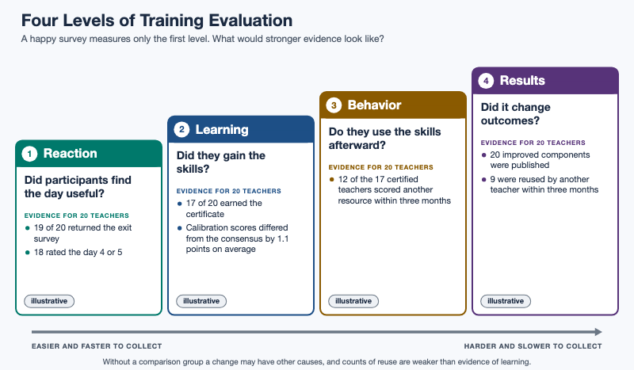Four Levels of Training Evaluation</a>
  <a href="pour-principles-learners/" title="Four Principles, Five Learners" style="display:block;border:1px solid #e3e7ec;border-radius:8px;overflow:hidden;text-decoration:none;color:inherit;box-shadow:0 1px 3px rgba(0,0,0,0.08);">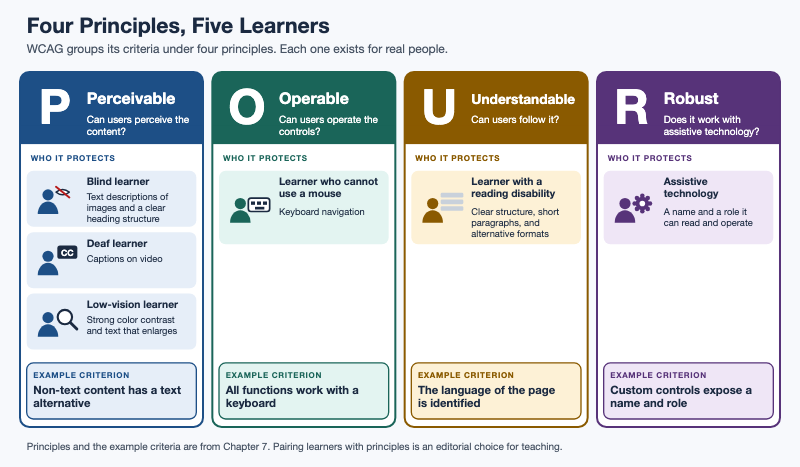Four Principles, Five Learners</a>
  <a href="four-agent-error-types/" title="Four Ways an Agent Gets It Wrong" style="display:block;border:1px solid #e3e7ec;border-radius:8px;overflow:hidden;text-decoration:none;color:inherit;box-shadow:0 1px 3px rgba(0,0,0,0.08);">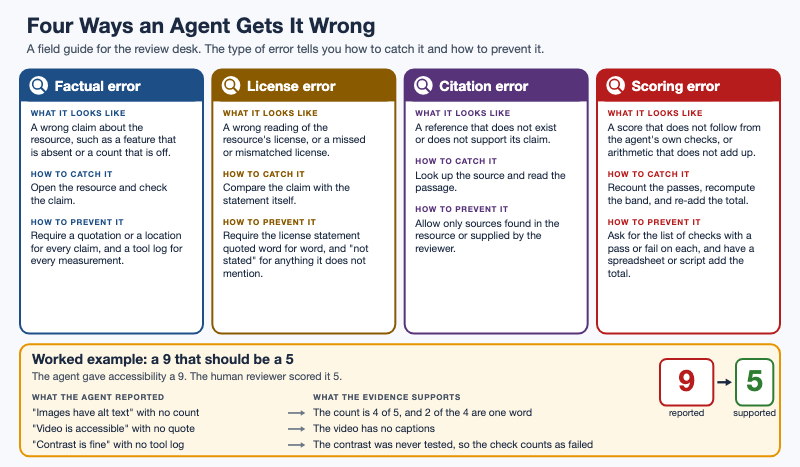Four Ways an Agent Gets It Wrong</a>
  <a href="price-and-permission/" title="Free Is Not Open: Price and Permission" style="display:block;border:1px solid #e3e7ec;border-radius:8px;overflow:hidden;text-decoration:none;color:inherit;box-shadow:0 1px 3px rgba(0,0,0,0.08);">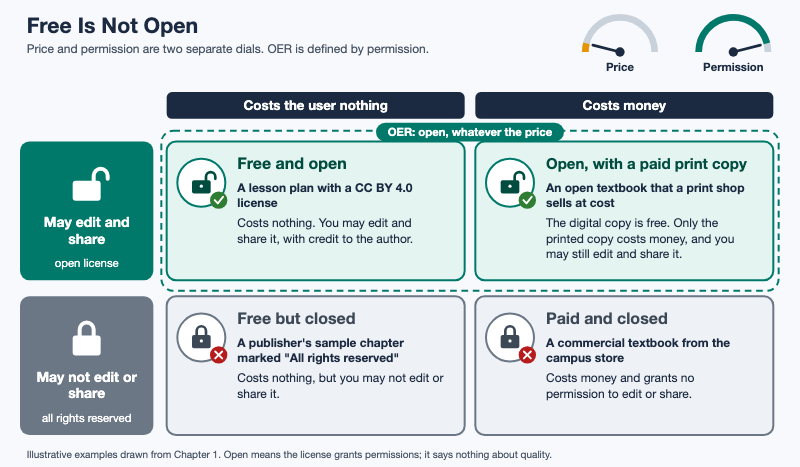Free Is Not Open: Price and Permission</a>
  <a href="ten-scores-to-one-decision/" title="From Ten Scores to One Decision" style="display:block;border:1px solid #e3e7ec;border-radius:8px;overflow:hidden;text-decoration:none;color:inherit;box-shadow:0 1px 3px rgba(0,0,0,0.08);">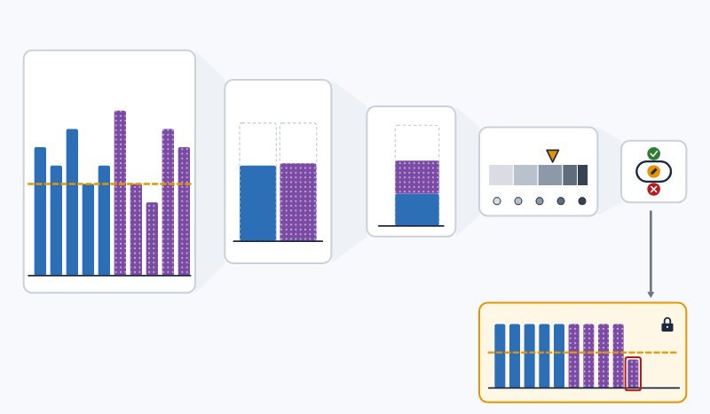From Ten Scores to One Decision</a>
  <a href="content-shelf-life/" title="How Fast Does Content Spoil?" style="display:block;border:1px solid #e3e7ec;border-radius:8px;overflow:hidden;text-decoration:none;color:inherit;box-shadow:0 1px 3px rgba(0,0,0,0.08);">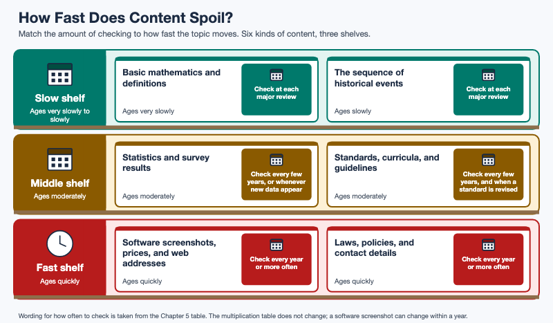How Fast Does Content Spoil?</a>
  <a href="inter-rater-agreement-explorer/" title="Inter-Rater Agreement Explorer" style="display:block;border:1px solid #e3e7ec;border-radius:8px;overflow:hidden;text-decoration:none;color:inherit;box-shadow:0 1px 3px rgba(0,0,0,0.08);">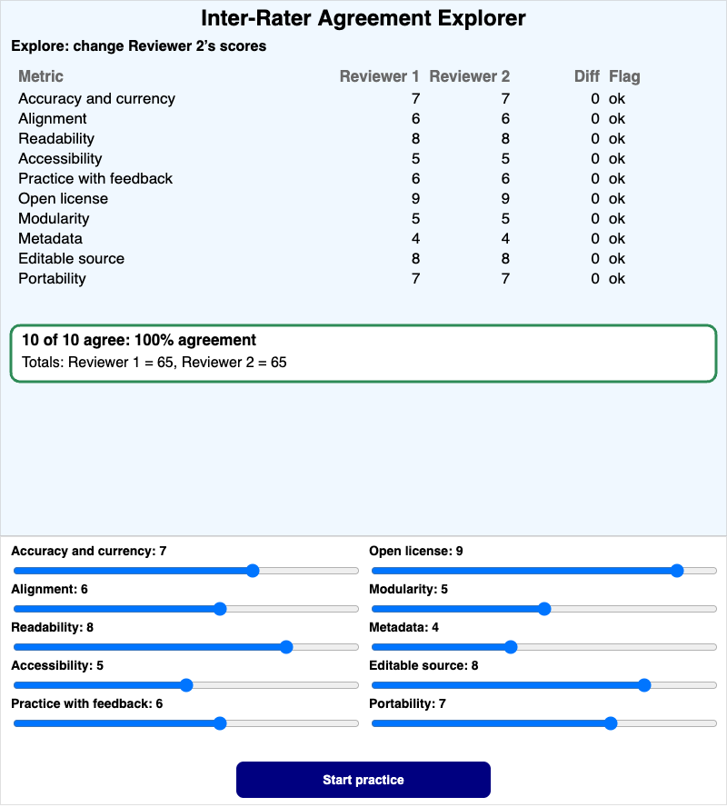Inter-Rater Agreement Explorer</a>
  <a href="license-compatibility-checker/" title="License Compatibility Checker" style="display:block;border:1px solid #e3e7ec;border-radius:8px;overflow:hidden;text-decoration:none;color:inherit;box-shadow:0 1px 3px rgba(0,0,0,0.08);">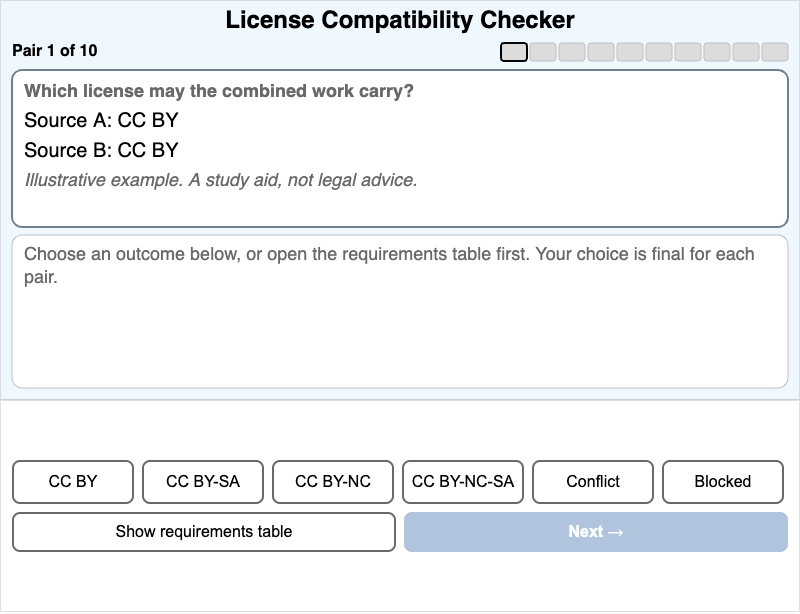License Compatibility Checker</a>
  <a href="license-selection-advisor/" title="License Selection Advisor" style="display:block;border:1px solid #e3e7ec;border-radius:8px;overflow:hidden;text-decoration:none;color:inherit;box-shadow:0 1px 3px rgba(0,0,0,0.08);">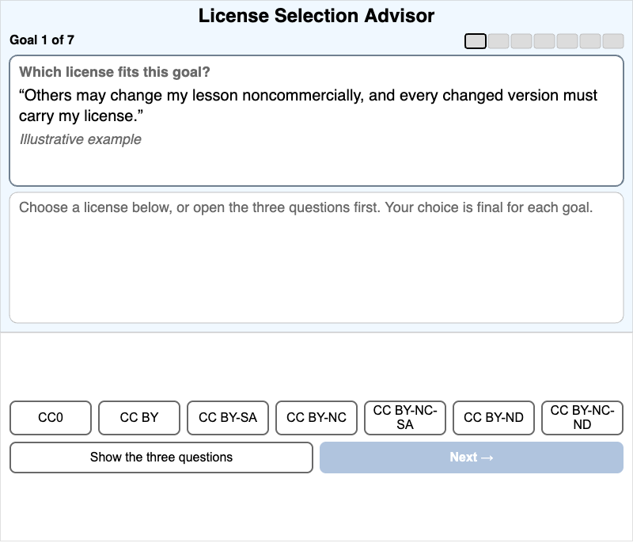License Selection Advisor</a>
  <a href="four-ways-into-an-lms/" title="Link, Embed, Import, or LTI: Four Ways Into an LMS" style="display:block;border:1px solid #e3e7ec;border-radius:8px;overflow:hidden;text-decoration:none;color:inherit;box-shadow:0 1px 3px rgba(0,0,0,0.08);">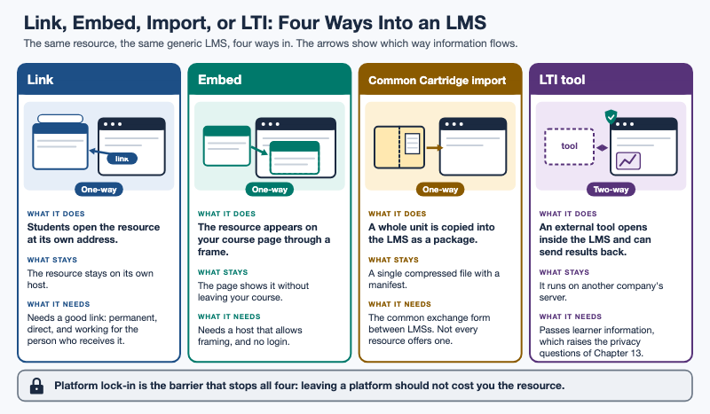Link, Embed, Import, or LTI: Four Ways Into an LMS</a>
  <a href="model-assistant-agent-skill/" title="Model, Assistant, Agent, Skill" style="display:block;border:1px solid #e3e7ec;border-radius:8px;overflow:hidden;text-decoration:none;color:inherit;box-shadow:0 1px 3px rgba(0,0,0,0.08);">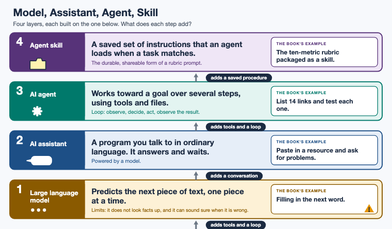Model, Assistant, Agent, Skill</a>
  <a href="noncommercial-gray-area-sorter/" title="NonCommercial Gray Area Sorter" style="display:block;border:1px solid #e3e7ec;border-radius:8px;overflow:hidden;text-decoration:none;color:inherit;box-shadow:0 1px 3px rgba(0,0,0,0.08);">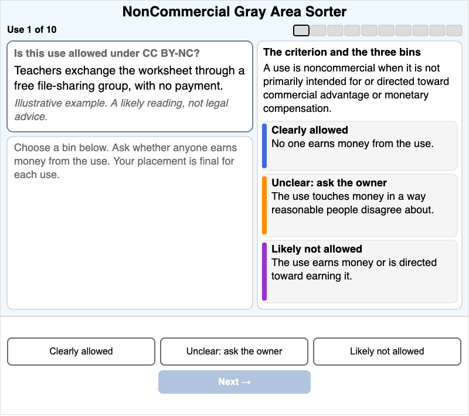NonCommercial Gray Area Sorter</a>
  <a href="oer-or-not-classifier/" title="OER or Not Classifier" style="display:block;border:1px solid #e3e7ec;border-radius:8px;overflow:hidden;text-decoration:none;color:inherit;box-shadow:0 1px 3px rgba(0,0,0,0.08);">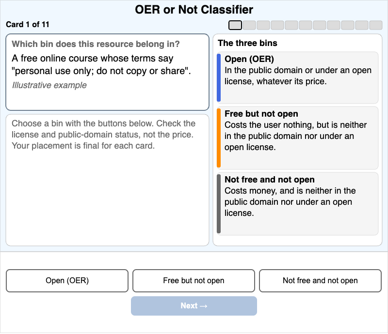OER or Not Classifier</a>
  <a href="quality-reusability-quadrant/" title="Quality and Reusability Quadrant Sorter" style="display:block;border:1px solid #e3e7ec;border-radius:8px;overflow:hidden;text-decoration:none;color:inherit;box-shadow:0 1px 3px rgba(0,0,0,0.08);">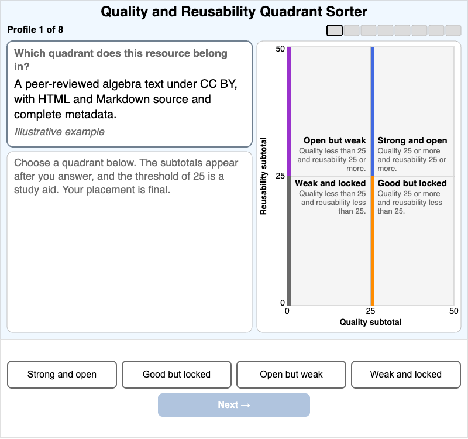Quality and Reusability Quadrant Sorter</a>
  <a href="reading-an-effect-size/" title="Reading an Effect Size" style="display:block;border:1px solid #e3e7ec;border-radius:8px;overflow:hidden;text-decoration:none;color:inherit;box-shadow:0 1px 3px rgba(0,0,0,0.08);">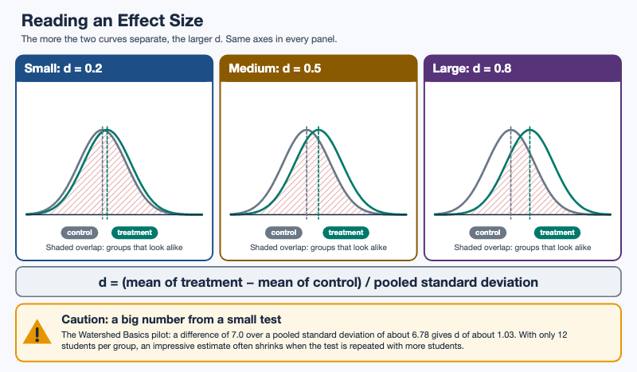Reading an Effect Size</a>
  <a href="reliability-validity-targets/" title="Reliability and Validity Targets Poster" style="display:block;border:1px solid #e3e7ec;border-radius:8px;overflow:hidden;text-decoration:none;color:inherit;box-shadow:0 1px 3px rgba(0,0,0,0.08);">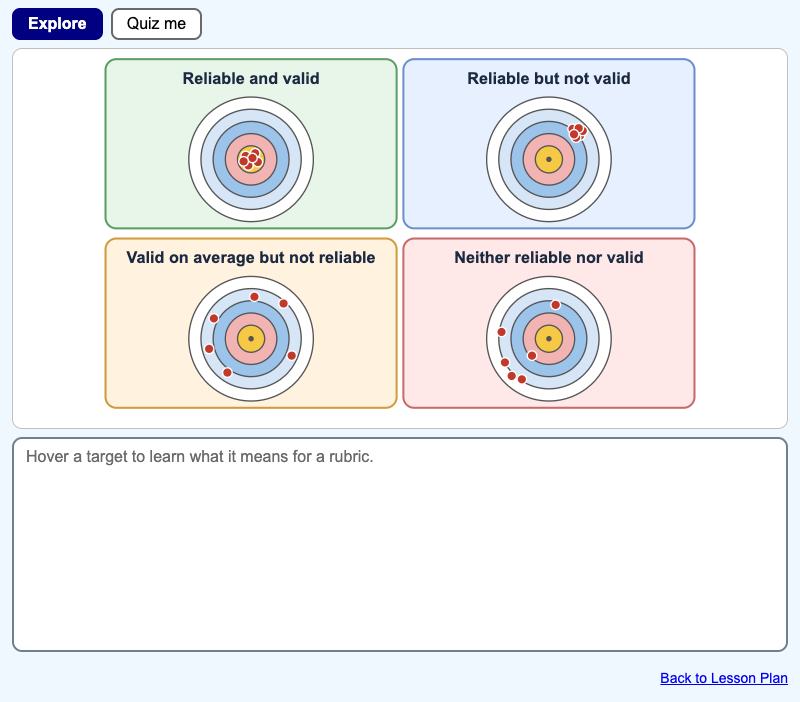Reliability and Validity Targets Poster</a>
  <a href="reviewer-bias-spotter/" title="Reviewer Bias Spotter" style="display:block;border:1px solid #e3e7ec;border-radius:8px;overflow:hidden;text-decoration:none;color:inherit;box-shadow:0 1px 3px rgba(0,0,0,0.08);">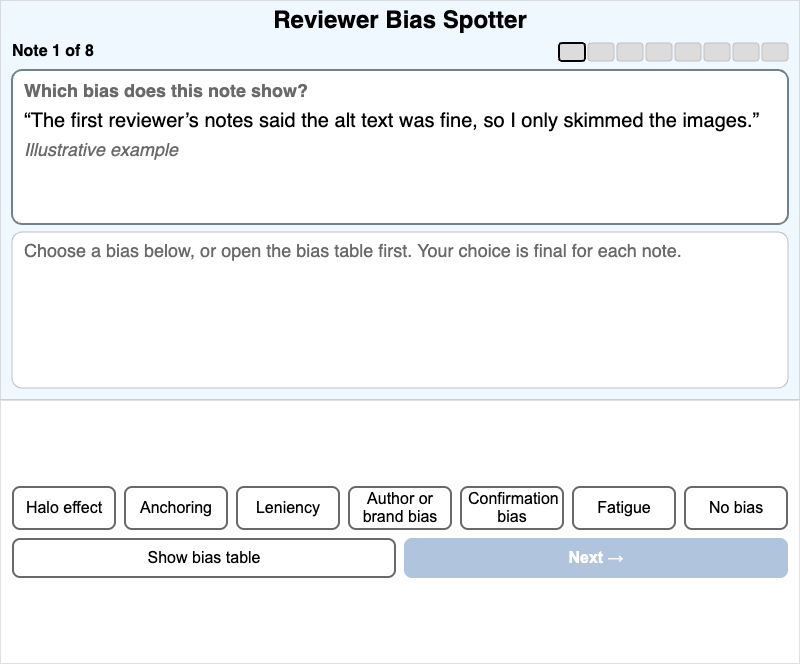Reviewer Bias Spotter</a>
  <a href="safe-to-send/" title="Safe to Send? Student Data and AI Services" style="display:block;border:1px solid #e3e7ec;border-radius:8px;overflow:hidden;text-decoration:none;color:inherit;box-shadow:0 1px 3px rgba(0,0,0,0.08);">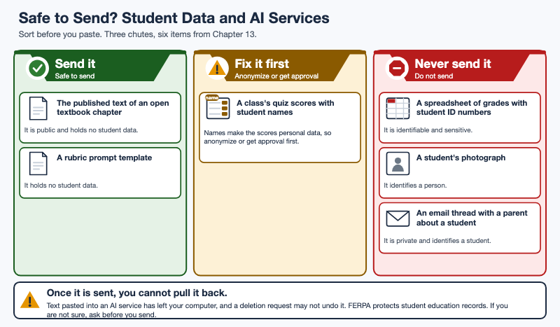Safe to Send? Student Data and AI Services</a>
  <a href="score-descriptor-matcher/" title="Score Descriptor Matcher" style="display:block;border:1px solid #e3e7ec;border-radius:8px;overflow:hidden;text-decoration:none;color:inherit;box-shadow:0 1px 3px rgba(0,0,0,0.08);">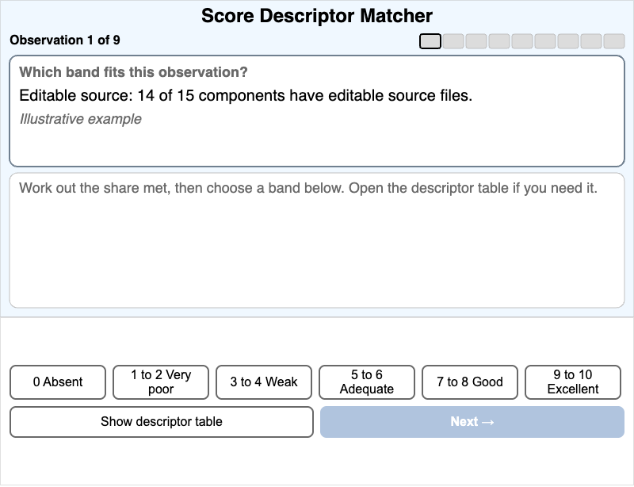Score Descriptor Matcher</a>
  <a href="six-cc-licenses-poster/" title="Six Creative Commons Licenses Poster" style="display:block;border:1px solid #e3e7ec;border-radius:8px;overflow:hidden;text-decoration:none;color:inherit;box-shadow:0 1px 3px rgba(0,0,0,0.08);">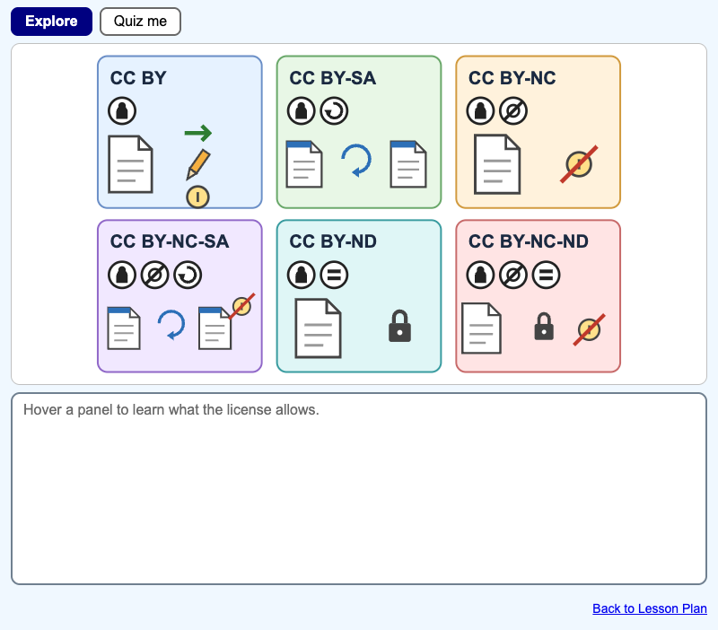Six Creative Commons Licenses Poster</a>
  <a href="source-and-delivery-files/" title="Source Files and Delivery Files" style="display:block;border:1px solid #e3e7ec;border-radius:8px;overflow:hidden;text-decoration:none;color:inherit;box-shadow:0 1px 3px rgba(0,0,0,0.08);">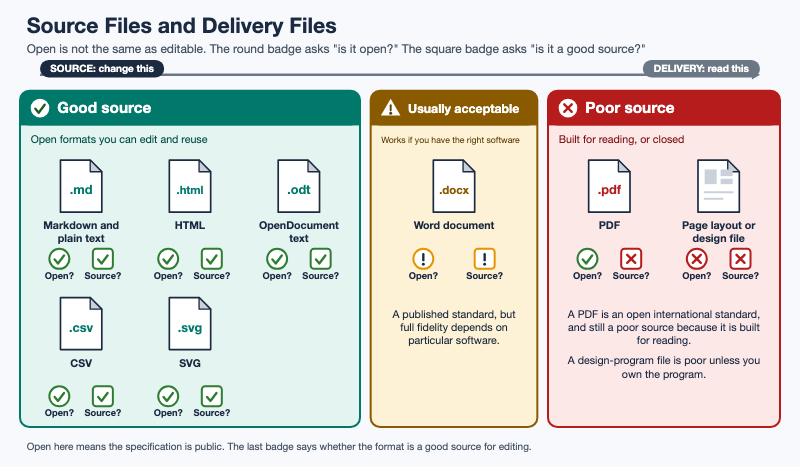Source Files and Delivery Files</a>
  <a href="rubric-structure-map/" title="Ten-Metric Rubric Map" style="display:block;border:1px solid #e3e7ec;border-radius:8px;overflow:hidden;text-decoration:none;color:inherit;box-shadow:0 1px 3px rgba(0,0,0,0.08);">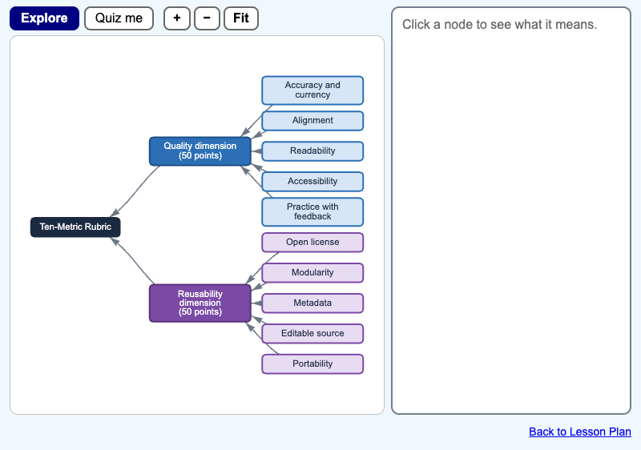Ten-Metric Rubric Map</a>
  <a href="five-r-permissions/" title="The 5R Permissions: Five Things You May Do" style="display:block;border:1px solid #e3e7ec;border-radius:8px;overflow:hidden;text-decoration:none;color:inherit;box-shadow:0 1px 3px rgba(0,0,0,0.08);">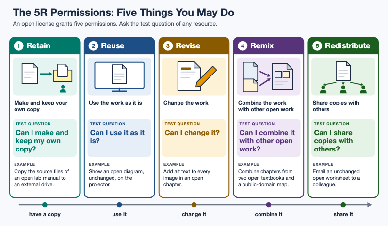The 5R Permissions: Five Things You May Do</a>
  <a href="ab-test-on-one-page/" title="The A/B Test on One Page" style="display:block;border:1px solid #e3e7ec;border-radius:8px;overflow:hidden;text-decoration:none;color:inherit;box-shadow:0 1px 3px rgba(0,0,0,0.08);">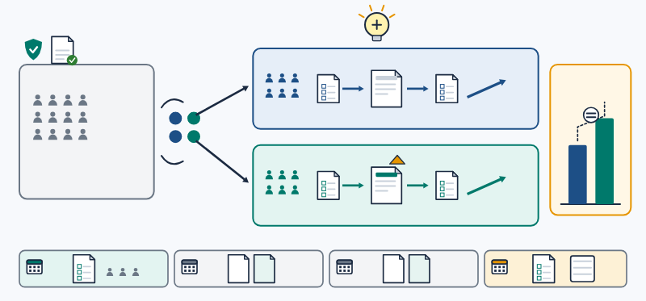The A/B Test on One Page</a>
  <a href="fix-toolkit/" title="The Fix Toolkit" style="display:block;border:1px solid #e3e7ec;border-radius:8px;overflow:hidden;text-decoration:none;color:inherit;box-shadow:0 1px 3px rgba(0,0,0,0.08);">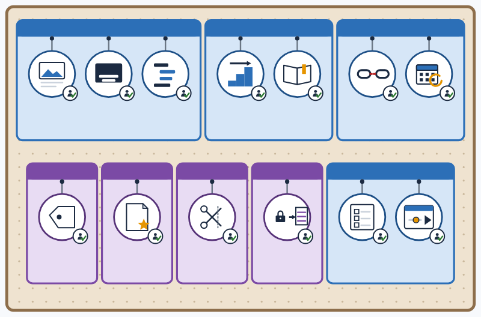The Fix Toolkit</a>
  <a href="oer-evaluator-loop/" title="The OER Evaluator Loop" style="display:block;border:1px solid #e3e7ec;border-radius:8px;overflow:hidden;text-decoration:none;color:inherit;box-shadow:0 1px 3px rgba(0,0,0,0.08);">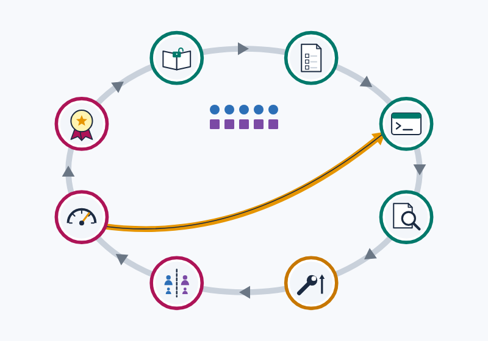The OER Evaluator Loop</a>
  <a href="total-score-calculator/" title="Total Score Calculator" style="display:block;border:1px solid #e3e7ec;border-radius:8px;overflow:hidden;text-decoration:none;color:inherit;box-shadow:0 1px 3px rgba(0,0,0,0.08);">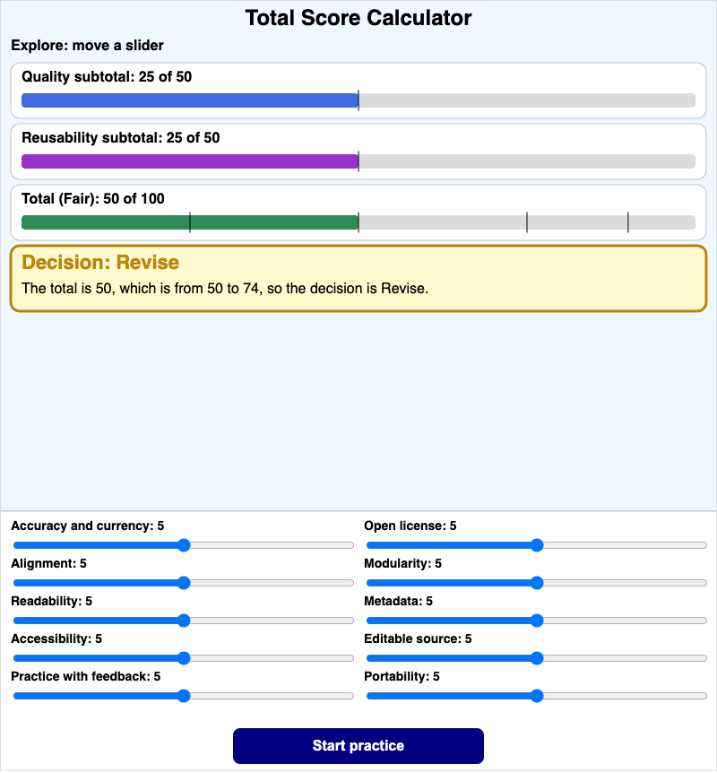Total Score Calculator</a>
  <a href="weak-and-strong-prompt/" title="Weak Prompt, Strong Prompt" style="display:block;border:1px solid #e3e7ec;border-radius:8px;overflow:hidden;text-decoration:none;color:inherit;box-shadow:0 1px 3px rgba(0,0,0,0.08);">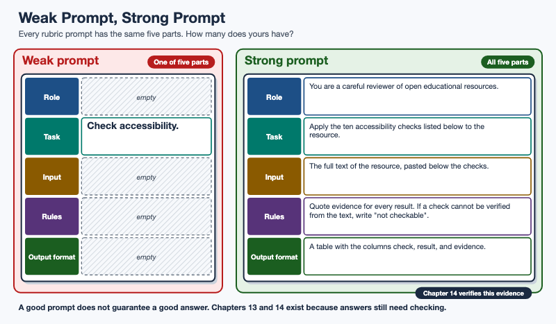Weak Prompt, Strong Prompt</a>
  <a href="what-a-screen-reader-hears/" title="What a Screen Reader Hears" style="display:block;border:1px solid #e3e7ec;border-radius:8px;overflow:hidden;text-decoration:none;color:inherit;box-shadow:0 1px 3px rgba(0,0,0,0.08);">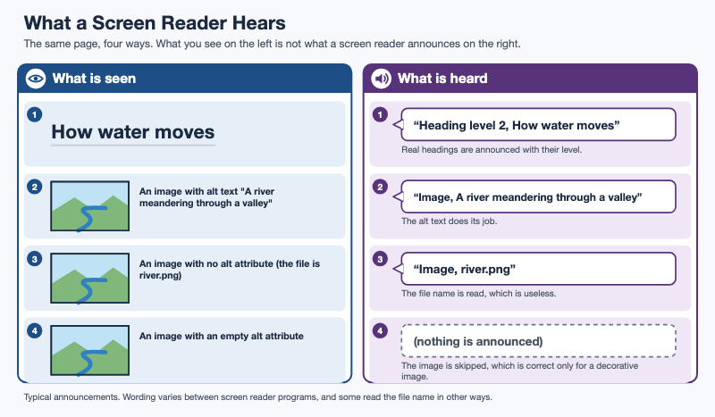What a Screen Reader Hears</a>
  <a href="automated-checks-finds-and-misses/" title="What Each Automated Check Can and Cannot Find" style="display:block;border:1px solid #e3e7ec;border-radius:8px;overflow:hidden;text-decoration:none;color:inherit;box-shadow:0 1px 3px rgba(0,0,0,0.08);">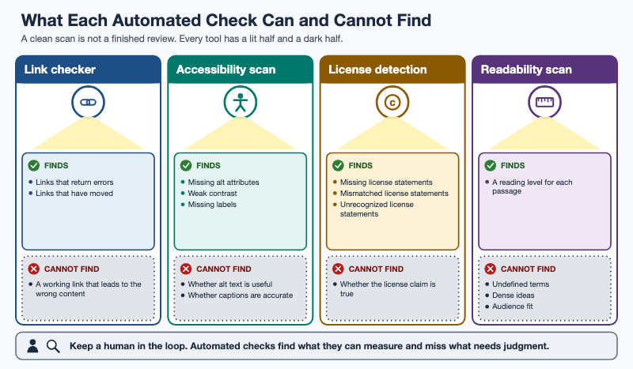What Each Automated Check Can and Cannot Find</a>
  <a href="woven-or-modular/" title="Woven or Modular? The Lift-Out Test" style="display:block;border:1px solid #e3e7ec;border-radius:8px;overflow:hidden;text-decoration:none;color:inherit;box-shadow:0 1px 3px rgba(0,0,0,0.08);">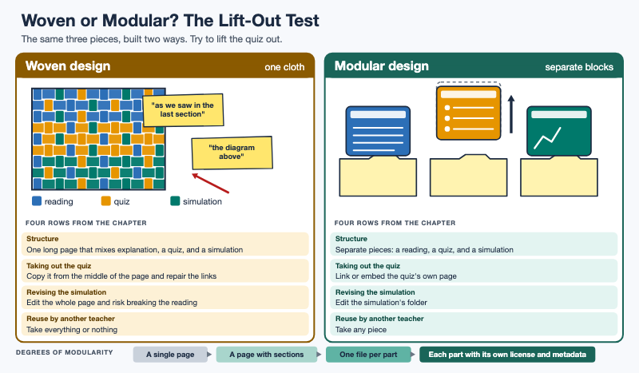Woven or Modular? The Lift-Out Test</a>
  <a href="cant-reuse-what-you-cant-find/" title="You Can&#x27;t Reuse What You Can&#x27;t Find" style="display:block;border:1px solid #e3e7ec;border-radius:8px;overflow:hidden;text-decoration:none;color:inherit;box-shadow:0 1px 3px rgba(0,0,0,0.08);">You Can&#x27;t Reuse What You Can&#x27;t Find</a>

