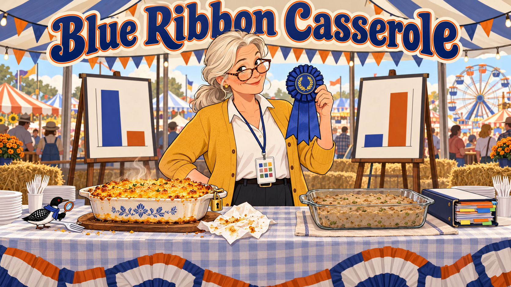
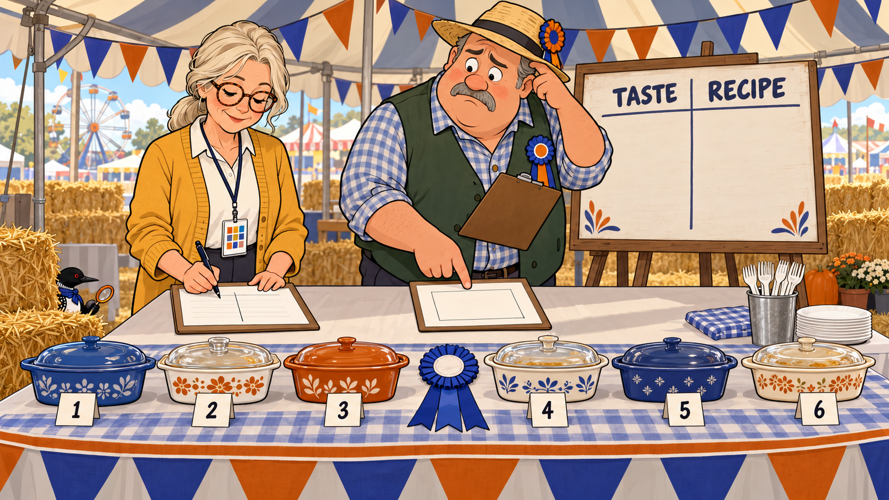
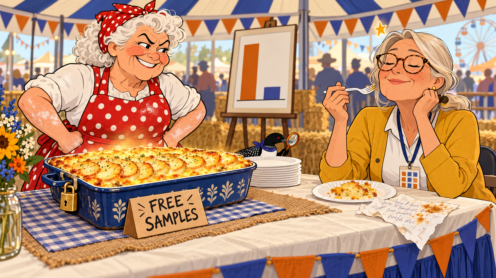
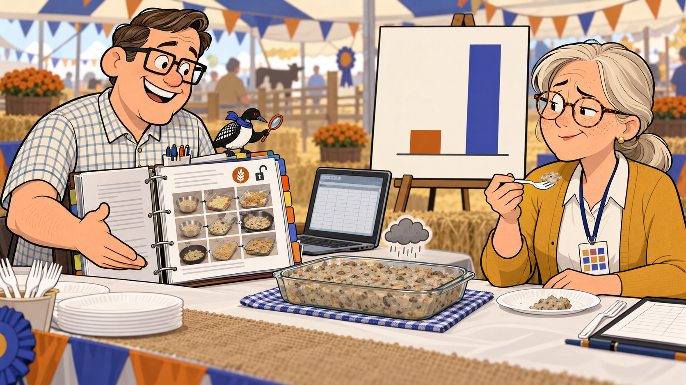
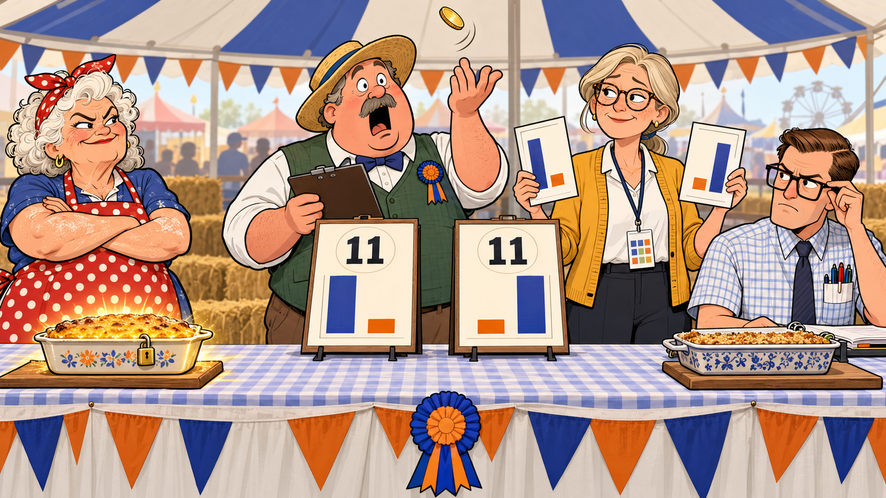
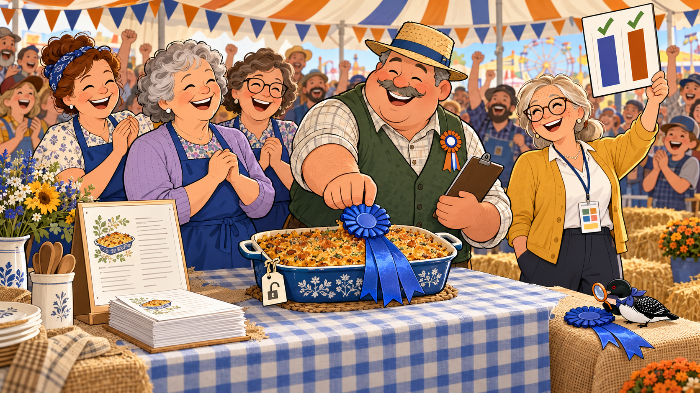
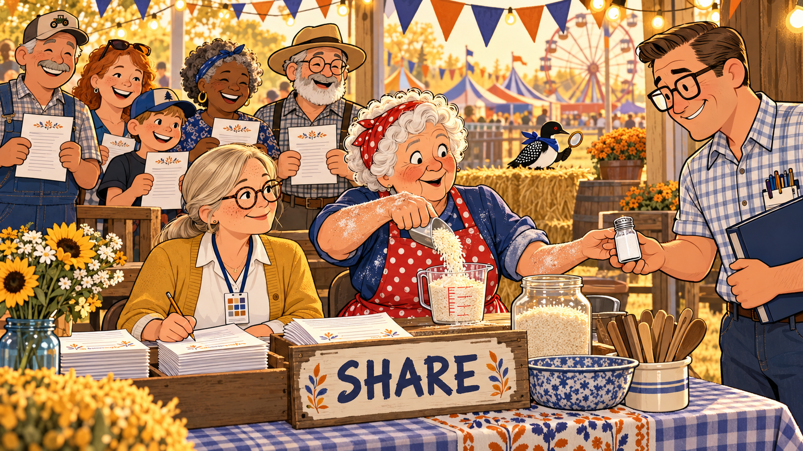
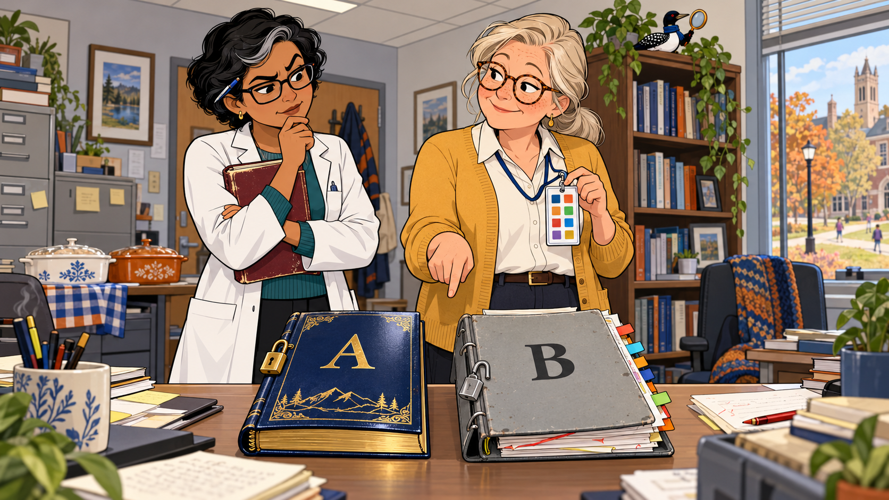
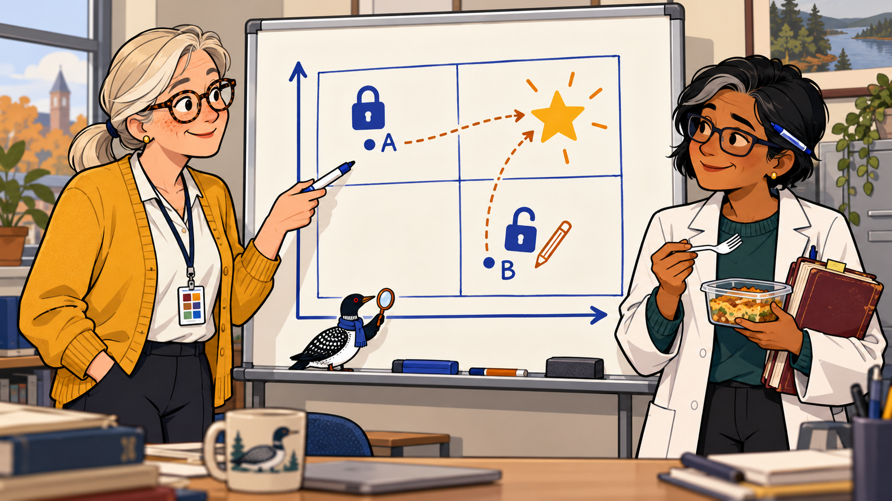

# Blue Ribbon Casserole

Cover Image Prompt

(This is the Cover Image. Do not include this label in the image.)
Please generate a wide-landscape 16:9 cover image for a graphic-novel comedy titled "Blue Ribbon Casserole". Flat cartoon illustration, modern vector style, clean confident outlines, bold simple shapes, gentle humor, warm cream and soft gray neutrals with indigo (#3949ab) and burnt orange (#b45309) as the two accent colors, wide landscape 16:9 composition. County-fair costume: triangle bunting in indigo and orange strung across the top, hay bales, a long folding judging table with paper plates and plastic forks, a striped tent roof, and a Ferris wheel far in the background. In the center stands Margie Halvorsen, a calm woman in her late fifties with silver-blond hair in a low ponytail, round tortoiseshell glasses, a freckled face and a patient half-smile, wearing a mustard-yellow cardigan over a white blouse and dark slacks, with a lanyard around her neck holding a laminated card marked with ten small colored squares. She holds a blue ribbon rosette high in one hand and looks over her glasses at the viewer, with a gentle raised eyebrow. On the table to her left sits a golden, glowing casserole dish with a small padlock hanging from its handle and a crumpled, grease-stained napkin beside it. On the table to her right sits a flat gray-beige casserole in a spotless glass dish beside a thick, tidy binder with colorful tabs. Behind her, two tall easel scoreboards stand side by side, each with two simple unlabeled bars, one tall and one short on the left board and the reverse on the right board. The title "Blue Ribbon Casserole" is rendered across the top in bold, friendly county-fair poster lettering in indigo with orange outlines; it is the only text in the image. Hidden cameo: a very small loon with a glossy black head, a white belly, a black back with a white checkered pattern, a red eye, a small indigo scarf, and an orange-handled magnifying glass held in one wing perches on the edge of the judging table next to a plastic fork, tiny and easy to miss. Color palette: cream, soft gray, indigo, burnt orange, a touch of golden yellow, and one blue ribbon. Emotional tone: warm, wry, and inviting. Generate the image immediately without asking clarifying questions.

Narrative Prompt

This is a fictional comedy for adult readers: OER evangelists, librarians, instructional designers, and the professors and teachers who choose textbooks. It is set at a Minnesota-style county fair and, on the following Monday, in a college faculty office. The central idea comes from Chapter 3 of the book: a resource has two independent halves, quality and reusability, and they must be scored and reported separately. A great dish that nobody can copy is a "good but locked" resource. A flawless recipe card for a bland dish is an "open but weak" resource. The dish that wins both columns is "strong and open".

Characters: Margie Halvorsen, the volunteer judge, is a librarian and OER evangelist. Chet Olson is the fair board chairman, who wants one number. The three contest cooks are Ardis (Entry A, the delicious dish with a secret napkin recipe), Wendell (Entry B, the perfectly documented dish that tastes like cardboard), and Dolores with the church basement committee (Entry C, the winner). On Monday, Dr. Priya Raman, a chemistry professor, compares two chemistry textbooks with Margie. Echo the Loon is a tiny background cameo in several panels.

Illustrative numbers: all scores in this story are illustrative. The fair's score sheet is a playful stand-in for the book's rubric, with a Taste column and a Recipe column of 10 points each; the Recipe column stands in for the five reusability metrics (open license, modularity, metadata, editable source, portability). The casserole scores are 9 and 2 (Entry A), 2 and 9 (Entry B), and 9 and 9 (Entry C). The two textbooks have quality and reusability subtotals of 44 and 12 (Text A) and 20 and 40 (Text B). These mirror the style of the eight profiles in Chapter 3's Quality and Reusability Quadrant Sorter, and each subtotal is out of 50. The totals, 56 and 60, both fall in the Fair band (50 to 74) from Chapter 3. The quadrant boundary of 25 per subtotal is a teaching choice, not a standard.

Visual language: county-fair comic style in the book's flat vector house style, with indigo and burnt orange accents. Keep every character's look identical across panels. The same recurring gags appear throughout: a padlock hanging on anything locked, an open padlock on anything shareable, and two-bar scoreboards that are never merged into one.

### Prologue – Two Questions Every Judge Gets

Every county fair judge hears the same two questions the moment the ribbon goes on: "Is it any good?" and "Can I have the recipe?" Most people think those are one question. Margie Halvorsen, librarian, OER evangelist, and volunteer judge of this year's hotdish contest, knows they are two, and she has brought a lanyard to prove it.

## Panel 1: One Box Marked Total

Image Prompt

(This is Panel 01. Do not include the panel number in the image.)
I am about to ask you to generate a series of images for a graphic novel. Please make the images have a consistent style and consistent characters. Do not ask any clarifying questions. Just generate the image immediately when asked.

Please generate a 16:9 image in a county-fair comic style depicting panel 1 of 8. Flat cartoon illustration, modern vector style, clean confident outlines, bold simple shapes, gentle humor, warm cream and soft gray neutrals with indigo (#3949ab) and burnt orange (#b45309) as the two accent colors, wide landscape 16:9 composition. County-fair costume: triangle bunting in indigo and orange, hay bales, a long folding judging table with paper plates and plastic forks, a striped tent roof, and a Ferris wheel visible far in the background. The scene is the interior of the judging tent on a sunny afternoon. Margie Halvorsen, a calm woman in her late fifties with silver-blond hair in a low ponytail, round tortoiseshell glasses, a freckled face and a patient half-smile, wearing a mustard-yellow cardigan over a white blouse and dark slacks, with a lanyard around her neck holding a laminated card marked with ten small colored squares, stands at the judging table with a pen, calmly drawing a line down the middle of a paper score sheet to make two columns. Chet Olson, a jovial heavyset man in his fifties wearing a straw hat with a small ribbon rosette pinned to his green vest and holding a clipboard, stands beside her with a puzzled, worried frown, pointing at a single big empty box on his own copy of the sheet. On an easel behind them is a hand-painted board with two column headings reading exactly "TASTE" and "RECIPE", which are the only text in the image. Along the table sit six covered casserole dishes in a row, each with a numbered paper flag but no readable writing. A single blue ribbon rosette lies in the middle of the table waiting for its winner. Hidden cameo: a very small loon with a glossy black head, a white belly, a black back with a white checkered pattern, a red eye, a small indigo scarf, and an orange-handled magnifying glass held in one wing peeks out from behind the hay bale at the lower left, tiny and easy to miss. Color palette: cream, soft gray, indigo, burnt orange, golden straw yellow. Emotional tone: wry and curious, the calm before the tasting. Generate the image immediately without asking clarifying questions.

The judging tent smells like cream of mushroom soup and ambition. Chet Olson, the fair board chairman, hands Margie a score sheet with one box marked Total. She crosses it out and draws two columns: Taste, which asks whether the dish does its job, and Recipe, which asks whether anyone else's kitchen could make it too. "We only have one blue ribbon," says Chet. "Then it goes to the dish that wins both columns," says Margie.

## Panel 2: Free Samples, All Rights Reserved

Image Prompt

(This is Panel 02. Do not include the panel number in the image.)
Please generate a 16:9 image in a county-fair comic style depicting panel 2 of 8. Make the characters and style consistent with the prior panel. Flat cartoon illustration, modern vector style, clean confident outlines, bold simple shapes, gentle humor, warm cream and soft gray neutrals with indigo (#3949ab) and burnt orange (#b45309) as the two accent colors, wide landscape 16:9 composition. County-fair costume: triangle bunting in indigo and orange, hay bales, a folding judging table with paper plates and plastic forks, and a striped tent roof. The scene is Entry A at the judging table. Ardis, a proud woman in her seventies with curly white hair under a red bandana, a bright red apron with white polka dots, flour-dusted forearms and a fiercely protective grin, stands guard behind a golden casserole topped with neat rows of potato rounds that glows softly as if lit from within; a small brass padlock hangs from the dish handle, and a hand-lettered cardboard sign propped against the dish reads exactly "FREE SAMPLES", which is the only text in the image. Margie Halvorsen, a calm woman in her late fifties with silver-blond hair in a low ponytail, round tortoiseshell glasses, a freckled face and a patient half-smile, wearing a mustard-yellow cardigan over a white blouse and dark slacks, with a lanyard around her neck holding a laminated card marked with ten small colored squares, has her eyes closed in bliss, a fork raised, and a tiny golden star floating above her head. On the table lies a crumpled, grease-stained napkin covered in illegible pencil scribbles and a small thumbprint of sauce. On an easel behind them, a two-bar scoreboard shows an unlabeled tall bar on the left and a short stub on the right, in orange and indigo. Hidden cameo: a very small loon with a glossy black head, a white belly, a black back with a white checkered pattern, a red eye, a small indigo scarf, and an orange-handled magnifying glass held in one wing peers at the napkin from beside the paper plates, tiny and in the background. Color palette: golden yellow, cream, red, indigo, burnt orange. Emotional tone: delighted on the surface, quietly suspicious underneath. Generate the image immediately without asking clarifying questions.

Entry A belongs to Ardis, who has won the tater tot division eleven years running. The first bite makes Margie close her eyes: Taste, nine out of ten. When she asks for the recipe, Ardis taps a grease-stained napkin that reads "a pinch of this, a handful of that, bake till it smells right," and a smaller sign next to the free-sample sign adds "Family recipe. Not for copying." Margie writes a 2 in the Recipe column, because there is no license, no label, nothing anyone can edit, and a bake time that only works in Ardis's oven.

## Panel 3: Very Well Documented

Image Prompt

(This is Panel 03. Do not include the panel number in the image.)
Please generate a 16:9 image in a county-fair comic style depicting panel 3 of 8. Make the characters and style consistent with the prior panel. Flat cartoon illustration, modern vector style, clean confident outlines, bold simple shapes, gentle humor, warm cream and soft gray neutrals with indigo (#3949ab) and burnt orange (#b45309) as the two accent colors, wide landscape 16:9 composition. County-fair costume: triangle bunting in indigo and orange, hay bales, a folding judging table with paper plates and plastic forks, and a striped tent roof. The scene is Entry B at the judging table. Wendell, a precise man in his forties with a neat side part, thick square glasses and a short-sleeved checked shirt with a pocket protector holding five pens, beams with pride beside a thick open three-ring binder with colorful tabs; the binder shows a tidy recipe card with a grid of tiny step-by-step photos, an allergen icon, and a small open-padlock icon in the corner, and a laptop with a plain gray window showing a spreadsheet grid sits next to it. In front of him on the table is a flat gray-beige casserole in a spotless glass dish with a tiny gray raincloud hovering over it. Margie Halvorsen, a calm woman in her late fifties with silver-blond hair in a low ponytail, round tortoiseshell glasses, a freckled face and a patient half-smile, wearing a mustard-yellow cardigan over a white blouse and dark slacks, with a lanyard around her neck holding a laminated card marked with ten small colored squares, chews slowly with a strained, extremely polite smile, one eyebrow slightly raised, fork still in hand. On the easel behind them, the two-bar scoreboard now shows a short stub on the left and a tall bar on the right, the mirror image of the previous panel, unlabeled. Hidden cameo: a very small loon with a glossy black head, a white belly, a black back with a white checkered pattern, a red eye, a small indigo scarf, and an orange-handled magnifying glass held in one wing stands on top of the binder spine reading the tabs, tiny and in the background. Color palette: cool gray, cream, indigo, burnt orange. Emotional tone: awkward and politely comic. Generate the image immediately without asking clarifying questions.

Entry B belongs to Wendell, whose recipe card comes with step-by-step photos, an allergen note, the filling and topping described separately, a spreadsheet anyone may edit, and a license line that reads "Share freely, credit Wendell." The casserole tastes like a wet cardboard box that has given up. "It is... very well documented," says Margie, in her best Minnesota nice. Taste: 2. Recipe: 9.

## Panel 4: Same Total, Opposite Problems

Image Prompt

(This is Panel 04. Do not include the panel number in the image.)
Please generate a 16:9 image in a county-fair comic style depicting panel 4 of 8. Make the characters and style consistent with the prior panel. Flat cartoon illustration, modern vector style, clean confident outlines, bold simple shapes, gentle humor, warm cream and soft gray neutrals with indigo (#3949ab) and burnt orange (#b45309) as the two accent colors, wide landscape 16:9 composition. County-fair costume: triangle bunting in indigo and orange, hay bales, a folding judging table, and a striped tent roof. The scene is the tie. Chet Olson, a jovial heavyset man in his fifties wearing a straw hat with a small ribbon rosette pinned to his green vest and holding a clipboard, stands center with his mouth wide open in shock, a coin spinning in the air above his raised hand. Behind him two small matching scoreboards stand side by side on the table, each with a big round number reading exactly "11", which are the only text in the image; the left board shows a tall bar and a short stub, the right board a short stub and a tall bar, so the numbers match while the shapes are opposites. Margie Halvorsen, a calm woman in her late fifties with silver-blond hair in a low ponytail, round tortoiseshell glasses, a freckled face and a patient half-smile, wearing a mustard-yellow cardigan over a white blouse and dark slacks, with a lanyard around her neck holding a laminated card marked with ten small colored squares, calmly holds up two score sheets, one in each hand, with a knowing look. At the left edge, Ardis, a proud woman in her seventies with curly white hair under a red bandana, a bright red apron with white polka dots, flour-dusted forearms and a fiercely protective grin, stands with her arms crossed beside her glowing golden casserole with its small padlock. At the right edge, Wendell, a precise man in his forties with a neat side part, thick square glasses and a short-sleeved checked shirt with a pocket protector holding five pens, adjusts his glasses beside his tidy binder. Color palette: cream, gray, indigo, burnt orange, bright golden coin. Emotional tone: comic suspense, a tie that is secretly two different problems. Generate the image immediately without asking clarifying questions.

Chet adds up the sheets and gasps. Entry A scored 9 for Taste and 2 for Recipe. Entry B scored 2 and 9. Both total 11, and Chet reaches for a coin. "Same total, opposite problems," says Margie, catching it midair. "Ardis needs to write her recipe down. Wendell needs a seasoning plan. One number would hide both."

## Panel 5: The Dish That Wins Both Columns

Image Prompt

(This is Panel 05. Do not include the panel number in the image.)
Please generate a 16:9 image in a county-fair comic style depicting panel 5 of 8. Make the characters and style consistent with the prior panel. Flat cartoon illustration, modern vector style, clean confident outlines, bold simple shapes, gentle humor, warm cream and soft gray neutrals with indigo (#3949ab) and burnt orange (#b45309) as the two accent colors, wide landscape 16:9 composition. County-fair costume: triangle bunting in indigo and orange, hay bales, a folding judging table with paper plates, and a striped tent roof. The scene is Entry C and the awards moment. Dolores, a cheerful woman in her sixties with short gray curls, a blue apron over a lavender cardigan and a warm smile, stands proudly with two other smiling women in matching blue aprons (the church basement committee) behind a golden wild rice casserole with a crunchy browned topping and a small open-padlock tag tied to its handle. Beside the dish stands a card holder with a neatly typed recipe page and a stack of free printed copies with a few already in the hands of curious fair-goers. Chet Olson, a jovial heavyset man in his fifties wearing a straw hat with a small ribbon rosette pinned to his green vest and holding a clipboard, pins a big blue ribbon rosette onto the dish with a flourish. Margie Halvorsen, a calm woman in her late fifties with silver-blond hair in a low ponytail, round tortoiseshell glasses, a freckled face and a patient half-smile, wearing a mustard-yellow cardigan over a white blouse and dark slacks, with a lanyard around her neck holding a laminated card marked with ten small colored squares, smiles broadly and holds up the two-bar scoreboard, where both bars now stand tall side by side and each has a small green checkmark. A cheering crowd of fair-goers in the background throws up their hands. There is no text in this image. Hidden cameo: a very small loon with a glossy black head, a white belly, a black back with a white checkered pattern, a red eye, a small indigo scarf, and an orange-handled magnifying glass held in one wing inspects a spare ribbon on the end of the table, tiny and in the background. Color palette: cream, golden yellow, ribbon blue, indigo, burnt orange. Emotional tone: joyful, triumphant, and celebratory. Generate the image immediately without asking clarifying questions.

Entry C comes from Dolores and the church basement committee, and it is wild rice hotdish with a crunchy topping. Taste: 9. The recipe card names the 1974 church cookbook it was adapted from, notes what the committee changed, carries the line "Share freely, credit the cook," lists the filling and topping separately, and comes with a typed copy anyone can edit. Recipe: 9. Chet pins on the blue ribbon, and for the first time that afternoon both of Margie's columns are full.

## Panel 6: A Handful Is Three-Quarters of a Cup

Image Prompt

(This is Panel 06. Do not include the panel number in the image.)
Please generate a 16:9 image in a county-fair comic style depicting panel 6 of 8. Make the characters and style consistent with the prior panel. Flat cartoon illustration, modern vector style, clean confident outlines, bold simple shapes, gentle humor, warm cream and soft gray neutrals with indigo (#3949ab) and burnt orange (#b45309) as the two accent colors, wide landscape 16:9 composition. County-fair costume: strings of warm lights, triangle bunting in indigo and orange, hay bales, and the golden glow of the late afternoon. The scene is a small recipe table at the edge of the fairground with a hand-lettered sign reading exactly "SHARE", which is the only text in the image. Ardis, a proud woman in her seventies with curly white hair under a red bandana, a bright red apron with white polka dots, flour-dusted forearms and a fiercely protective grin that has now softened into a surprised smile, pours a heaping handful of rice into a clear measuring cup and stares at the amount in amazement. Margie Halvorsen, a calm woman in her late fifties with silver-blond hair in a low ponytail, round tortoiseshell glasses, a freckled face and a patient half-smile, wearing a mustard-yellow cardigan over a white blouse and dark slacks, with a lanyard around her neck holding a laminated card marked with ten small colored squares, sits beside her with a pencil and a fresh typed recipe sheet, writing carefully. A short line of five fair-goers waits at the table, each holding a freshly printed recipe sheet and beaming. At the right edge, Wendell, a precise man in his forties with a neat side part, thick square glasses and a short-sleeved checked shirt with a pocket protector holding five pens, receives a salt shaker that Ardis is handing him with a mischievous look, his binder under his arm. Hidden cameo: a very small loon with a glossy black head, a white belly, a black back with a white checkered pattern, a red eye, a small indigo scarf, and an orange-handled magnifying glass held in one wing stands on a hay bale near the line, tiny and in the background. Color palette: golden hour yellow, cream, indigo, burnt orange. Emotional tone: warm, generous, and quietly funny. Generate the image immediately without asking clarifying questions.

The ribbon goes home with Dolores, but Margie is not done. She sits Ardis down at the recipe table and discovers that "a handful" is three-quarters of a cup. In an hour Ardis has a measured recipe, a name for the dish, and a line that says "Share it, credit Ardis." Reusability is the quick fix, Margie explains, while Wendell's problem is taste, which takes longer, though Ardis hands him a salt shaker, which counts as peer review.

## Panel 7: Monday, Two Chemistry Textbooks

Image Prompt

(This is Panel 07. Do not include the panel number in the image.)
Please generate a 16:9 image in a county-fair comic style depicting panel 7 of 8. Make the characters and style consistent with the prior panel. Flat cartoon illustration, modern vector style, clean confident outlines, bold simple shapes, gentle humor, warm cream and soft gray neutrals with indigo (#3949ab) and burnt orange (#b45309) as the two accent colors, wide landscape 16:9 composition. The costume drops the fair for the day: this is a plain college faculty office on a Monday morning with fluorescent lighting, a window onto a campus quad, a cluttered desk, and a faint echo of the fair in the form of two covered casserole dishes in the corner. Two textbooks lie side by side on the desk. Text A is sleek and beautiful, a glossy navy cover with gold embossed shapes and a small brass padlock hanging from its spine, with a large letter "A" on the cover. Text B is plain and humble, a gray binder with colorful labeled tabs, a few red pencil marks sticking out of its pages, and a small open-padlock charm dangling from it, with a large letter "B" on the cover; these two letters are the only text in the image. Dr. Priya Raman, a brisk woman in her late forties of South Asian descent with short black hair that has one streak of gray at the front, rectangular dark-framed glasses and one permanently arched eyebrow, wearing a white lab coat over a teal sweater, with a pen behind her ear and a thick battered maroon textbook under her arm, stands with her arms crossed and her eyebrow arched even higher, studying the two books. Margie Halvorsen, a calm woman in her late fifties with silver-blond hair in a low ponytail, round tortoiseshell glasses, a freckled face and a patient half-smile, wearing a mustard-yellow cardigan over a white blouse and dark slacks, with a lanyard around her neck holding a laminated card marked with ten small colored squares, holds up her card and points at the two books with a knowing smile. Hidden cameo: a very small loon with a glossy black head, a white belly, a black back with a white checkered pattern, a red eye, a small indigo scarf, and an orange-handled magnifying glass held in one wing perches on top of the bookshelf, tiny and in the background. Color palette: navy, cream, gray, indigo, burnt orange, touches of gold. Emotional tone: amused recognition, a déjà vu moment. Generate the image immediately without asking clarifying questions.

On Monday Margie carries the fair into the faculty office, where Dr. Priya Raman has two chemistry textbooks on her desk. Text A is gorgeous, with excellent practice problems and accessibility, but it is free to read, all rights reserved, PDF only, and behind a login. Text B is plain, openly licensed, and has editable source and full metadata, but also several factual errors and dense prose. "That's Ardis and Wendell," says Margie. Priya checks the numbers (illustrative): 56 for Text A and 60 for Text B, both in the Fair band, "so the totals look nearly the same."

## Panel 8: Two Scoreboards, Two Plans

Image Prompt

(This is Panel 08. Do not include the panel number in the image.)
Please generate a 16:9 image in a county-fair comic style depicting panel 8 of 8. Make the characters and style consistent with the prior panel. Flat cartoon illustration, modern vector style, clean confident outlines, bold simple shapes, gentle humor, warm cream and soft gray neutrals with indigo (#3949ab) and burnt orange (#b45309) as the two accent colors, wide landscape 16:9 composition. The scene is the same plain college faculty office, now with a large whiteboard in the foreground. On the whiteboard a marker-drawn two-by-two grid has an arrow along the bottom pointing right for reusability and an arrow along the left pointing up for quality. A small padlock icon and a dot with the letter "A" sit in the upper-left cell, an open-padlock icon with a small pencil and a dot with the letter "B" sit in the lower-right cell, a big star sits in the upper-right cell, and a dotted arrow leads from each dot toward the star; the letters "A" and "B" are the only text in the image. Margie Halvorsen, a calm woman in her late fifties with silver-blond hair in a low ponytail, round tortoiseshell glasses, a freckled face and a patient half-smile, wearing a mustard-yellow cardigan over a white blouse and dark slacks, with a lanyard around her neck holding a laminated card marked with ten small colored squares, holds a dry-erase marker and points at the grid. Dr. Priya Raman, a brisk woman in her late forties of South Asian descent with short black hair that has one streak of gray at the front, rectangular dark-framed glasses and one permanently arched eyebrow, wearing a white lab coat over a teal sweater, with a pen behind her ear and a thick battered maroon textbook under her arm, has finally lowered that eyebrow a little and holds a plastic fork and a small container of leftover hotdish. Hidden cameo: a very small loon with a glossy black head, a white belly, a black back with a white checkered pattern, a red eye, a small indigo scarf, and an orange-handled magnifying glass held in one wing sits on the whiteboard marker tray holding its tiny magnifying glass up to the grid, tiny and in the background. Color palette: cream, soft gray, indigo, burnt orange, golden yellow star. Emotional tone: satisfied, clear, and warmly amused. Generate the image immediately without asking clarifying questions.

Margie draws the four quadrants on the whiteboard and plots both books. Text A lands in Good but locked: improve its license, metadata, source, or portability, which means asking whether the publisher will open it or finding an open alternative. Text B lands in Open but weak: improve its accuracy, readability, accessibility, or practice. Priya, who has been silent for a full minute, volunteers to fact-check Text B, since a good recipe card is worth saving. "Two scoreboards," she says, and finishes the last of Dolores's hotdish, which Margie had saved in a container.

### Epilogue – What Did Margie Learn?

A county fair and a faculty office turn out to run on the same rule. Quality asks whether a resource does its job for the person using it. Reusability asks whether other people can find it, change it, and use it in their own setting. A resource can win one scoreboard and lose the other, and a single blended number will hide which one needs work.

| Challenge | How Margie Responded | Lesson for Today |
|-----------|----------------------|------------------|
| The fair wanted one number | She crossed out Total and drew two columns | Keep the quality subtotal and the reusability subtotal separate. A merged number tells you how good a resource is on average and hides what to fix. |
| Entry A: delicious, but locked | Scored Taste 9 and Recipe 2, then wrote the recipe down | Good but locked: improve the license, metadata, source, or portability. These often change quickly with small actions. |
| Entry B: documented, but bland | Scored Taste 2 and Recipe 9 | Open but weak: improve accuracy, readability, accessibility, or practice. Quality fixes usually take longer. |
| A tie at 11 and 11 | Held up both sheets instead of flipping a coin | The same total can mean opposite problems. Report the total with both subtotals and the lowest metric. |
| Two chemistry textbooks on Monday | Plotted both on a quadrant | Totals of 56 and 60 look alike, but the quadrants called for different plans. |

### Call to Action

The next time someone tells you a textbook is "pretty good," ask which scoreboard they mean. Score the resource on quality, score it on reusability, and keep the two numbers side by side. Then bring a hotdish to the meeting and a recipe card to go with it.

---

*"Taste tells me whether it works. The recipe tells me whether it travels."*  
– Margie Halvorsen

*"A handful is three-quarters of a cup. Who knew?"*  
– Ardis

*"Folks, a tie is not a result. It is a mystery."*  
– Chet Olson

---

## References

1. [Wikipedia: Open educational resources](https://en.wikipedia.org/wiki/Open_educational_resources) - Overview of teaching and learning materials that carry an open license or sit in the public domain
2. [Wikipedia: Rubric (academic)](https://en.wikipedia.org/wiki/Rubric_%28academic%29) - How scoring rubrics set criteria and levels of performance
3. [Wikipedia: Creative Commons license](https://en.wikipedia.org/wiki/Creative_Commons_license) - The family of public copyright licenses that grant reuse permissions
4. [Creative Commons: About CC Licenses](https://creativecommons.org/share-your-work/cclicenses/) - The organization's own guide to the licenses and what each permits
5. [Yuan and Recker (2015): Not all rubrics are equal](https://doi.org/10.19173/irrodl.v16i5.2389) - A review of rubrics for evaluating the quality of open educational resources

Where this is taught in this book:

- [Chapter 1: Foundations of Open Educational Resources](../../chapters/01-foundations-of-oer/index.md) covers free versus open, which is Ardis's sign in Panel 2.
- [Chapter 3: The Ten-Metric Rubric and Scoring](../../chapters/03-ten-metric-rubric-scoring/index.md) covers quality versus reusability, subtotals, and score bands.
- [Quality and Reusability Quadrant Sorter](../../sims/quality-reusability-quadrant/index.md) lets you sort eight profiles into the four quadrants from Panel 8.
