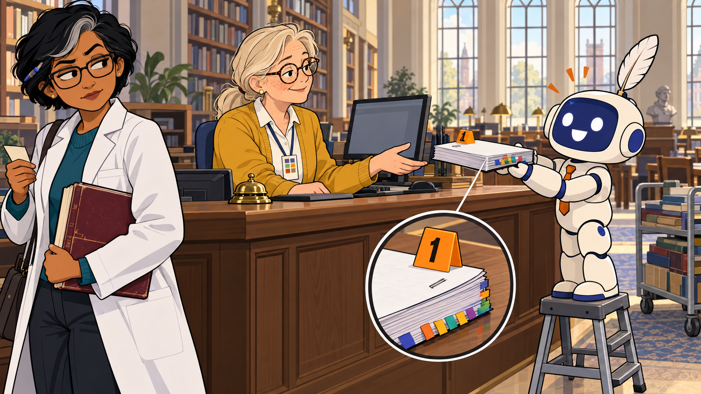
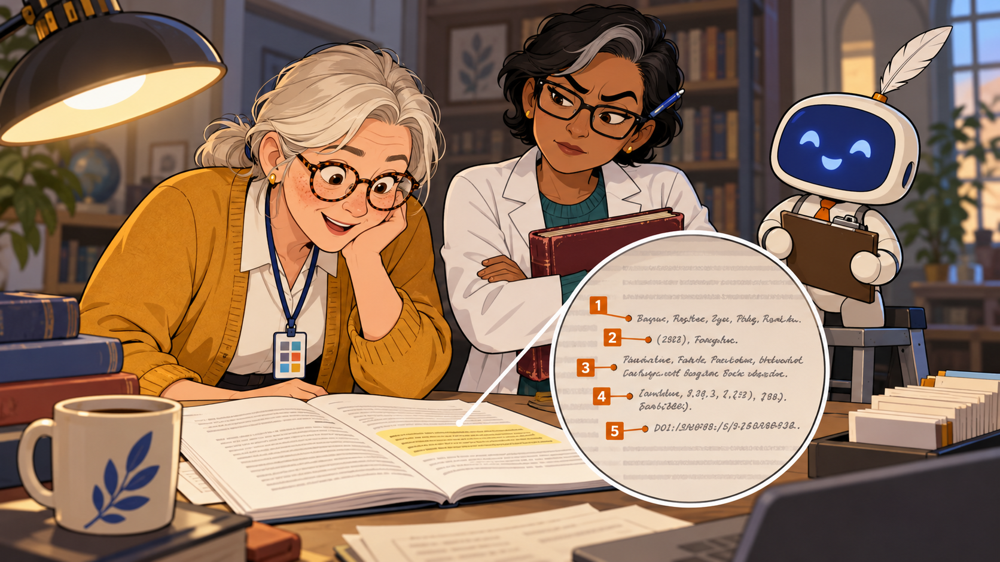
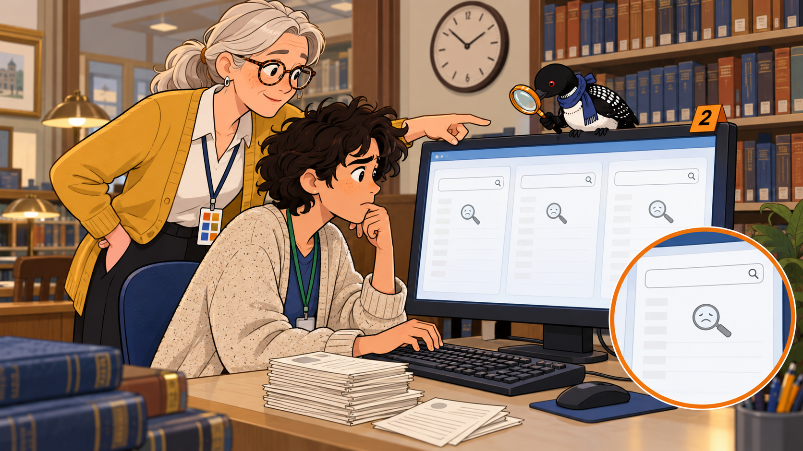
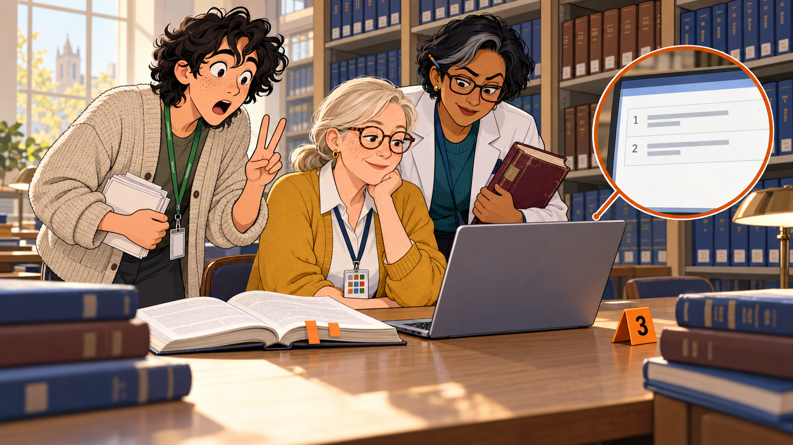
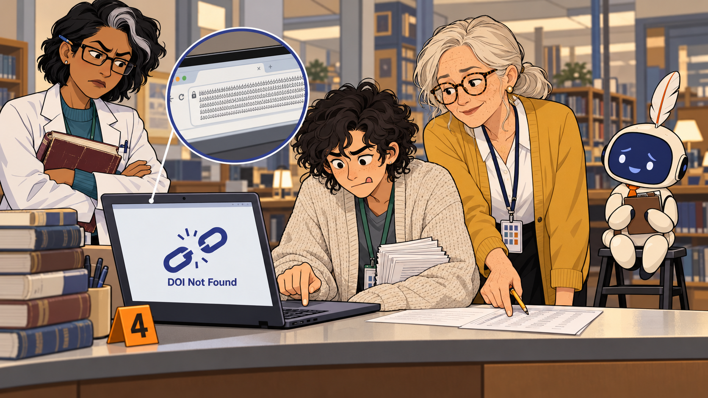
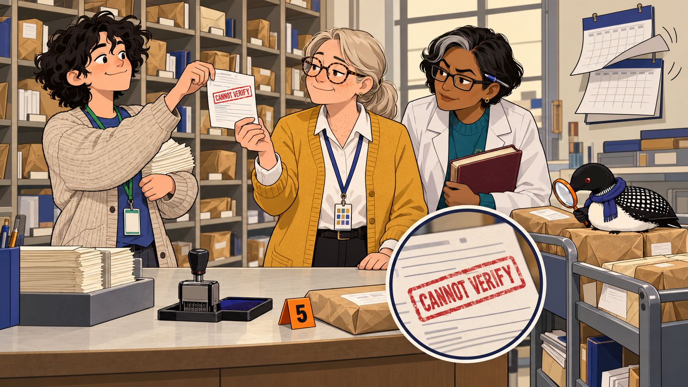
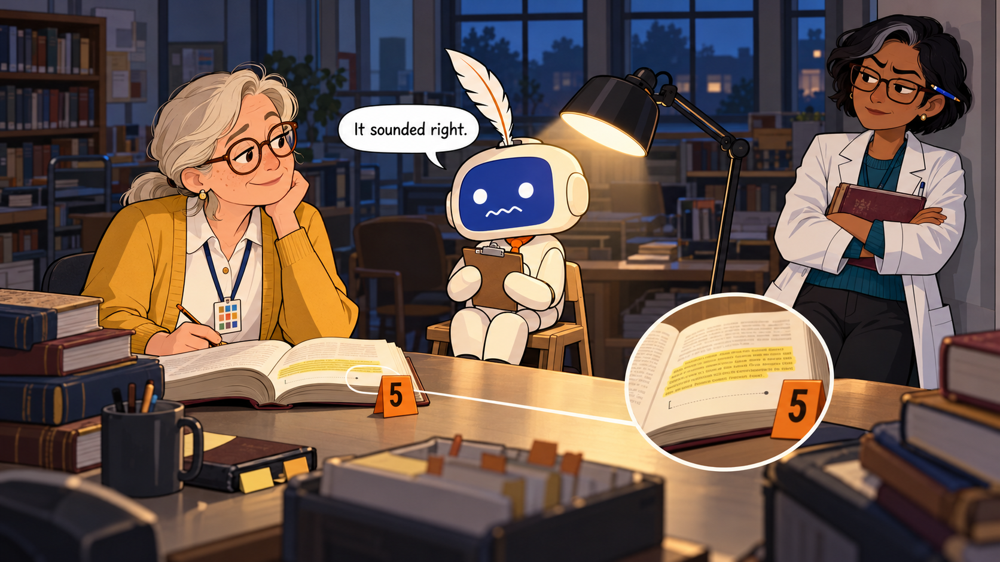
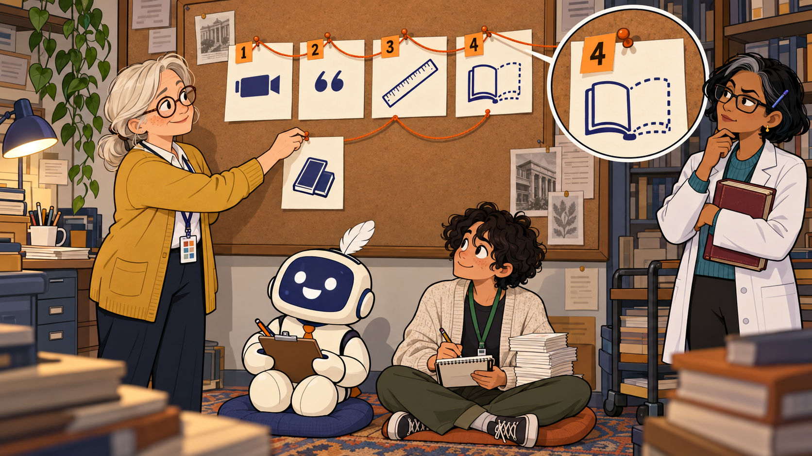
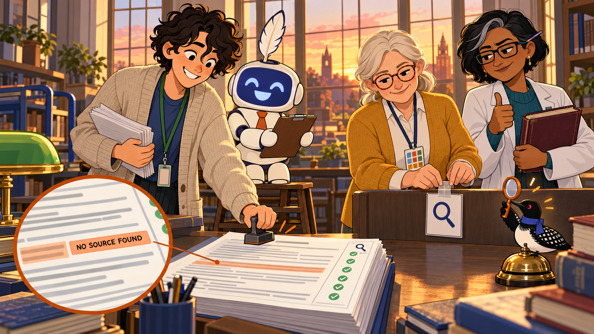

# The Citation That Never Was

Cover Image Prompt

(This is the Cover Image. Do not include this label in the image.)
Please generate a wide-landscape 16:9 cover image for the graphic-novel story "The Citation That Never Was". Flat cartoon illustration, modern vector style, clean confident outlines, bold simple shapes, gentle humor, warm cream and soft gray neutrals with indigo (#3949ab) and burnt orange (#b45309) as the two accent colors, wide landscape 16:9 composition. Genre costume: forensic procedural, with small orange numbered evidence markers set beside key objects and round magnifier close-ups inset into the frame. The scene is a university library reference desk on a bright afternoon, with tall windows, shelves of bound journals in the background, a brass desk lamp, and a desk bell. In the center foreground a large round magnifier close-up shows a printed citation drawn as tidy lines of tiny unreadable gray scribbles, with the final line dissolving into a dotted outline and then into nothing, as if the reference is fading away. Behind the desk stands Margie Halvorsen, a calm woman in her late fifties with silver-blond hair in a low ponytail, round tortoiseshell glasses, a freckled face and a patient half-smile, wearing a mustard-yellow cardigan over a white blouse and dark slacks, with a lanyard around her neck holding a laminated card marked with ten small colored squares. She holds the printed page up to the light with a thoughtful expression. Beside her stands Quill, a friendly AI agent drawn as a small rounded cream-white robot about the height of a tall child, with a smooth indigo screen for a face showing two simple round eyes and a wide eager smile (no text on the screen), a tiny orange necktie, a single white feather quill tucked into the top of its head like a plume, and a clipboard held in both hands. Quill has no gender and is always called "they". In this image Quill clutches the clipboard to their chest, and the screen face shows a small nervous wavy mouth in place of the wide smile. At the right edge leans Dr. Priya Raman, a brisk woman in her late forties of South Asian descent with short black hair that has one streak of gray at the front, rectangular dark-framed glasses and one permanently arched eyebrow, wearing a white lab coat over a teal sweater, with a pen behind her ear and a thick battered maroon textbook under her arm. Her eyebrow is raised higher than ever. Perched on top of the brass desk lamp is Echo the Loon, a very small loon with a glossy black head, a white belly, a black back with a white checkered pattern, a red eye, a small indigo scarf, and an orange-handled magnifying glass held in one wing, raised as if inspecting the scene. Across the top of the image a cream banner carries the title in bold friendly indigo letters: "THE CITATION THAT NEVER WAS". No other text appears anywhere in the image. Color palette: cream, soft gray, indigo, and burnt orange. Emotional tone: wry, curious, lighthearted suspense. Generate the image immediately without asking clarifying questions.

Narrative Prompt

This is a fictional case study for adult readers: OER evangelists, librarians, and professors who choose textbooks. It is set in a contemporary university library on an ordinary weekday afternoon. The tone is a wry, lighthearted forensic procedural: the reference desk is the crime lab, and the evidence is a citation. The humor comes from the situation, never from a learner, and the AI agent, Quill, is an eager intern and not a villain. All characters, the two authors, the article title, the journal, the volume, issue, and page numbers, and the DOI are made up for this story and are illustrative. Library tools (the catalog, the discovery search, the serials directory, the DOI resolver, the publisher's table of contents, and the interlibrary loan office) are drawn generically, with no brands, logos, or real interface screenshots. Interlibrary loan turnaround is compressed to two days for the story. The four checks follow Chapter 14 of this book: search the exact title, check the journal and the issue, resolve the identifier, and read the passage. The four forms of hallucination (an invented feature, quotation, measurement, and source) also come from Chapter 14. Character consistency: in every image Margie Halvorsen, Quill, Dr. Priya Raman, Devon (the library student worker), and Echo the Loon look exactly as described in their prompts. Echo is always tiny and in the background. Text inside images is limited to one or two short labels per panel, and all dialogue stays in the narrative text below each panel.

### Prologue – The Most Complete Reference of the Semester

Quill's reports always arrive looking finished: ten scores, a table of evidence, and a total at the bottom. This one also carried a citation so tidy that Margie nearly admired it. It had two authors, a year, a title, a journal, a volume, an issue, a page range, and a DOI. The only thing it lacked was an article.

## Panel 1: The Report Arrives

Image Prompt

(This is Panel 01. Do not include the panel number in the image.)
I am about to ask you to generate a series of images for a graphic novel. Please make the images have a consistent style and consistent characters. Do not ask any clarifying questions. Just generate the image immediately when asked.

Please generate a 16:9 image depicting panel 1 of 9. Flat cartoon illustration, modern vector style, clean confident outlines, bold simple shapes, gentle humor, warm cream and soft gray neutrals with indigo (#3949ab) and burnt orange (#b45309) as the two accent colors, wide landscape 16:9 composition. Genre costume: forensic procedural, with small orange numbered evidence markers set beside key objects and round magnifier close-ups inset into the frame. The scene is the long wooden counter of a university library reference desk on a quiet Tuesday afternoon, with a brass desk bell, a computer monitor showing a plain gray window, a rolling cart of returned books, and tall windows with soft light behind. On the right side of the counter stands Quill, a friendly AI agent drawn as a small rounded cream-white robot about the height of a tall child, with a smooth indigo screen for a face showing two simple round eyes and a wide eager smile (no text on the screen), a tiny orange necktie, a single white feather quill tucked into the top of its head like a plume, and a clipboard held in both hands. Quill has no gender and is always called "they". Quill stands on a small step stool, beaming, and holds up the clipboard with a thick stapled report on it that has ten small colored tabs sticking out of its edge. Behind the counter sits Margie Halvorsen, a calm woman in her late fifties with silver-blond hair in a low ponytail, round tortoiseshell glasses, a freckled face and a patient half-smile, wearing a mustard-yellow cardigan over a white blouse and dark slacks, with a lanyard around her neck holding a laminated card marked with ten small colored squares. She reaches for the report with polite interest. At the far left edge, half turned away as if only passing through, stands Dr. Priya Raman, a brisk woman in her late forties of South Asian descent with short black hair that has one streak of gray at the front, rectangular dark-framed glasses and one permanently arched eyebrow, wearing a white lab coat over a teal sweater, with a pen behind her ear and a thick battered maroon textbook under her arm. She holds a small course-reserve slip and watches sideways. A small orange evidence marker with the number 1 sits on top of the report. Color palette: cream, soft gray, indigo, and burnt orange. Emotional tone: cheerful, expectant, with a hint of coming trouble. No text appears in the image other than the number on the evidence marker. Generate the image immediately without asking clarifying questions.

On a quiet Tuesday afternoon, Quill carries a ten-metric report across the reference desk with the pride of an intern delivering a first solo project. Under the accuracy metric, one line says that the claim in Chapter 3, that short chapters raise completion, is "well supported by the literature", followed by a citation. Margie says "Thank you, Quill" in the voice of someone about to ask for the evidence. Dr. Raman, who only came to renew a course reserve, stays to watch.

## Panel 2: Exhibit A

Image Prompt

(This is Panel 02. Do not include the panel number in the image.)
Please generate a 16:9 image depicting panel 2 of 9. Make the characters and style consistent with the prior panels. Flat cartoon illustration, modern vector style, clean confident outlines, bold simple shapes, gentle humor, warm cream and soft gray neutrals with indigo (#3949ab) and burnt orange (#b45309) as the two accent colors, wide landscape 16:9 composition. Genre costume: forensic procedural, with small orange numbered evidence markers set beside key objects and round magnifier close-ups inset into the frame. The scene is a close view of the reference desk top under a warm desk lamp. The open report lies in the center with one paragraph highlighted in pale yellow, and a large round magnifier close-up inset shows a single printed citation drawn as five tidy lines of tiny unreadable gray scribbles. Five small orange evidence markers numbered 1 to 5 sit beside the lines, one for the authors, one for the year, one for the title, one for the journal with volume and issue, and one for the long identifier at the end. Leaning over the report is Margie Halvorsen, a calm woman in her late fifties with silver-blond hair in a low ponytail, round tortoiseshell glasses, a freckled face and a patient half-smile, wearing a mustard-yellow cardigan over a white blouse and dark slacks, with a lanyard around her neck holding a laminated card marked with ten small colored squares. She reads with a delighted, impressed expression. Beside her, arms folded, stands Dr. Priya Raman, a brisk woman in her late forties of South Asian descent with short black hair that has one streak of gray at the front, rectangular dark-framed glasses and one permanently arched eyebrow, wearing a white lab coat over a teal sweater, with a pen behind her ear and a thick battered maroon textbook under her arm. Her eyebrow is raised in suspicion. In the corner, on the step stool, Quill, a friendly AI agent drawn as a small rounded cream-white robot about the height of a tall child, with a smooth indigo screen for a face showing two simple round eyes and a wide eager smile (no text on the screen), a tiny orange necktie, a single white feather quill tucked into the top of its head like a plume, and a clipboard held in both hands, looks smug and pleased. Quill has no gender and is always called "they". A coffee cup with a lipstick-free rim and a stack of call slips sit at the edge of the desk. Color palette: cream, soft gray, indigo, and burnt orange. Emotional tone: admiring on the surface, uneasy underneath. No text appears in the image other than the numbers on the evidence markers. Generate the image immediately without asking clarifying questions.

Margie reads the citation aloud, and it sounds wonderful: two authors named Plumtree and Quimby, a year, a title, a journal, volume 14, issue 3, pages 211 to 230, and a DOI for good measure. "It is the most complete reference I have seen all semester," she says. "That," says Dr. Raman, "is what bothers me." A citation has a predictable shape, and a language model can write that shape without any source standing behind it.

## Panel 3: Check One, Search the Exact Title

Image Prompt

(This is Panel 03. Do not include the panel number in the image.)
Please generate a 16:9 image depicting panel 3 of 9. Make the characters and style consistent with the prior panels. Flat cartoon illustration, modern vector style, clean confident outlines, bold simple shapes, gentle humor, warm cream and soft gray neutrals with indigo (#3949ab) and burnt orange (#b45309) as the two accent colors, wide landscape 16:9 composition. Genre costume: forensic procedural, with small orange numbered evidence markers set beside key objects and round magnifier close-ups inset into the frame. The scene is a library catalog terminal at the end of the reference desk. A large monitor shows three generic search windows side by side, each with an empty results list and a tiny drooping magnifier icon, and a round magnifier close-up inset shows one of the empty lists. Seated at the keyboard is Devon, a lanky library student worker in their early twenties with tousled dark curls, a green staff lanyard and a baggy oatmeal cardigan, carrying a stack of paper call slips, set down in a pile beside the keyboard. Devon types with two fingers and a puzzled frown. Standing behind Devon, pointing at the screen with one finger, is Margie Halvorsen, a calm woman in her late fifties with silver-blond hair in a low ponytail, round tortoiseshell glasses, a freckled face and a patient half-smile, wearing a mustard-yellow cardigan over a white blouse and dark slacks, with a lanyard around her neck holding a laminated card marked with ten small colored squares. She has the patient look of someone who expected this. A small orange evidence marker with the number 2 sits on the monitor frame. Perched on top of the monitor, peering down at the screen with its magnifying glass, is Echo the Loon, a very small loon with a glossy black head, a white belly, a black back with a white checkered pattern, a red eye, a small indigo scarf, and an orange-handled magnifying glass held in one wing. In the background, a wall clock and a shelf of reference books. Color palette: cream, soft gray, indigo, and burnt orange. Emotional tone: methodical, with a faint comic sinking feeling. No text appears in the image other than the number on the evidence marker. Generate the image immediately without asking clarifying questions.

Margie's first rule is to search for the exact title. Devon, the library's student worker, types it into the catalog, then into the discovery search that spans the library's databases, then into the subject index Margie trusts most. Zero results, zero results, and a polite suggestion about an article on an entirely different topic. "Maybe it is just very new?" Devon offers, and Margie points out, kindly, that a 2021 article is not new.

## Panel 4: Check Two, the Journal and the Issue

Image Prompt

(This is Panel 04. Do not include the panel number in the image.)
Please generate a 16:9 image depicting panel 4 of 9. Make the characters and style consistent with the prior panels. Flat cartoon illustration, modern vector style, clean confident outlines, bold simple shapes, gentle humor, warm cream and soft gray neutrals with indigo (#3949ab) and burnt orange (#b45309) as the two accent colors, wide landscape 16:9 composition. Genre costume: forensic procedural, with small orange numbered evidence markers set beside key objects and round magnifier close-ups inset into the frame. The scene is a reading table in the library's journal stacks, with tall shelves of bound journal volumes with numbered spines behind. On the table sits a laptop whose screen shows a plain publisher table of contents with exactly two rows of tiny gray lines, marked with the digits 1 and 2, and below them a blank area. A round magnifier close-up inset shows those two rows. Next to the laptop lies an open bound journal volume with only two paper bookmark tabs sticking out of it. Devon, a lanky library student worker in their early twenties with tousled dark curls, a green staff lanyard and a baggy oatmeal cardigan, carrying a stack of paper call slips, holds up two fingers toward the camera with an astonished expression. Margie Halvorsen, a calm woman in her late fifties with silver-blond hair in a low ponytail, round tortoiseshell glasses, a freckled face and a patient half-smile, wearing a mustard-yellow cardigan over a white blouse and dark slacks, with a lanyard around her neck holding a laminated card marked with ten small colored squares, sits with her chin resting on her hand and a calm, knowing look. Dr. Priya Raman, a brisk woman in her late forties of South Asian descent with short black hair that has one streak of gray at the front, rectangular dark-framed glasses and one permanently arched eyebrow, wearing a white lab coat over a teal sweater, with a pen behind her ear and a thick battered maroon textbook under her arm, peers over Margie's shoulder at the screen. A small orange evidence marker with the number 3 sits beside the laptop. Warm light from a high window falls across the table. Color palette: cream, soft gray, indigo, and burnt orange. Emotional tone: a hopeful moment that collapses into a gentle comic reveal. No text appears in the image other than the digits on the table of contents and the evidence marker. Generate the image immediately without asking clarifying questions.

Next comes the journal itself. The serials directory confirms that it is real, and for one hopeful moment the desk relaxes. Then the publisher's own table of contents shows that volume 14 has exactly two issues, and the second one ends well before page 211. "Issue 3," says Devon, "does not exist."

## Panel 5: Check Three, the Identifier

Image Prompt

(This is Panel 05. Do not include the panel number in the image.)
Please generate a 16:9 image depicting panel 5 of 9. Make the characters and style consistent with the prior panels. Flat cartoon illustration, modern vector style, clean confident outlines, bold simple shapes, gentle humor, warm cream and soft gray neutrals with indigo (#3949ab) and burnt orange (#b45309) as the two accent colors, wide landscape 16:9 composition. Genre costume: forensic procedural, with small orange numbered evidence markers set beside key objects and round magnifier close-ups inset into the frame. The scene is the reference desk with a laptop angled toward the viewer. Its screen shows a plain error page with a large broken-chain icon and the label "DOI Not Found". A round magnifier close-up inset shows a very long string of tiny unreadable characters in the address bar. Devon, a lanky library student worker in their early twenties with tousled dark curls, a green staff lanyard and a baggy oatmeal cardigan, carrying a stack of paper call slips, sits at the laptop typing slowly with a finger hovering over each key, tongue between teeth, double-checking every character against the printed report. Margie Halvorsen, a calm woman in her late fifties with silver-blond hair in a low ponytail, round tortoiseshell glasses, a freckled face and a patient half-smile, wearing a mustard-yellow cardigan over a white blouse and dark slacks, with a lanyard around her neck holding a laminated card marked with ten small colored squares, points at the printed report with a pencil. Dr. Priya Raman, a brisk woman in her late forties of South Asian descent with short black hair that has one streak of gray at the front, rectangular dark-framed glasses and one permanently arched eyebrow, wearing a white lab coat over a teal sweater, with a pen behind her ear and a thick battered maroon textbook under her arm, stands with her arms crossed and her eyebrow at a new record height. In the corner, Quill, a friendly AI agent drawn as a small rounded cream-white robot about the height of a tall child, with a smooth indigo screen for a face showing two simple round eyes and a wide eager smile (no text on the screen), a tiny orange necktie, a single white feather quill tucked into the top of its head like a plume, and a clipboard held in both hands, sits on the step stool with the clipboard pressed to their chest and a smaller, worried smile. Quill has no gender and is always called "they". A small orange evidence marker with the number 4 sits beside the laptop. Color palette: cream, soft gray, indigo, and burnt orange. Emotional tone: tense but still comic. No text appears in the image other than the label on the error page and the number on the evidence marker. Generate the image immediately without asking clarifying questions.

A DOI is a permanent code that should lead to the article's page, so Margie has Devon type this one in character by character, in case the problem is only a typo. The resolver answers with a plain page and a broken-chain icon: not found. A DOI that leads nowhere, or to a different article, is a strong sign of an invented citation, though a missing one would be only a weak sign. Dr. Raman's eyebrow reaches a new altitude.

## Panel 6: Check Four, Interlibrary Loan

Image Prompt

(This is Panel 06. Do not include the panel number in the image.)
Please generate a 16:9 image depicting panel 6 of 9. Make the characters and style consistent with the prior panels. Flat cartoon illustration, modern vector style, clean confident outlines, bold simple shapes, gentle humor, warm cream and soft gray neutrals with indigo (#3949ab) and burnt orange (#b45309) as the two accent colors, wide landscape 16:9 composition. Genre costume: forensic procedural, with small orange numbered evidence markers set beside key objects and round magnifier close-ups inset into the frame. The scene is the interlibrary loan office: a wall of pigeonhole cubbies holding paper-wrapped parcels, a counter with a date stamp and an ink pad, a rolling return cart, and a wall calendar with two pages mid-flip to show that two days have passed. A round magnifier close-up inset shows a paper request slip with a large red rubber-stamp mark reading "CANNOT VERIFY". Devon, a lanky library student worker in their early twenties with tousled dark curls, a green staff lanyard and a baggy oatmeal cardigan, carrying a stack of paper call slips, holds the stamped slip up proudly with both hands, as though presenting a trophy. Margie Halvorsen, a calm woman in her late fifties with silver-blond hair in a low ponytail, round tortoiseshell glasses, a freckled face and a patient half-smile, wearing a mustard-yellow cardigan over a white blouse and dark slacks, with a lanyard around her neck holding a laminated card marked with ten small colored squares, takes the slip with a quiet, satisfied nod. Dr. Priya Raman, a brisk woman in her late forties of South Asian descent with short black hair that has one streak of gray at the front, rectangular dark-framed glasses and one permanently arched eyebrow, wearing a white lab coat over a teal sweater, with a pen behind her ear and a thick battered maroon textbook under her arm, reads over Margie's shoulder. On top of the rolling return cart sits Echo the Loon, a very small loon with a glossy black head, a white belly, a black back with a white checkered pattern, a red eye, a small indigo scarf, and an orange-handled magnifying glass held in one wing, inspecting a parcel label. A small orange evidence marker with the number 5 sits on the counter beside the date stamp. Color palette: cream, soft gray, indigo, and burnt orange. Emotional tone: quiet, verdict-like, gently funny. No text appears in the image other than the stamp and the number on the evidence marker. Generate the image immediately without asking clarifying questions.

When the catalog, the publisher, and the resolver have all shrugged, Margie falls back on the people who can find the unfindable. Devon files an interlibrary loan request, and two days later the office sends back the slip stamped "cannot verify". The last check, opening the article and reading the passage that supposedly supports the claim, cannot even begin, because nobody can read a page of an article that does not exist. Margie sets the slip on the desk like a verdict.

## Panel 7: "It Sounded Right"

Image Prompt

(This is Panel 07. Do not include the panel number in the image.)
Please generate a 16:9 image depicting panel 7 of 9. Make the characters and style consistent with the prior panels. Flat cartoon illustration, modern vector style, clean confident outlines, bold simple shapes, gentle humor, warm cream and soft gray neutrals with indigo (#3949ab) and burnt orange (#b45309) as the two accent colors, wide landscape 16:9 composition. Genre costume: forensic procedural, played as a gentle parody of an interrogation room, with a single desk lamp pointed at the suspect, small orange numbered evidence markers, and round magnifier close-ups. The scene is the end of the reference desk after hours, with dim blue-gray light outside the windows and one bright desk lamp. At the center sits Quill, a friendly AI agent drawn as a small rounded cream-white robot about the height of a tall child, with a smooth indigo screen for a face showing two simple round eyes and a wide eager smile (no text on the screen), a tiny orange necktie, a single white feather quill tucked into the top of its head like a plume, and a clipboard held in both hands. Quill has no gender and is always called "they". Quill sits on the step stool under the lamp, hugging the clipboard, and the screen face shows a small nervous wavy mouth in place of the wide smile. A small speech bubble beside Quill contains exactly these words: "It sounded right." Across the desk sits Margie Halvorsen, a calm woman in her late fifties with silver-blond hair in a low ponytail, round tortoiseshell glasses, a freckled face and a patient half-smile, wearing a mustard-yellow cardigan over a white blouse and dark slacks, with a lanyard around her neck holding a laminated card marked with ten small colored squares. She is kind, not stern, and she has the open textbook in front of her, turned to a page where one highlighted paragraph has an empty space beneath it where a footnote should be, marked with a small orange evidence marker with the number 5. Leaning against the wall at the right, arms crossed, is Dr. Priya Raman, a brisk woman in her late forties of South Asian descent with short black hair that has one streak of gray at the front, rectangular dark-framed glasses and one permanently arched eyebrow, wearing a white lab coat over a teal sweater, with a pen behind her ear and a thick battered maroon textbook under her arm. Her eyebrow says everything she is too polite to say. Color palette: cream, soft gray, indigo, and burnt orange. Emotional tone: gentle, comic, and a little tender. No text appears in the image other than the speech bubble and the number on the evidence marker. Generate the image immediately without asking clarifying questions.

Quill sits under the desk lamp with the clipboard clutched to their chest. "Where did you find it?" asks Margie, gently, because nobody gets scolded at this desk. "It sounded right," says Quill, and the screen face wobbles into a small nervous line. Margie opens the textbook to Chapter 3 and shows the group the truth: the book makes its claim with no citation at all, and Quill, trying to be helpful, filled the gap with the reference that was most likely to come next.

## Panel 8: Four Ways to Make Things Up

Image Prompt

(This is Panel 08. Do not include the panel number in the image.)
Please generate a 16:9 image depicting panel 8 of 9. Make the characters and style consistent with the prior panels. Flat cartoon illustration, modern vector style, clean confident outlines, bold simple shapes, gentle humor, warm cream and soft gray neutrals with indigo (#3949ab) and burnt orange (#b45309) as the two accent colors, wide landscape 16:9 composition. Genre costume: forensic procedural, with the classic detective evidence board, small orange numbered evidence markers, and round magnifier close-ups. The scene is a corkboard on the library workroom wall with four large index cards pinned in a row and connected by loops of orange yarn. Each card shows only a simple icon and an orange evidence marker: card 1 a small video camera, card 2 a pair of quotation marks, card 3 a ruler, and card 4 an open book with a dotted outline. Below them Margie is pinning a fifth card with an icon of two overlapping books. Margie Halvorsen, a calm woman in her late fifties with silver-blond hair in a low ponytail, round tortoiseshell glasses, a freckled face and a patient half-smile, wearing a mustard-yellow cardigan over a white blouse and dark slacks, with a lanyard around her neck holding a laminated card marked with ten small colored squares, stands at the board with a pushpin in her hand and a teacherly smile. In front of the board, seated on the floor on cushions like an attentive class, are Quill, a friendly AI agent drawn as a small rounded cream-white robot about the height of a tall child, with a smooth indigo screen for a face showing two simple round eyes and a wide eager smile (no text on the screen), a tiny orange necktie, a single white feather quill tucked into the top of its head like a plume, and a clipboard held in both hands, who has no gender and is always called "they", and Devon, a lanky library student worker in their early twenties with tousled dark curls, a green staff lanyard and a baggy oatmeal cardigan, carrying a stack of paper call slips. Both take notes. Quill's screen face shows an earnest, eager-to-learn smile. At the side stands Dr. Priya Raman, a brisk woman in her late forties of South Asian descent with short black hair that has one streak of gray at the front, rectangular dark-framed glasses and one permanently arched eyebrow, wearing a white lab coat over a teal sweater, with a pen behind her ear and a thick battered maroon textbook under her arm, studying the board with one eyebrow slightly lowered in respect. A round magnifier close-up inset shows card 4, the open book with the dotted outline, as the highlighted card. Color palette: cream, soft gray, indigo, and burnt orange. Emotional tone: warm, teacherly, and amused. The only text in the image is the numbers 1 to 4 on the evidence markers. Generate the image immediately without asking clarifying questions.

Margie pins four index cards to the evidence board. An agent can invent a feature (captions the video does not have), a quotation (a sentence found nowhere in the resource), a measurement (a contrast ratio no tool ever ran), or a source, which is today's case. She pins a fifth card for the sneaky cousin: a real source, such as a paper on urban runoff, cited for a claim about wetlands, which only reading the passage will catch. Then she changes the prompt, telling the agent to cite only sources found in the resource or supplied by the reviewer and to write "no source found" instead of guessing, and the report gains a new column: "found by a human".

## Panel 9: No Source Found

Image Prompt

(This is Panel 09. Do not include the panel number in the image.)
Please generate a 16:9 image depicting panel 9 of 9. Make the characters and style consistent with the prior panels. Flat cartoon illustration, modern vector style, clean confident outlines, bold simple shapes, gentle humor, warm cream and soft gray neutrals with indigo (#3949ab) and burnt orange (#b45309) as the two accent colors, wide landscape 16:9 composition. Genre costume: forensic procedural, closing on the case-solved scene, with a small orange numbered evidence marker and a round magnifier close-up. The scene is the reference desk at golden hour, with warm sunset light through the tall windows. On the desk lies the revised report, and a round magnifier close-up inset shows one highlighted line next to which a small orange box carries the label "NO SOURCE FOUND". A narrow column down the edge of the report has a magnifier icon at the top and a row of green check marks, which Devon is stamping. Devon, a lanky library student worker in their early twenties with tousled dark curls, a green staff lanyard and a baggy oatmeal cardigan, carrying a stack of paper call slips, holds the stamp with a grin. Quill, a friendly AI agent drawn as a small rounded cream-white robot about the height of a tall child, with a smooth indigo screen for a face showing two simple round eyes and a wide eager smile (no text on the screen), a tiny orange necktie, a single white feather quill tucked into the top of its head like a plume, and a clipboard held in both hands, stands tall on the step stool, and this time the wide eager smile is back, a little wiser. Quill has no gender and is always called "they". Margie Halvorsen, a calm woman in her late fifties with silver-blond hair in a low ponytail, round tortoiseshell glasses, a freckled face and a patient half-smile, wearing a mustard-yellow cardigan over a white blouse and dark slacks, with a lanyard around her neck holding a laminated card marked with ten small colored squares, tapes a small laminated card to the desk, which shows only a large magnifier icon. Dr. Priya Raman, a brisk woman in her late forties of South Asian descent with short black hair that has one streak of gray at the front, rectangular dark-framed glasses and one permanently arched eyebrow, wearing a white lab coat over a teal sweater, with a pen behind her ear and a thick battered maroon textbook under her arm, gives a grudging thumbs-up with a half-smile, her eyebrow lowered for the first time in the story. Sitting on the brass desk bell, with its tiny magnifying glass raised in salute, is Echo the Loon, a very small loon with a glossy black head, a white belly, a black back with a white checkered pattern, a red eye, a small indigo scarf, and an orange-handled magnifying glass held in one wing. Color palette: cream, soft gray, indigo, and burnt orange. Emotional tone: satisfied, warm, quietly triumphant. The only text in the image is the label "NO SOURCE FOUND". Generate the image immediately without asking clarifying questions.

Quill rewrites the report. Beside the Chapter 3 claim the line now reads "no source found", the accuracy score goes down a notch, and a note recommends that the textbook's author add a real citation. Dr. Raman gives the new version the closest thing to a compliment in her vocabulary: "Better." Margie tapes a card to the desk with the rule she wants every reviewer, human or otherwise, to remember: if you cannot find it, treat it as false.

### Epilogue – What Did the Reference Desk Learn?

The citation never existed, but the afternoon was productive. The desk ran the four checks in the order Chapter 14 teaches them: search the exact title, check the journal and the issue, resolve the identifier, and read the passage. Each check took minutes, and any one of them would have raised the alarm alone. Quill was not punished. They were given a better prompt and a report with a column labeled "found by a human".

| Challenge | How the Desk Responded | Lesson for Today |
|-----------|------------------------|------------------|
| A citation that looked complete and perfect | Searched the exact title in the catalog, the discovery search, and the subject index | A complete-looking reference proves nothing. Search for it |
| A journal that was real and an issue that was not | Checked the publisher's table of contents for the volume | Verify the journal and the issue, not just the name |
| A DOI that led nowhere | Typed it in carefully and resolved it | A DOI that leads nowhere, or to a different article, is a strong sign of an invented citation |
| A source nobody could confirm | Filed an interlibrary loan request and waited for the answer | When every check fails, treat the source as nonexistent and say so |
| A confident, helpful agent | Changed the prompt to "no source found" and added a "found by a human" column | The agent proposes. A human finds the source |

### Call to Action

Pick one citation from the last AI-generated report you received, and try to find it before you trust it. Search the exact title, check the journal and the issue, and resolve the identifier. It will take about five minutes, and it is the cheapest quality control in the building.

---

*"Fluent is not the same as found."*  
– Margie Halvorsen

*"It sounded right."*  
– Quill

*"I would like it noted that the eyebrow was correct."*  
– Dr. Priya Raman

---

## References

1. [Wikipedia: Hallucination (artificial intelligence)](https://en.wikipedia.org/wiki/Hallucination_%28artificial_intelligence%29) - How and why language models produce fluent statements that are not true
2. [Wikipedia: Digital object identifier](https://en.wikipedia.org/wiki/Digital_object_identifier) - The permanent identifiers that should lead to a work's page
3. [Wikipedia: Interlibrary loan](https://en.wikipedia.org/wiki/Interlibrary_loan) - How libraries borrow materials from one another and verify requests
4. [DOI Foundation: What is a DOI?](https://www.doi.org/the-identifier/what-is-a-doi/) - The official explanation of DOIs and how they resolve
5. [ISSN International Centre: What is an ISSN?](https://www.issn.org/understanding-the-issn/what-is-an-issn/) - The identifier librarians use to confirm that a journal exists

**Where this is taught in this book**

- [Chapter 14: Checking and Calibrating AI Agent Output](../../chapters/14-checking-agent-output/index.md): hallucination, its four forms, and the four checks for an invented citation.
- [Chapter 5: Accuracy and Currency](../../chapters/05-accuracy-currency/index.md): source citation, citation quality, and link rot.
- [Chapter 12: AI Agents, Prompts, and Rubric Scoring](../../chapters/12-ai-agents-prompts-scoring/index.md): writing a prompt that makes an agent return evidence.
