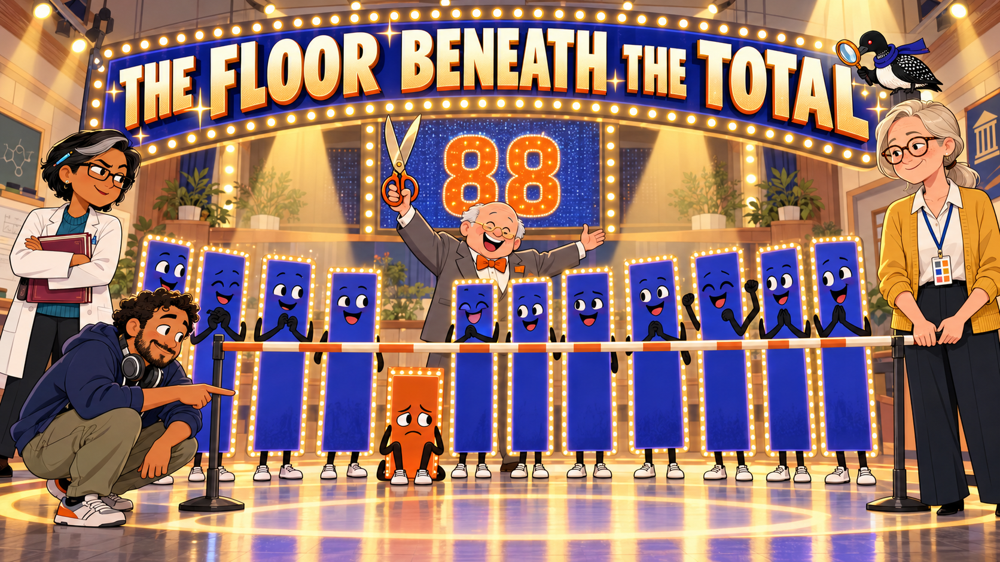
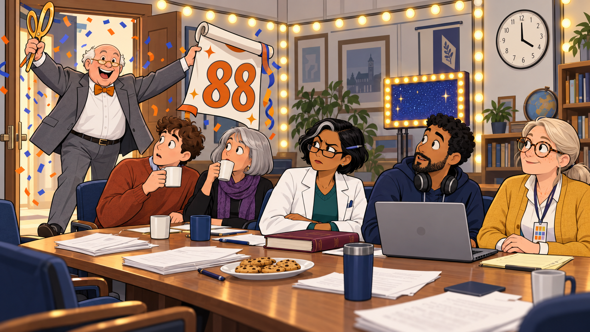
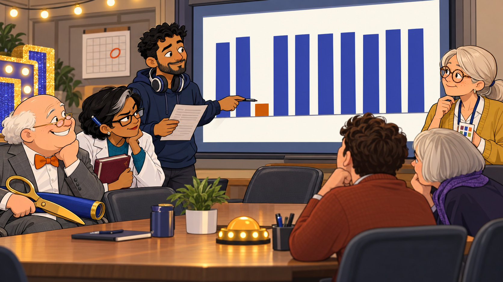
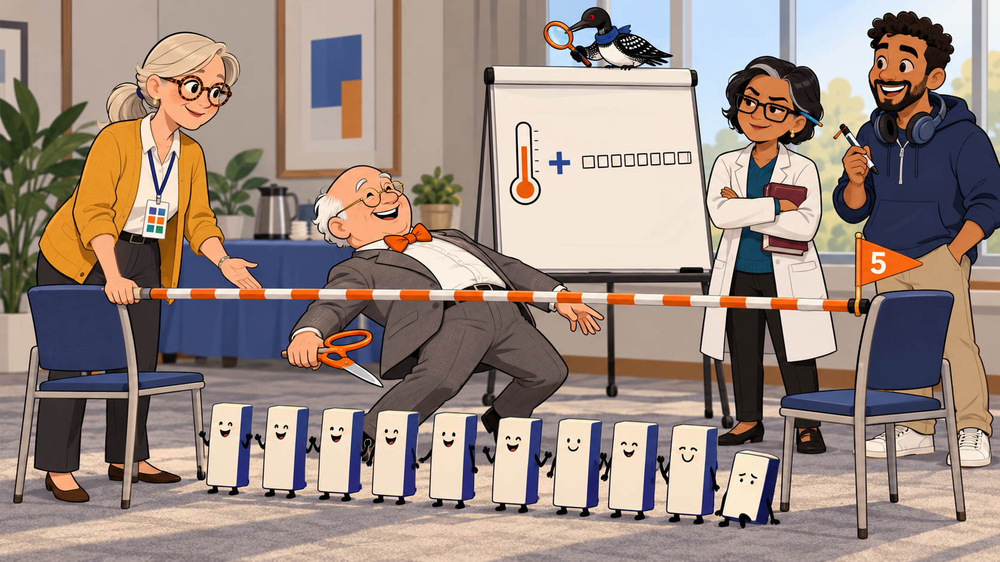
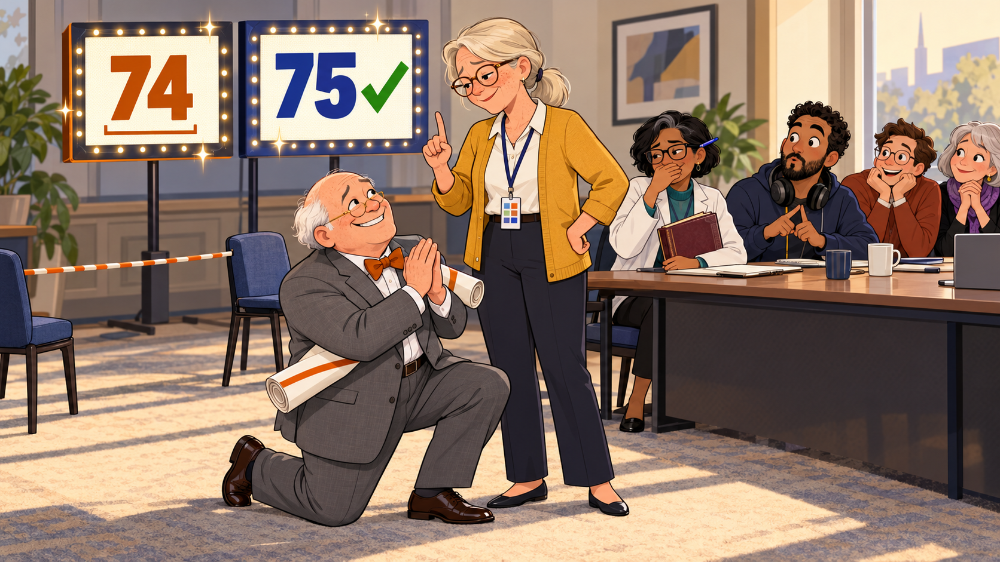
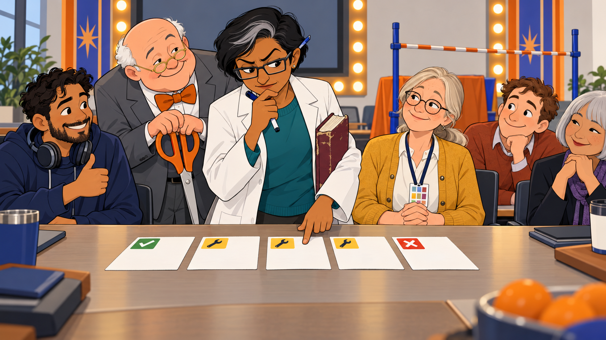
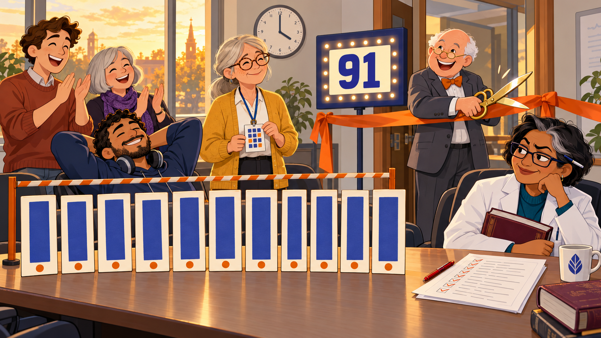
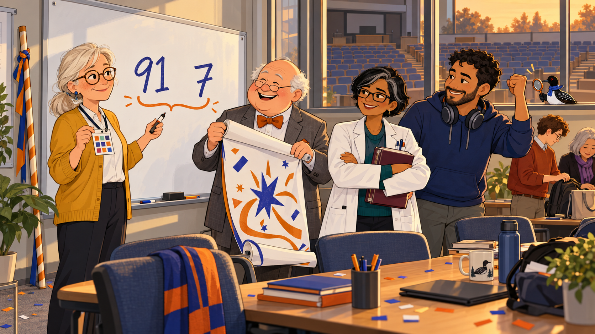

# The Floor Beneath the Total

<!--  -->

Cover Image Prompt

(This is the Cover Image. Do not include this label in the image.)
Please generate a wide-landscape 16:9 cover image for a lighthearted graphic-novel story, drawn like the poster for a TV game show. Flat cartoon illustration, modern vector style, clean confident outlines, bold simple shapes, gentle humor, warm cream and soft gray neutrals with indigo (#3949ab) and burnt orange (#b45309) as the two accent colors, wide landscape 16:9 composition. Genre costume: a TV game show. The scene is a college department conference room that has been turned into a glitzy game-show stage, with strings of bright round bulbs, a pool of spotlight, and a huge glittering scoreboard behind the cast that shows the number 88 in big orange numerals. In the foreground a long horizontal limbo pole rests across two stands, marked with a bold orange stripe, and a row of ten tall rectangular score cards stands behind it like contestants: nine are tall and glowing indigo, and one in the fourth position is short and sits sadly beneath the pole. Characters: Dean Pemberton, a cheerful round-faced man in his sixties with a white fringe of hair around a bald head and tiny gold-rimmed half-moon glasses, wearing a gray suit with an orange bow tie, always grinning and often holding an oversized pair of ceremonial scissors or a rolled-up banner. Dean Pemberton stands at center as the game-show host with the ceremonial scissors raised high and a delighted grin. Margie Halvorsen, a calm woman in her late fifties with silver-blond hair in a low ponytail, round tortoiseshell glasses, a freckled face and a patient half-smile, wearing a mustard-yellow cardigan over a white blouse and dark slacks, with a lanyard around her neck holding a laminated card marked with ten small colored squares. Margie stands on the right holding one end of the limbo pole steady and looking calmly at the short card. Dr. Priya Raman, a brisk woman in her late forties of South Asian descent with short black hair that has one streak of gray at the front, rectangular dark-framed glasses and one permanently arched eyebrow, wearing a white lab coat over a teal sweater, with a pen behind her ear and a thick battered maroon textbook under her arm. Priya stands on the left with her arms crossed and the arched eyebrow aimed at the scoreboard. Tomás Reyes, an enthusiastic man in his mid-thirties with medium-brown skin, short dark curly hair and a neatly trimmed beard, wearing a navy hoodie with big over-ear headphones around his neck. Tomás crouches in front pointing at the short card with a knowing smile. In the background (Echo cameo): A very small loon with a glossy black head, a white belly, a black back with a white checkered pattern, a red eye, a small indigo scarf, and an orange-handled magnifying glass held in one wing. Echo is always tiny and in the background, never the focus. Echo perches on top of the scoreboard, peering down at the short card through the magnifying glass. The only text in the image is the title THE FLOOR BENEATH THE TOTAL in bold chunky game-show letters across the top, spelled exactly like that, plus the number 88 on the scoreboard. Color palette: warm cream and soft gray with indigo and burnt orange, with golden spotlight glints. Emotional tone: playful, suspenseful, and warmly funny. Generate the image immediately without asking clarifying questions.

Narrative Prompt

This is a lighthearted workplace comedy for OER evangelists, librarians, and professors, set in a present-day college department meeting. Dean Pemberton wants to adopt a new economics textbook, *Marketplace Basics*, because it scored 88 out of 100 on the ten-metric rubric. Tomás Reyes reads the lowest metric, accessibility at 4, and Margie Halvorsen shows the committee the adoption threshold from Chapters 3 and 11: Adopt needs a total of at least 75 and every metric at least 5. The story uses a limbo bar set at 5 as a running visual: in this version of limbo nothing gets under the bar. Every score and total in the story is illustrative and was written for this story, not taken from a real review. The made-up scores for *Marketplace Basics*, in rubric order, are accuracy and currency 10, alignment 9, readability 9, accessibility 4, practice with feedback 9 (quality subtotal 41), then open license 10, modularity 9, metadata 9, editable source 10, portability 9 (reusability subtotal 47), for a total of 88 in the Good band. After the fixes in the story, accessibility is 7, the quality subtotal is 44, and the total is 91 in the Excellent band, with 7 as the lowest metric. The boundary cases (75, 74, 50, 49, and 88 with one metric at 4) come from Chapter 11. A student who uses a screen reader is enrolled in Monday's section but never appears in any panel and is never the subject of a joke. Visual style: flat cartoon, modern vector, with a game-show costume (bright bulbs, scoreboards, spotlights). Keep the same four characters looking identical in every panel: Dean Pemberton, Margie Halvorsen, Dr. Priya Raman, and Tomás Reyes, plus two unnamed committee members (a young man in a rust-colored sweater and an older woman with a silver bob haircut and a purple scarf) who sit at the table.

### Prologue – The Number Dean Loves

Every department has a number it loves. For Dean Pemberton the number is 88, the total score of a new economics textbook, which he considers an A-minus worth a ribbon-cutting. What he does not love is the number 4, which sits quietly in one column of the review and is about to spoil his Thursday afternoon. This is the story of a limbo bar, a very polite librarian, and the rule that stops a good total from hiding a bad metric.

## Panel 1: Eighty-Eight!

<!--  -->

Image Prompt

(This is Panel 01. Do not include the panel number in the image.)
I am about to ask you to generate a series of images for a graphic novel. Please make the images have a consistent style and consistent characters. Do not ask any clarifying questions. Just generate the image immediately when asked.

Please generate a 16:9 image depicting panel 1 of 8. Flat cartoon illustration, modern vector style, clean confident outlines, bold simple shapes, gentle humor, warm cream and soft gray neutrals with indigo (#3949ab) and burnt orange (#b45309) as the two accent colors, wide landscape 16:9 composition. Genre costume: a TV game show. The setting is a college department conference room at four o'clock on a Thursday afternoon (a round wall clock with its hands at four), dressed up as a game-show set by the Dean, with strings of bright round bulbs along the walls, a small glittering scoreboard on a stand in the corner, and a long wooden table covered in papers, a plate of cookies, and a plain gray generic laptop. Characters: Dean Pemberton, a cheerful round-faced man in his sixties with a white fringe of hair around a bald head and tiny gold-rimmed half-moon glasses, wearing a gray suit with an orange bow tie, always grinning and often holding an oversized pair of ceremonial scissors or a rolled-up banner. Dean Pemberton bursts through the door on the left, one hand waving the ceremonial scissors and the other holding a rolled-up banner that has come partly unrolled to show the number 88 in giant orange numerals, with confetti drifting behind him. Dr. Priya Raman, a brisk woman in her late forties of South Asian descent with short black hair that has one streak of gray at the front, rectangular dark-framed glasses and one permanently arched eyebrow, wearing a white lab coat over a teal sweater, with a pen behind her ear and a thick battered maroon textbook under her arm. Priya sits at the table with her textbook on the table in front of her, one eyebrow raised as high as it will go. Tomás Reyes, an enthusiastic man in his mid-thirties with medium-brown skin, short dark curly hair and a neatly trimmed beard, wearing a navy hoodie with big over-ear headphones around his neck. Tomás sits beside her looking up from the laptop with polite surprise. Margie Halvorsen, a calm woman in her late fifties with silver-blond hair in a low ponytail, round tortoiseshell glasses, a freckled face and a patient half-smile, wearing a mustard-yellow cardigan over a white blouse and dark slacks, with a lanyard around her neck holding a laminated card marked with ten small colored squares. Margie sits calmly at the end of the table with her hands folded over her lanyard card. Two unnamed committee members also sit at the table: a young man in a rust-colored sweater and an older woman with a silver bob haircut and a purple scarf, both caught mid-sip of coffee. The only text in the image is the number 88 on the banner. Color palette: warm cream and soft gray with indigo and burnt orange accents. Emotional tone: bubbly entrance meeting a chilly skeptical audience. Generate the image immediately without asking clarifying questions.

Dean Pemberton rolls into the four o'clock department meeting like a game show host who has already seen the final answer. The new economics text, *Marketplace Basics*, scored **88** out of 100, and he has brought a banner, a press release, and a pair of ceremonial scissors to prove it. "It's in the Good band!" he announces. Dr. Raman, who has heard Dean announce numbers before, raises the eyebrow she keeps for the occasion.

## Panel 2: The Metric Nobody Read Aloud

<!--  -->

Image Prompt

(This is Panel 02. Do not include the panel number in the image.)
Please generate a 16:9 image depicting panel 2 of 8. Make the characters and style consistent with the prior panel. Flat cartoon illustration, modern vector style, clean confident outlines, bold simple shapes, gentle humor, warm cream and soft gray neutrals with indigo (#3949ab) and burnt orange (#b45309) as the two accent colors, wide landscape 16:9 composition. Genre costume: a TV game show. The setting is the same department conference room with its strings of bright bulbs and glittering scoreboard stand, now with a large screen at the front showing a bar chart of ten vertical bars with no labels or text: nine bars are tall and indigo and the fourth bar is very short and burnt orange. On the wall a paper calendar has one square circled in orange (no readable text). Characters: Tomás Reyes, an enthusiastic man in his mid-thirties with medium-brown skin, short dark curly hair and a neatly trimmed beard, wearing a navy hoodie with big over-ear headphones around his neck. Tomás stands at the screen pointing a pen at the short orange bar with a calm, helpful expression and holding a printed score sheet in the other hand. Dean Pemberton, a cheerful round-faced man in his sixties with a white fringe of hair around a bald head and tiny gold-rimmed half-moon glasses, wearing a gray suit with an orange bow tie, always grinning and often holding an oversized pair of ceremonial scissors or a rolled-up banner. Dean Pemberton sits at the table with the rolled banner across his lap and his grin frozen in place, the ceremonial scissors drooping. Dr. Priya Raman, a brisk woman in her late forties of South Asian descent with short black hair that has one streak of gray at the front, rectangular dark-framed glasses and one permanently arched eyebrow, wearing a white lab coat over a teal sweater, with a pen behind her ear and a thick battered maroon textbook under her arm. Priya leans forward with the arched eyebrow and a look of grim satisfaction. Margie Halvorsen, a calm woman in her late fifties with silver-blond hair in a low ponytail, round tortoiseshell glasses, a freckled face and a patient half-smile, wearing a mustard-yellow cardigan over a white blouse and dark slacks, with a lanyard around her neck holding a laminated card marked with ten small colored squares. Margie nods slowly beside her, one finger resting on her lanyard card. The two unnamed committee members, a young man in a rust-colored sweater and an older woman with a silver bob haircut and a purple scarf, lean in to squint at the chart. No other people appear in the image. There is no text in this image at all. Color palette: warm cream and soft gray with indigo and burnt orange accents, with the orange bar as the visual focus. Emotional tone: a quiet, comic hush as the room notices something. Generate the image immediately without asking clarifying questions.

Tomás does the thing nobody had done yet: he reads the ten scores instead of the total. Nine of them sit at 9 or 10. Accessibility is a **4**, because the images have no alt text, the video has no captions, and the headings are only bold type. The course section that opens on Monday will include a student who reads with a screen reader, and the textbook is not ready for them.

## Panel 3: Margie Sets the Bar

<!--  -->

Image Prompt

(This is Panel 03. Do not include the panel number in the image.)
Please generate a 16:9 image depicting panel 3 of 8. Make the characters and style consistent with the prior panel. Flat cartoon illustration, modern vector style, clean confident outlines, bold simple shapes, gentle humor, warm cream and soft gray neutrals with indigo (#3949ab) and burnt orange (#b45309) as the two accent colors, wide landscape 16:9 composition. Genre costume: a TV game show. The setting is the same department conference room, but the table has been pushed back to clear a stage. A telescoping limbo pole is stretched across two chairs at knee height, wrapped in a bold burnt-orange stripe, with a tiny orange flag on one end that shows the number 5. Beside it stand ten small rectangular score cards in a row like contestants, nine tall and one short, the short one slumped against the pole. Behind them is a flip chart on a stand showing a simple drawing with no words: a big plus sign between a thermometer-style gauge and a row of ten tiny check boxes. Characters: Margie Halvorsen, a calm woman in her late fifties with silver-blond hair in a low ponytail, round tortoiseshell glasses, a freckled face and a patient half-smile, wearing a mustard-yellow cardigan over a white blouse and dark slacks, with a lanyard around her neck holding a laminated card marked with ten small colored squares. Margie stands beside the pole with one hand resting on it, explaining patiently. Dean Pemberton, a cheerful round-faced man in his sixties with a white fringe of hair around a bald head and tiny gold-rimmed half-moon glasses, wearing a gray suit with an orange bow tie, always grinning and often holding an oversized pair of ceremonial scissors or a rolled-up banner. Dean Pemberton is bent backward in a comic limbo pose, scissors still in hand, delighted to be included. Dr. Priya Raman, a brisk woman in her late forties of South Asian descent with short black hair that has one streak of gray at the front, rectangular dark-framed glasses and one permanently arched eyebrow, wearing a white lab coat over a teal sweater, with a pen behind her ear and a thick battered maroon textbook under her arm. Priya watches with her arms crossed and the eyebrow arched. Tomás Reyes, an enthusiastic man in his mid-thirties with medium-brown skin, short dark curly hair and a neatly trimmed beard, wearing a navy hoodie with big over-ear headphones around his neck. Tomás holds the flip-chart marker and grins. In the background (Echo cameo): A very small loon with a glossy black head, a white belly, a black back with a white checkered pattern, a red eye, a small indigo scarf, and an orange-handled magnifying glass held in one wing. Echo is always tiny and in the background, never the focus. Echo perches on top of the flip chart stand, aiming the magnifying glass at the limbo pole. The only text in the image is the number 5 on the tiny flag. Color palette: warm cream and soft gray with indigo and burnt orange accents, with the orange stripe as the focal line. Emotional tone: cheerful and instructive, with a hint of mischief. Generate the image immediately without asking clarifying questions.

"The adoption threshold has two parts," Margie says, and hangs a limbo pole at height five. "The total must be at least 75, **and** every metric must be at least 5." Dean, a limbo enthusiast, points out that in limbo you go under the bar. "Here nothing goes under it," Margie says. "This is the floor. One metric below the bar is out, however tall the other nine stand."

## Panel 4: Seventy-Four Is Not Seventy-Five

<!--  -->

Image Prompt

(This is Panel 04. Do not include the panel number in the image.)
Please generate a 16:9 image depicting panel 4 of 8. Make the characters and style consistent with the prior panel. Flat cartoon illustration, modern vector style, clean confident outlines, bold simple shapes, gentle humor, warm cream and soft gray neutrals with indigo (#3949ab) and burnt orange (#b45309) as the two accent colors, wide landscape 16:9 composition. Genre costume: a TV game show. The setting is the same department conference room. In the background are two glittering scoreboards on stands side by side: the left one shows the number 74 in orange with a tiny gap bracket beneath it, and the right one shows the number 75 in indigo with a bold green check mark beside it. The limbo pole with its orange stripe is still set up across two chairs at the edge of the frame. Characters: Dean Pemberton, a cheerful round-faced man in his sixties with a white fringe of hair around a bald head and tiny gold-rimmed half-moon glasses, wearing a gray suit with an orange bow tie, always grinning and often holding an oversized pair of ceremonial scissors or a rolled-up banner. Dean Pemberton is down on one knee in the foreground with his hands clasped in a theatrical plea, the rolled banner under his arm and a hopeful, pleading smile. Margie Halvorsen, a calm woman in her late fifties with silver-blond hair in a low ponytail, round tortoiseshell glasses, a freckled face and a patient half-smile, wearing a mustard-yellow cardigan over a white blouse and dark slacks, with a lanyard around her neck holding a laminated card marked with ten small colored squares. Margie stands over him with kind, unmoved eyes and gently holds up one finger as if to say one more point. Dr. Priya Raman, a brisk woman in her late forties of South Asian descent with short black hair that has one streak of gray at the front, rectangular dark-framed glasses and one permanently arched eyebrow, wearing a white lab coat over a teal sweater, with a pen behind her ear and a thick battered maroon textbook under her arm. Priya sits at the table with a hand over her mouth, trying not to laugh, the arched eyebrow twitching. Tomás Reyes, an enthusiastic man in his mid-thirties with medium-brown skin, short dark curly hair and a neatly trimmed beard, wearing a navy hoodie with big over-ear headphones around his neck. Tomás sits beside her with his headphones around his neck, silently mouthing the number. The two unnamed committee members, a young man in a rust-colored sweater and an older woman with a silver bob haircut and a purple scarf, watch like spectators at a tennis match. The only text in the image is the numbers 74 and 75 on the two scoreboards. Color palette: warm cream and soft gray with indigo and burnt orange accents. Emotional tone: warm comedy, a good-natured bargaining scene. Generate the image immediately without asking clarifying questions.

Dean tries a gentler approach. "What about 74? That's practically 75." Margie shakes her head kindly: a total of 74 is a Revise, however close it looks, while a 75 with every metric at 5 or above is an Adopt. A threshold is a line, not a mood.

## Panel 5: Priya Pokes the Edges

<!--  -->

Image Prompt

(This is Panel 05. Do not include the panel number in the image.)
Please generate a 16:9 image depicting panel 5 of 8. Make the characters and style consistent with the prior panel. Flat cartoon illustration, modern vector style, clean confident outlines, bold simple shapes, gentle humor, warm cream and soft gray neutrals with indigo (#3949ab) and burnt orange (#b45309) as the two accent colors, wide landscape 16:9 composition. Genre costume: a TV game show. The setting is the same department conference room. On the table in front of Priya, five large index cards lie in a neat row. Each card has a bold colored tab in its top corner with a simple icon and no words: a green tab with a check mark, three yellow tabs with a small wrench, and one red tab with an X. The limbo pole is visible in the background and the game-show bulbs glow along the wall. Characters: Dr. Priya Raman, a brisk woman in her late forties of South Asian descent with short black hair that has one streak of gray at the front, rectangular dark-framed glasses and one permanently arched eyebrow, wearing a white lab coat over a teal sweater, with a pen behind her ear and a thick battered maroon textbook under her arm. Priya stands at the table holding a marker in one hand, tapping the cards one by one with the other, caught between suspicion and reluctant admiration. Dean Pemberton, a cheerful round-faced man in his sixties with a white fringe of hair around a bald head and tiny gold-rimmed half-moon glasses, wearing a gray suit with an orange bow tie, always grinning and often holding an oversized pair of ceremonial scissors or a rolled-up banner. Dean Pemberton peers over her shoulder with his scissors drooping and his bow tie slightly crooked. Margie Halvorsen, a calm woman in her late fifties with silver-blond hair in a low ponytail, round tortoiseshell glasses, a freckled face and a patient half-smile, wearing a mustard-yellow cardigan over a white blouse and dark slacks, with a lanyard around her neck holding a laminated card marked with ten small colored squares. Margie sits back with a small proud smile, hands folded over her lanyard card. Tomás Reyes, an enthusiastic man in his mid-thirties with medium-brown skin, short dark curly hair and a neatly trimmed beard, wearing a navy hoodie with big over-ear headphones around his neck. Tomás gives a silent thumbs-up from the end of the table. The two unnamed committee members, a young man in a rust-colored sweater and an older woman with a silver bob haircut and a purple scarf, nod along. There is no text in this image at all. Color palette: warm cream and soft gray with indigo and burnt orange accents plus the small green, yellow, and red tabs. Emotional tone: a skeptic testing a rule and quietly losing the argument. Generate the image immediately without asking clarifying questions.

Dr. Raman hunts for loopholes, as skeptics do. A total of exactly 50 is a Revise, and 49 is a Reject. An 88 with one metric at 4 is a Revise too, because the floor catches a failed metric that a high total hides. The rule gives a sensible answer at every edge, which Priya finds mildly irritating.

## Panel 6: What Revise Means

<!--  -->

Image Prompt

(This is Panel 06. Do not include the panel number in the image.)
Please generate a 16:9 image depicting panel 6 of 8. Make the characters and style consistent with the prior panel. Flat cartoon illustration, modern vector style, clean confident outlines, bold simple shapes, gentle humor, warm cream and soft gray neutrals with indigo (#3949ab) and burnt orange (#b45309) as the two accent colors, wide landscape 16:9 composition. Genre costume: a TV game show. The setting is the same department conference room, now more relaxed, with the limbo pole leaning against the wall and the strings of bulbs still glowing. A flip chart on a stand shows three large simple icons stacked in a column with no words: a picture frame with a tiny speech balloon, a rectangle with a closed-caption symbol, and a ladder of three bars of decreasing width like a heading outline. Next to the chart a paper wall calendar shows a week of five boxes with the first four ticked and the last one circled in orange (no readable text). Characters: Tomás Reyes, an enthusiastic man in his mid-thirties with medium-brown skin, short dark curly hair and a neatly trimmed beard, wearing a navy hoodie with big over-ear headphones around his neck. Tomás sits in front of his laptop with a determined, relaxed grin, already typing. Margie Halvorsen, a calm woman in her late fifties with silver-blond hair in a low ponytail, round tortoiseshell glasses, a freckled face and a patient half-smile, wearing a mustard-yellow cardigan over a white blouse and dark slacks, with a lanyard around her neck holding a laminated card marked with ten small colored squares. Margie sticks a yellow note onto the calendar with a satisfied smile. Dean Pemberton, a cheerful round-faced man in his sixties with a white fringe of hair around a bald head and tiny gold-rimmed half-moon glasses, wearing a gray suit with an orange bow tie, always grinning and often holding an oversized pair of ceremonial scissors or a rolled-up banner. Dean Pemberton sits up straighter, the sulk lifting from his face as he starts to see a path forward, the scissors raised halfway. Dr. Priya Raman, a brisk woman in her late forties of South Asian descent with short black hair that has one streak of gray at the front, rectangular dark-framed glasses and one permanently arched eyebrow, wearing a white lab coat over a teal sweater, with a pen behind her ear and a thick battered maroon textbook under her arm. Priya stands by the flip chart with her marker, the eyebrow lowered a few degrees. The two unnamed committee members, a young man in a rust-colored sweater and an older woman with a silver bob haircut and a purple scarf, share a quiet relieved smile. There is no text in this image at all. Color palette: warm cream and soft gray with indigo and burnt orange accents. Emotional tone: hopeful, practical, a plan taking shape. Generate the image immediately without asking clarifying questions.

Revise does not mean no. It means the resource is promising and needs work, and the work here is small: alt text for every image, captions on the video, and real headings. Tomás volunteers to do the fixes, and Priya, who does not accept anyone's word for a score, volunteers to re-check them. Dean brightens. "So it's a Revise with a ribbon in it." "A Revise with a Friday," Margie says.

## Panel 7: Friday's Re-Score

<!--  -->

Image Prompt

(This is Panel 07. Do not include the panel number in the image.)
Please generate a 16:9 image depicting panel 7 of 8. Make the characters and style consistent with the prior panel. Flat cartoon illustration, modern vector style, clean confident outlines, bold simple shapes, gentle humor, warm cream and soft gray neutrals with indigo (#3949ab) and burnt orange (#b45309) as the two accent colors, wide landscape 16:9 composition. Genre costume: a TV game show. The setting is the same department conference room on Friday afternoon (a round wall clock with its hands at four, golden light through the window). A ribbon of orange fabric is stretched across the conference room doorway ready for cutting, and a game-show scoreboard on a stand glows with the number 91 in indigo numerals. On the table lies a printed checklist covered in tidy tick marks and a red pen. In the front of the scene the row of ten score cards from the earlier panels stands again, and the card that was short is now nearly as tall as the others and stands well above the orange-striped limbo pole beside it. Characters: Dr. Priya Raman, a brisk woman in her late forties of South Asian descent with short black hair that has one streak of gray at the front, rectangular dark-framed glasses and one permanently arched eyebrow, wearing a white lab coat over a teal sweater, with a pen behind her ear and a thick battered maroon textbook under her arm. Priya sits at the table with the checklist and the red pen, looking at the cards with the arched eyebrow lowered and a grudging half-smile. Dean Pemberton, a cheerful round-faced man in his sixties with a white fringe of hair around a bald head and tiny gold-rimmed half-moon glasses, wearing a gray suit with an orange bow tie, always grinning and often holding an oversized pair of ceremonial scissors or a rolled-up banner. Dean Pemberton stands at the ribbon with the ceremonial scissors open and gleaming, beaming with joy. Tomás Reyes, an enthusiastic man in his mid-thirties with medium-brown skin, short dark curly hair and a neatly trimmed beard, wearing a navy hoodie with big over-ear headphones around his neck. Tomás slumps in his chair in happy exhaustion, headphones around his neck. Margie Halvorsen, a calm woman in her late fifties with silver-blond hair in a low ponytail, round tortoiseshell glasses, a freckled face and a patient half-smile, wearing a mustard-yellow cardigan over a white blouse and dark slacks, with a lanyard around her neck holding a laminated card marked with ten small colored squares. Margie stands by the cards, holding up her lanyard card with a quiet smile. The two unnamed committee members, a young man in a rust-colored sweater and an older woman with a silver bob haircut and a purple scarf, applaud. The only text in the image is the number 91 on the scoreboard. Color palette: warm cream and soft gray with indigo and burnt orange accents and golden afternoon light. Emotional tone: triumphant and warm, a well-earned small celebration. Generate the image immediately without asking clarifying questions.

On Friday, Priya re-runs the accessibility checks herself. Just over three quarters of them now pass, which puts accessibility in the Good band at a **7**. The total becomes **91**, in the Excellent band, and the lowest metric is 7, well above the floor of 5, so the decision is Adopt. Dean cuts the ribbon with a flourish that the scissors have been waiting all week to deliver. (All of these scores are illustrative.)

## Panel 8: Say It With Me

<!--  -->

Image Prompt

(This is Panel 08. Do not include the panel number in the image.)
Please generate a 16:9 image depicting panel 8 of 8. Make the characters and style consistent with the prior panel. Flat cartoon illustration, modern vector style, clean confident outlines, bold simple shapes, gentle humor, warm cream and soft gray neutrals with indigo (#3949ab) and burnt orange (#b45309) as the two accent colors, wide landscape 16:9 composition. Genre costume: a TV game show. The setting is the same department conference room in warm early-evening light. On the whiteboard two big numbers are written side by side with a hand-drawn orange bracket joining them: 91 and 7. The limbo pole leans in the corner with a ribbon tied to it, and a few scraps of confetti lie on the floor. Through the window behind them is a view of an empty lecture hall with rows of empty seats ready for Monday morning, with no people in it. Characters: Margie Halvorsen, a calm woman in her late fifties with silver-blond hair in a low ponytail, round tortoiseshell glasses, a freckled face and a patient half-smile, wearing a mustard-yellow cardigan over a white blouse and dark slacks, with a lanyard around her neck holding a laminated card marked with ten small colored squares. Margie stands at the whiteboard having just written the two numbers, with the marker in one hand and her lanyard card held up to the viewer with the other. Dean Pemberton, a cheerful round-faced man in his sixties with a white fringe of hair around a bald head and tiny gold-rimmed half-moon glasses, wearing a gray suit with an orange bow tie, always grinning and often holding an oversized pair of ceremonial scissors or a rolled-up banner. Dean Pemberton stands next to her holding a new banner partly unrolled, grinning with a gentle self-aware laugh. Dr. Priya Raman, a brisk woman in her late forties of South Asian descent with short black hair that has one streak of gray at the front, rectangular dark-framed glasses and one permanently arched eyebrow, wearing a white lab coat over a teal sweater, with a pen behind her ear and a thick battered maroon textbook under her arm. Priya stands with her arms folded and a rare, real smile, the eyebrow at rest. Tomás Reyes, an enthusiastic man in his mid-thirties with medium-brown skin, short dark curly hair and a neatly trimmed beard, wearing a navy hoodie with big over-ear headphones around his neck. Tomás stands on the right with one fist raised in quiet triumph. The two unnamed committee members, a young man in a rust-colored sweater and an older woman with a silver bob haircut and a purple scarf, are packing up their bags in the background. In the background (Echo cameo): A very small loon with a glossy black head, a white belly, a black back with a white checkered pattern, a red eye, a small indigo scarf, and an orange-handled magnifying glass held in one wing. Echo is always tiny and in the background, never the focus. Echo sits on the windowsill with the magnifying glass held up toward the whiteboard. The only text in the image is the two numbers 91 and 7 on the whiteboard. Color palette: warm cream and soft gray with indigo and burnt orange accents and golden evening light. Emotional tone: satisfied, warm, and quietly funny. Generate the image immediately without asking clarifying questions.

Before everyone leaves, Margie writes two numbers on the whiteboard, 91 and 7, and draws a bracket around them. "Never report a total without the lowest metric," she says, and the committee repeats it, Dean loudest. His new banner is a little smaller than the first, and this time it includes the small print. Monday's section will open with a book that every learner can use.

### Epilogue – What Did the Committee Learn?

The committee started the afternoon with a number and ended it with a rule. A total tells you how a resource does on average, and the lowest metric tells you who can use it. The department adopted *Marketplace Basics* on Friday, and not on Thursday, for the price of a few days of careful work.

| Challenge | How the Committee Responded | Lesson for Today |
|-----------|------------------------------|------------------|
| A high total of 88 hid an accessibility score of 4 | Tomás read all ten scores aloud instead of just the total | Read the lowest metric before you read the total, and report both |
| Dean pleaded that 74 was practically 75 | Margie showed the rule at its edges: 74 is Revise, 75 with the floor met is Adopt | A threshold is a line, so apply it exactly as written |
| A Revise sounded like a failure | The committee listed the cheap fixes: alt text, captions, real headings | Revise means promising and needs work, and the work is often small |
| The fix had to be trusted, not assumed | Priya, the skeptic, re-ran the accessibility checks herself | Re-score with evidence, ideally by a reviewer other than the fixer |

### Call to Action

The next time someone in a meeting quotes you a total, ask one question: what is the lowest metric? Try it yourself with the [Total Score Calculator](../../sims/total-score-calculator/index.md), where you can drag one metric below 5 and watch a Good band total turn into a Revise.

---

*"Read the lowest metric before you read the total."*  
– Margie Halvorsen

*"I have never been so happy to be told no by a piece of lumber."*  
– Dean Pemberton

*"I will believe the seven when I have counted the checks myself."*  
– Dr. Priya Raman

---

## References

1. [Wikipedia: Rubric (academic)](https://en.wikipedia.org/wiki/Rubric_%28academic%29) - Overview of scoring rubrics and how they define criteria and levels
2. [Wikipedia: Open educational resources](https://en.wikipedia.org/wiki/Open_educational_resources) - Background on openly licensed teaching and learning materials
3. [Wikipedia: Web Content Accessibility Guidelines](https://en.wikipedia.org/wiki/Web_Content_Accessibility_Guidelines) - The standard behind the accessibility metric in the story
4. [W3C Web Accessibility Initiative: WCAG 2 Overview](https://www.w3.org/WAI/standards-guidelines/wcag/) - The official overview of the guidelines
5. [W3C Web Accessibility Initiative: Images Tutorial](https://www.w3.org/WAI/tutorials/images/) - How to write useful text alternatives for images

Where this is taught in this book:

- [Chapter 3: The Ten-Metric Rubric and Scoring](../../chapters/03-ten-metric-rubric-scoring/index.md) for score bands and the adoption threshold
- [Chapter 7: Accessibility](../../chapters/07-accessibility/index.md) for alt text, headings, captions, and WCAG 2.1 AA
- [Chapter 11: Manual Evaluation and Adoption Decisions](../../chapters/11-manual-evaluation-adoption/index.md) for adopt, revise, or reject and the boundary cases
- [Chapter 15: Improving a Resource with AI Agents](../../chapters/15-improving-resources-with-ai/index.md) for fixing weak metrics and re-scoring
