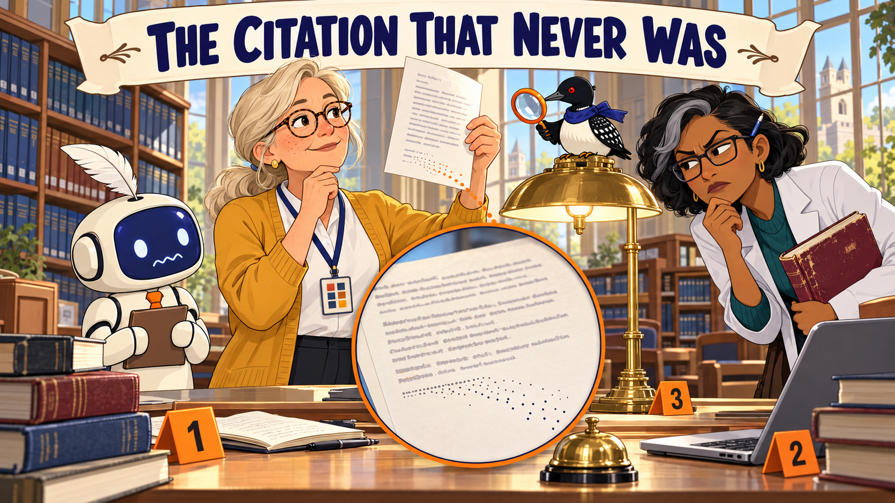

# OER Evaluator Stories

Short, lighthearted graphic-novel stories that help OER evangelists, librarians, and faculty remember how to evaluate open educational resources, with and without AI agents.

The [Story Ideas](story-ideas.md) page lists 29 planned stories. The six stories below have illustrated covers and complete panel artwork. The [Cast and Style Sheet](cast-sheet.md) keeps the characters looking the same from story to story.

## Stories

-   ### [Blue Ribbon Casserole](blue-ribbon-casserole/index.md)

    [{ loading=lazy }](blue-ribbon-casserole/index.md)

    A county-fair hotdish contest shows why a great resource that nobody can reuse, and a perfectly portable bad one, both need work.

    *Chapters 1 and 3*

-   ### [The Floor Beneath the Total](floor-beneath-the-total/index.md)

    [{ loading=lazy }](floor-beneath-the-total/index.md)

    A committee wants to adopt a textbook that scores 88, until someone points at the one metric under the floor.

    *Chapters 3 and 11*

-   ### [The Citation That Never Was](citation-that-never-was/index.md)

    [{ loading=lazy }](citation-that-never-was/index.md)

    Quill's report cites a journal article that reads perfectly, and the reference desk goes looking for it.

    *Chapters 5 and 14*

-   ### [The Tortoise, the Hare, and the Rubric](tortoise-hare-and-the-rubric/index.md)

    [{ loading=lazy }](tortoise-hare-and-the-rubric/index.md)

    One colleague reviews five textbooks by hand and another uses an agent, and the best review turns out to need both.

    *Chapters 11 to 14*

-   ### [Minnesota Nice Is Not a Scoring Method](minnesota-nice-scoring/index.md)

    [{ loading=lazy }](minnesota-nice-scoring/index.md)

    Five very polite reviewers score everything between 7 and 9, and learn to disagree out loud.

    *Chapters 3, 11, and 14*

-   ### [The Lake Effect Workshop](lake-effect-workshop/index.md)

    [{ loading=lazy }](lake-effect-workshop/index.md)

    Five OER evangelists from five Minnesota campuses build a one-day workshop together, and then a blizzard arrives.

    *Chapters 11, 12, 14, and 19*

