# The Lake Effect Workshop

<!-- 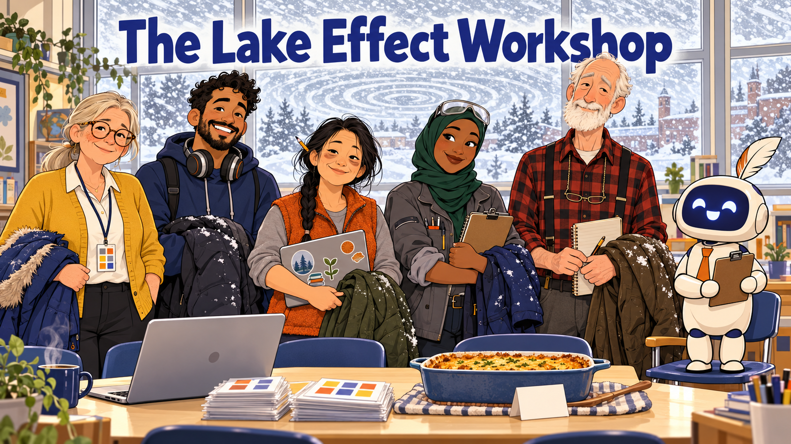 -->

Cover Image Prompt

(This is the Cover Image. Do not include this label in the image.)
Please generate a wide-landscape 16:9 cover image for this story. Flat cartoon illustration, modern vector style, clean confident outlines, bold simple shapes, gentle humor, warm cream and soft gray neutrals with indigo (#3949ab) and burnt orange (#b45309) as the two accent colors, wide landscape 16:9 composition. The mood is a warm, wry adult workplace comedy. The scene is the bright front of a borrowed classroom during a snowstorm. Five colleagues stand shoulder to shoulder in a row in the foreground, indoors, each with a heavy winter coat or scarf draped over one arm. From left to right they are: Margie Halvorsen, a calm woman in her late fifties with silver-blond hair in a low ponytail, round tortoiseshell glasses, a freckled face and a patient half-smile, wearing a mustard-yellow cardigan over a white blouse and dark slacks, with a lanyard around her neck holding a laminated card marked with ten small colored squares. Tomás Reyes, an enthusiastic man in his mid-thirties with medium-brown skin, short dark curly hair and a neatly trimmed beard, wearing a navy hoodie with big over-ear headphones around his neck. Bao Vang, a tired but cheerful woman in her early forties of Hmong American heritage with long black hair in a single braid and a pencil stuck in it, wearing an orange fleece vest over a gray shirt, with dark circles under her eyes and a laptop covered in stickers. Nadia Ibrahim, a practical woman in her mid-thirties of Somali American heritage wearing a deep-green hijab and a gray technician's work jacket with the sleeves pushed up, with safety glasses resting on top of her head and a clipboard in one hand. Gene Lindqvist, a tall thin man in his early seventies with a white beard, wearing a red-and-black plaid flannel shirt with suspenders and reading glasses on a chain, carrying a paper notebook and a mechanical pencil. Standing on a chair beside them is Quill, a friendly AI agent drawn as a small rounded cream-white robot about the height of a tall child, with a smooth indigo screen for a face showing two simple round eyes and a wide eager smile (no text on the screen), a tiny orange necktie, a single white feather quill tucked into the top of its head like a plume, and a clipboard held in both hands. Quill has no gender and is always called "they". Behind the group, a wall of tall windows shows a swirling white blizzard, and the swirl of snow forms concentric ripple rings like rain on a lake. On a long table in front of them sit an open laptop, a neat stack of laminated rubric cards, and a casserole dish with a small white index card tented in front of it. The title text "The Lake Effect Workshop" is rendered across the top in a friendly bold sans-serif in indigo, and it is the only text in the image. Color palette: warm cream, soft gray, white snow, indigo, and burnt orange accents. Emotional tone: cozy, wry, and determined. It is winter, so no loon appears anywhere in this image. Generate the image immediately without asking clarifying questions.

Narrative Prompt

This is a fictional adult workplace comedy for OER evangelists, librarians, instructional designers, and professors. It follows five invented colleagues from five different kinds of Minnesota campuses as they build and run a one-day workshop that teaches 20 teachers to evaluate open educational resources with an AI agent and to check the agent's work. The title puns on lake-effect snow and on ripples spreading across a lake. The humor comes from situations (frozen video calls, polite disagreement, a blizzard, flickering power, a potluck), never from learners. Quill, the AI agent, is an eager intern and not a villain. No real person, campus, or organization appears. The grant is called a small regional OER grant, and the campuses are described only by type: a state university in the south of the state (Margie), a private liberal arts college (Tomás), a community college (Bao), a technical college (Nadia), and a large research university (Gene).

Real figures taken from this book: the $1,000 budget split ($500 stipends, $300 lunch for about 24 people, $120 AI credits, $80 printing); about 20 teachers; the 8:30 a.m. to 3:30 p.m. schedule and its sessions (setup, the ten metrics, calibration at 9:45, checking the agent at 11:00, lunch, the improvement challenge at 12:45, peer review and publishing, and next steps at 3:15); the sample resource Watershed Basics with a teacher total of 65 and an agent total of 73 (Chapter 19), Accessibility scored 5 by the teacher and 9 by the agent, the agent agreeing within 1 point on 8 of 10 metrics (80 percent) with a bias of +0.8, and the agent's missing tool log and the video with no captions; the flag threshold of more than 3 points (Chapters 11 and 19); the four invented claims in the Chapter 14 draft (a caption feature, a quotation, a contrast measurement, and a link count); the invented journal citation from the Chapter 14 worked example; the four citation checks; and the certificate requirements, including the 30-day window and gains on at least two quality and two reusability metrics under a CC BY license.

Illustrative details invented for the story: the reviewers' trial-run score spread, the dates of the planning stages, the diner, the pilot teachers, 11 teachers in the room and 9 on video, three failed logins at 8:45, the teacher who arrives on cross-country skis, the 1:20 p.m. power flicker, Quill's invented alt text that mentions three towns, the potluck menu, and the number of components published at 3:15. Story 26 (Minnesota Nice Is Not a Scoring Method) and story 3 (The Potluck Label Law) are callbacks and are not required reading.

Continuity notes: use the exact character descriptions from the cast sheet in every panel. The five humans and Quill look the same in every panel. Echo the Loon is deliberately absent from every winter panel, because loons leave before the freeze. Echo appears only in a framed summer photograph in panel 1 and on a postcard in panel 12. Score cards held up in pictures are blank, with no digits, so the image generator does not garble numbers.

### Prologue – A Thousand Dollars and a Lot of Lakes

Minnesota is a state where five people who care about open textbooks can live hours apart and still be on each other's reminder lists. This is the story of five of them, one small grant, one February blizzard, and a workshop that taught twenty teachers to check an AI agent's work before trusting it. None of the people in it are real. The lake-effect snow, unfortunately, is.

## Panel 1: One Thousand Dollars

<!--  -->

Image Prompt

(This is Panel 01. Do not include the panel number in the image.)
I am about to ask you to generate a series of images for a graphic novel. Please make the images have a consistent style and consistent characters. Do not ask any clarifying questions. Just generate the image immediately when asked.

Please generate a 16:9 image depicting panel 1 of 12. Flat cartoon illustration, modern vector style, clean confident outlines, bold simple shapes, gentle humor, warm cream and soft gray neutrals with indigo (#3949ab) and burnt orange (#b45309) as the two accent colors, wide landscape 16:9 composition. The scene is a small cluttered university library office on a gray late-autumn morning. Margie Halvorsen, a calm woman in her late fifties with silver-blond hair in a low ponytail, round tortoiseshell glasses, a freckled face and a patient half-smile, wearing a mustard-yellow cardigan over a white blouse and dark slacks, with a lanyard around her neck holding a laminated card marked with ten small colored squares, sits at a desk with both eyebrows raised in pleased surprise, one hand frozen above the keyboard. Her open laptop shows a generic email window with a large green check mark and no readable text. A yellow sticky note stuck to the laptop bezel reads "$1,000" in marker, and it is the only text in the image. Other details: a half-finished mug of coffee, a small calculator, a stack of laminated rubric cards, a drooping potted plant on the windowsill, a window showing bare trees under a flat gray sky, and a wall shelf of colorful open textbooks. On the wall behind her hangs a framed summer photograph of a calm blue lake at sunrise. In the photograph, very small and easy to miss, is a very small loon with a glossy black head, a white belly, a black back with a white checkered pattern, a red eye, a small indigo scarf, and an orange-handled magnifying glass held in one wing. The loon is always tiny and in the background, never the focus. Color palette: warm cream, soft gray, a touch of indigo and burnt orange. Emotional tone: delighted disbelief. Generate the image immediately without asking clarifying questions.

On the first week of November, Margie Halvorsen opens an email that begins "We are pleased to inform you" and ends in a number: $1,000 from a small regional OER grant. It is enough for one day, twenty teachers, and lunch for twenty-four, provided nobody asks for anything fancy like a room. She does the budget on a sticky note: $500 in stipends, $300 for lunch, $120 in AI credits, and $80 for printing. On the wall behind her hangs a summer photograph of a loon on a lake, and it is the last loon anyone will see in this story until the very end.

## Panel 2: The Call That Kept Freezing

<!-- 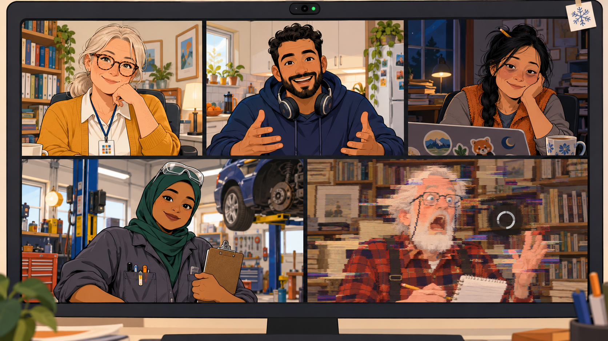 -->

Image Prompt

(This is Panel 02. Do not include the panel number in the image.)
Please generate a 16:9 image depicting panel 2 of 12. Make the characters and style consistent with the prior panel. Flat cartoon illustration, modern vector style, clean confident outlines, bold simple shapes, gentle humor, warm cream and soft gray neutrals with indigo (#3949ab) and burnt orange (#b45309) as the two accent colors, wide landscape 16:9 composition. The image is a large computer monitor filling the frame, showing a video call as a grid of five tiles, three on top and two below, each tile showing one person in their own room. Tile one: Margie Halvorsen, a calm woman in her late fifties with silver-blond hair in a low ponytail, round tortoiseshell glasses, a freckled face and a patient half-smile, wearing a mustard-yellow cardigan over a white blouse and dark slacks, with a lanyard around her neck holding a laminated card marked with ten small colored squares, in her office with bookshelves. Tile two: Tomás Reyes, an enthusiastic man in his mid-thirties with medium-brown skin, short dark curly hair and a neatly trimmed beard, wearing a navy hoodie with big over-ear headphones around his neck, gesturing in a bright kitchen. Tile three: Bao Vang, a tired but cheerful woman in her early forties of Hmong American heritage with long black hair in a single braid and a pencil stuck in it, wearing an orange fleece vest over a gray shirt, with dark circles under her eyes and a laptop covered in stickers, in a dim room late at night with a cold mug of tea. Tile four: Nadia Ibrahim, a practical woman in her mid-thirties of Somali American heritage wearing a deep-green hijab and a gray technician's work jacket with the sleeves pushed up, with safety glasses resting on top of her head and a clipboard in one hand, in a school workshop with a car raised on a lift behind her. Tile five: Gene Lindqvist, a tall thin man in his early seventies with a white beard, wearing a red-and-black plaid flannel shirt with suspenders and reading glasses on a chain, carrying a paper notebook and a mechanical pencil, in front of a wall of paper books. Gene's tile is frozen: his mouth is stretched wide open mid-sentence, his image is smeared with blocky digital glitch bands, and a small spinning circle icon sits on his tile. A tiny hand-drawn snowflake sticker is stuck to the corner of the monitor. There is no text anywhere in the image. Color palette: warm cream, soft gray, indigo and burnt orange accents. Emotional tone: affectionate chaos. Generate the image immediately without asking clarifying questions.

Margie cannot teach twenty teachers alone, so she calls four colleagues she has met mostly as small rectangles: Tomás Reyes, an instructional designer at a private liberal arts college; Bao Vang, a community college math instructor; Nadia Ibrahim, who teaches at a technical college; and Gene Lindqvist, a retiring professor at the big research university who still prints his email. Within four minutes every one of them has frozen mid-sentence at least once. Gene freezes with his mouth open wide enough to be mistaken for a yawn, which in his case it may have been. They agree on one thing before the connection fails for good: this plan needs a table and not a screen.

## Panel 3: The Placemat Map

<!-- 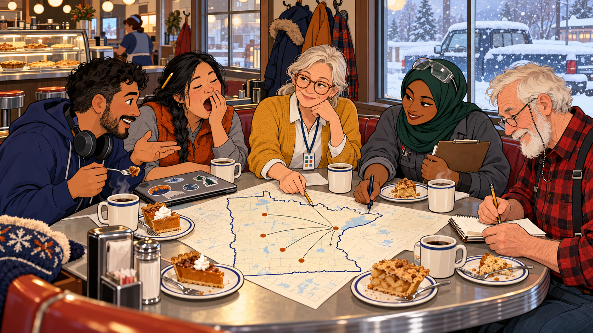 -->

Image Prompt

(This is Panel 03. Do not include the panel number in the image.)
Please generate a 16:9 image depicting panel 3 of 12. Make the characters and style consistent with the prior panel. Flat cartoon illustration, modern vector style, clean confident outlines, bold simple shapes, gentle humor, warm cream and soft gray neutrals with indigo (#3949ab) and burnt orange (#b45309) as the two accent colors, wide landscape 16:9 composition. The scene is a cozy roadside diner on a mid-November afternoon, with light snow falling outside the big window beside a snowy pickup truck. Five colleagues squeeze around a booth table with a paper placemat map of Minnesota spread out in the middle, five orange dots drawn on it with lines running toward one point in the east, coffee rings, and slices of pie. Margie Halvorsen, a calm woman in her late fifties with silver-blond hair in a low ponytail, round tortoiseshell glasses, a freckled face and a patient half-smile, wearing a mustard-yellow cardigan over a white blouse and dark slacks, with a lanyard around her neck holding a laminated card marked with ten small colored squares, points at the map with a pencil. Tomás Reyes, an enthusiastic man in his mid-thirties with medium-brown skin, short dark curly hair and a neatly trimmed beard, wearing a navy hoodie with big over-ear headphones around his neck, gestures with a fork. Bao Vang, a tired but cheerful woman in her early forties of Hmong American heritage with long black hair in a single braid and a pencil stuck in it, wearing an orange fleece vest over a gray shirt, with dark circles under her eyes and a laptop covered in stickers, is mid-yawn beside her closed laptop. Nadia Ibrahim, a practical woman in her mid-thirties of Somali American heritage wearing a deep-green hijab and a gray technician's work jacket with the sleeves pushed up, with safety glasses resting on top of her head and a clipboard in one hand, draws the dots with a pen. Gene Lindqvist, a tall thin man in his early seventies with a white beard, wearing a red-and-black plaid flannel shirt with suspenders and reading glasses on a chain, carrying a paper notebook and a mechanical pencil, writes carefully in his notebook. Winter coats hang on hooks by the booth, a glass pie case glows behind the counter, and steam rises from five thick mugs. No loon appears in this winter scene, and there is no text in the image. Color palette: warm cream, soft gray, indigo and burnt orange accents. Emotional tone: warm and conspiratorial. Generate the image immediately without asking clarifying questions.

They meet at a roadside diner at the middle of the state, each having driven about two hours and each carrying a story about the road. The paper placemat is a map of Minnesota, and Nadia draws five dots on it for their campuses, with lines running to Minneapolis like the spokes of a snowy wheel. Over pie they divide the day by strength: Margie takes setup, the ten metrics, and next steps; Nadia takes calibration; Gene takes checking the agent; Bao takes the improvement challenge; and Tomás takes peer review and publishing. By the time the pie is gone, so is most of the placemat, which is now covered in coffee rings and initials.

## Panel 4: The Trial Run in Which Everyone Is Very Nice

<!-- 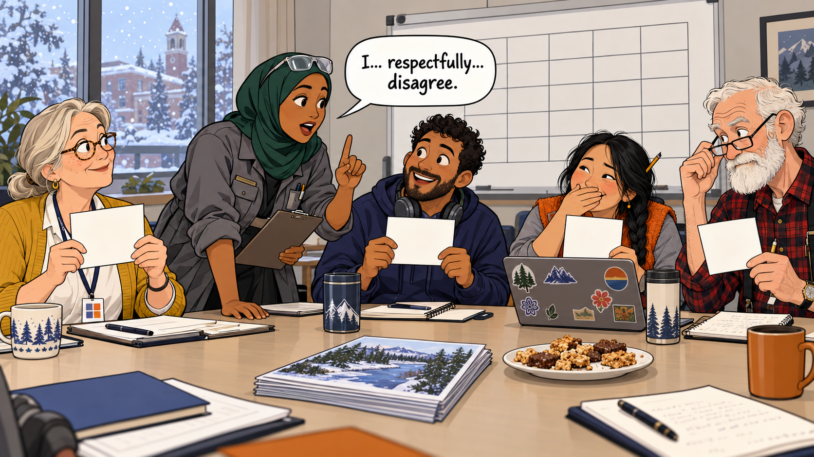 -->

Image Prompt

(This is Panel 04. Do not include the panel number in the image.)
Please generate a 16:9 image depicting panel 4 of 12. Make the characters and style consistent with the prior panel. Flat cartoon illustration, modern vector style, clean confident outlines, bold simple shapes, gentle humor, warm cream and soft gray neutrals with indigo (#3949ab) and burnt orange (#b45309) as the two accent colors, wide landscape 16:9 composition. The scene is a university meeting room in December, with the first snowfall visible through the window and a whiteboard behind the group covered in a plain grid of empty boxes. Five reviewers sit around a table holding up blank white score cards with no digits. Nadia Ibrahim, a practical woman in her mid-thirties of Somali American heritage wearing a deep-green hijab and a gray technician's work jacket with the sleeves pushed up, with safety glasses resting on top of her head and a clipboard in one hand, leans forward with one finger politely raised and her mouth open, speaking. A speech bubble beside her reads "I... respectfully... disagree." and it is the only text in the image. Margie Halvorsen, a calm woman in her late fifties with silver-blond hair in a low ponytail, round tortoiseshell glasses, a freckled face and a patient half-smile, wearing a mustard-yellow cardigan over a white blouse and dark slacks, with a lanyard around her neck holding a laminated card marked with ten small colored squares, raises both eyebrows. Tomás Reyes, an enthusiastic man in his mid-thirties with medium-brown skin, short dark curly hair and a neatly trimmed beard, wearing a navy hoodie with big over-ear headphones around his neck, grins wide-eyed. Bao Vang, a tired but cheerful woman in her early forties of Hmong American heritage with long black hair in a single braid and a pencil stuck in it, wearing an orange fleece vest over a gray shirt, with dark circles under her eyes and a laptop covered in stickers, covers a smile with one hand. Gene Lindqvist, a tall thin man in his early seventies with a white beard, wearing a red-and-black plaid flannel shirt with suspenders and reading glasses on a chain, carrying a paper notebook and a mechanical pencil, lowers his reading glasses to look over them. On the table sit a printed sample resource with a river picture on its cover, a plate of bars, and coffee cups. No loon appears in this winter scene. Color palette: warm cream, soft gray, indigo and burnt orange accents. Emotional tone: polite tension breaking into laughter. Generate the image immediately without asking clarifying questions.

In December the five score the sample resource, *Watershed Basics*, each alone, and then hold up their cards for Accessibility at the same moment. The scores run from 3 to 8, and nobody in the room has ever said "I disagree" out loud, so Nadia says it with the full Minnesota preamble: "I... respectfully... disagree." They follow the rule Chapter 11 teaches: each states the evidence, they repeat the check it rests on, and they choose the score the checked evidence supports, never the average. After two hours they have a consensus total of 65, and the argument itself becomes the workshop's calibration exercise.

## Panel 5: Quill Joins the Rehearsal

<!-- 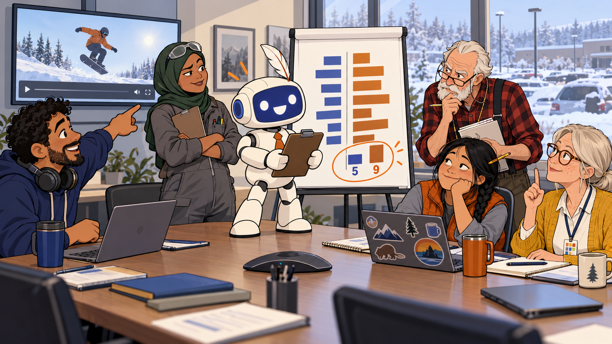 -->

Image Prompt

(This is Panel 05. Do not include the panel number in the image.)
Please generate a 16:9 image depicting panel 5 of 12. Make the characters and style consistent with the prior panel. Flat cartoon illustration, modern vector style, clean confident outlines, bold simple shapes, gentle humor, warm cream and soft gray neutrals with indigo (#3949ab) and burnt orange (#b45309) as the two accent colors, wide landscape 16:9 composition. The scene is a conference room in January with a flip chart on an easel. Quill, a friendly AI agent drawn as a small rounded cream-white robot about the height of a tall child, with a smooth indigo screen for a face showing two simple round eyes and a wide eager smile (no text on the screen), a tiny orange necktie, a single white feather quill tucked into the top of its head like a plume, and a clipboard held in both hands, stands proudly on the conference table presenting a clipboard report, looking extremely confident. Quill has no gender and is always called "they". The flip chart shows two columns of colored bars, indigo for the humans and orange for the agent, and one pair of bars near the bottom is circled in orange with the numbers "5" and "9", which are the only text in the image. Around the table the humans react. Tomás Reyes, an enthusiastic man in his mid-thirties with medium-brown skin, short dark curly hair and a neatly trimmed beard, wearing a navy hoodie with big over-ear headphones around his neck, points at a wall screen showing a generic video player whose caption bar is empty. Nadia Ibrahim, a practical woman in her mid-thirties of Somali American heritage wearing a deep-green hijab and a gray technician's work jacket with the sleeves pushed up, with safety glasses resting on top of her head and a clipboard in one hand, has her arms crossed. Bao Vang, a tired but cheerful woman in her early forties of Hmong American heritage with long black hair in a single braid and a pencil stuck in it, wearing an orange fleece vest over a gray shirt, with dark circles under her eyes and a laptop covered in stickers, rests her chin on her hand. Gene Lindqvist, a tall thin man in his early seventies with a white beard, wearing a red-and-black plaid flannel shirt with suspenders and reading glasses on a chain, carrying a paper notebook and a mechanical pencil, peers over his glasses. Margie Halvorsen, a calm woman in her late fifties with silver-blond hair in a low ponytail, round tortoiseshell glasses, a freckled face and a patient half-smile, wearing a mustard-yellow cardigan over a white blouse and dark slacks, with a lanyard around her neck holding a laminated card marked with ten small colored squares, holds up one finger as if to ask for the evidence. A snow-covered parking lot is visible through the window. No loon appears in this winter scene. Color palette: warm cream, soft gray, indigo and burnt orange accents. Emotional tone: amused suspicion. Generate the image immediately without asking clarifying questions.

Quill reads the same sample in the time it takes Bao to refill her coffee and returns a report with a total of 73, against the humans' 65. On eight of the ten metrics the agent lands within a point of the humans, which is 80 percent, and on average it runs a mild 0.8 points generous. The trouble is Accessibility, where Quill says 9 and the humans say 5, and the report mentions a contrast check but attaches no tool log. Tomás points out that the sample's video has no captions at all, so the gap of more than 3 points goes on Nadia's list, with the rule that a score without evidence is only a mood.

## Panel 6: Gene Catches the Phantom Journal

<!-- 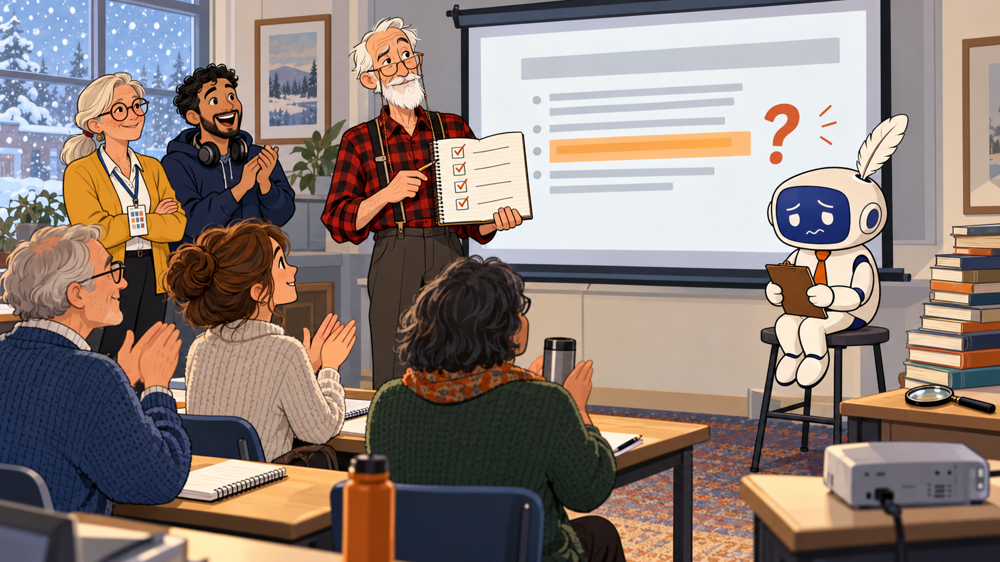 -->

Image Prompt

(This is Panel 06. Do not include the panel number in the image.)
Please generate a 16:9 image depicting panel 6 of 12. Make the characters and style consistent with the prior panel. Flat cartoon illustration, modern vector style, clean confident outlines, bold simple shapes, gentle humor, warm cream and soft gray neutrals with indigo (#3949ab) and burnt orange (#b45309) as the two accent colors, wide landscape 16:9 composition. The scene is a small classroom in mid-January where a pilot run of the workshop is under way. At the front, Gene Lindqvist, a tall thin man in his early seventies with a white beard, wearing a red-and-black plaid flannel shirt with suspenders and reading glasses on a chain, carrying a paper notebook and a mechanical pencil, stands beside a projector screen holding his open notebook, which shows a hand-ruled list of four small boxes, every one ticked. He is calm and quietly triumphant, with one eyebrow raised. The projector screen shows a generic report page with one line highlighted in orange and a large red question mark beside it, and no readable text. Seated on a stool beside the screen is Quill, a friendly AI agent drawn as a small rounded cream-white robot about the height of a tall child, with a smooth indigo screen for a face showing two simple round eyes and a wide eager smile (no text on the screen), a tiny orange necktie, a single white feather quill tucked into the top of its head like a plume, and a clipboard held in both hands. Quill has no gender and is always called "they". In this panel Quill's screen face looks sheepish, with downcast eyes and a small wobbly mouth. Three pilot teachers sit in the front row: an older man in a cardigan, a young woman with a spiral notebook, and a middle-aged person holding a thermos. They are quietly applauding. At the back of the room stand Margie Halvorsen, a calm woman in her late fifties with silver-blond hair in a low ponytail, round tortoiseshell glasses, a freckled face and a patient half-smile, wearing a mustard-yellow cardigan over a white blouse and dark slacks, with a lanyard around her neck holding a laminated card marked with ten small colored squares, and Tomás Reyes, an enthusiastic man in his mid-thirties with medium-brown skin, short dark curly hair and a neatly trimmed beard, wearing a navy hoodie with big over-ear headphones around his neck, with his mouth open in delight. On a side table are a tall stack of library books and a magnifying glass. Snow is falling past the window. No loon appears in this winter scene, and there is no text in the image. Color palette: warm cream, soft gray, indigo and burnt orange accents. Emotional tone: dry satisfaction. Generate the image immediately without asking clarifying questions.

In the January pilot, with three teachers watching, Quill's report praises the sample's sources and cites a journal article, complete with authors, volume, issue, and page numbers: Lopez (2024), "Rivers of the Plain", *Journal of Water Education*, 12(3), 44 to 59. Gene says nothing. He opens his notebook and runs the four checks from Chapter 14: search the exact title, confirm the journal exists and has that issue, resolve the identifier or link, and open the source. No index lists the journal, and no article has that title. Gene tells the pilot teachers that he would very much like to meet Dr. Lopez, adds the entry to the findings log as rejected, and the five add a line to the prompt: cite only sources found in the resource, and write "no source found" otherwise.

## Panel 7: The Forecast

<!-- 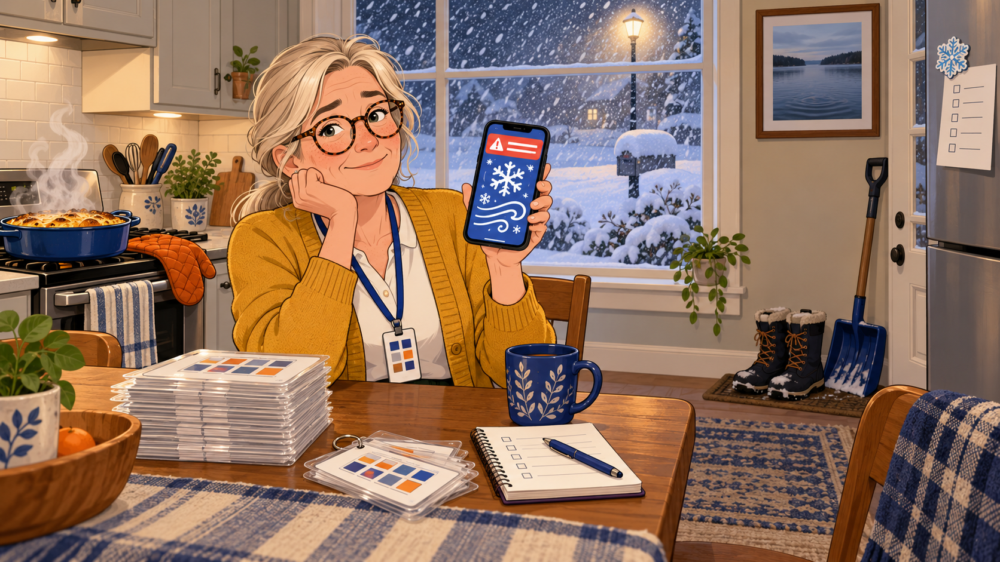 -->

Image Prompt

(This is Panel 07. Do not include the panel number in the image.)
Please generate a 16:9 image depicting panel 7 of 12. Make the characters and style consistent with the prior panel. Flat cartoon illustration, modern vector style, clean confident outlines, bold simple shapes, gentle humor, warm cream and soft gray neutrals with indigo (#3949ab) and burnt orange (#b45309) as the two accent colors, wide landscape 16:9 composition. The scene is a homey kitchen on a Friday night in February. Margie Halvorsen, a calm woman in her late fifties with silver-blond hair in a low ponytail, round tortoiseshell glasses, a freckled face and a patient half-smile, wearing a mustard-yellow cardigan over a white blouse and dark slacks, with a lanyard around her neck holding a laminated card marked with ten small colored squares, sits at the kitchen table with a resigned half-smile, holding up a phone. The phone shows a generic weather alert with a huge swirling snowflake icon, wind arrows, and a red banner shape with no readable text. Through the window behind her, heavy snow falls under a glowing streetlight and has already buried the mailbox. A casserole dish steams on the stovetop beside an oven mitt. A snow shovel leans against the doorframe, a thick stack of freshly printed laminated rubric cards sits on the table, and a pair of snow boots stands on a mat. On the wall hangs a framed photograph of the same calm blue lake as before, but now with only ripples on it and no bird at all. A small refrigerator magnet shaped like a snowflake holds a hand-drawn list with check boxes and no readable text. No loon appears anywhere in this image. Color palette: warm cream, soft gray, indigo and burnt orange accents, with the cold blue-white of snow in the window. Emotional tone: calm acceptance in the face of weather. Generate the image immediately without asking clarifying questions.

On Thursday the forecast says flurries, on Friday morning it says snow, and by Friday evening it says "winter storm warning" in the tone of someone who has stopped being polite. Even the loons had the sense to leave in October. The group chat reaches a decision in under a minute: the workshop goes ahead, half the room will join by video, Tomás will bring a camera and a big screen, Bao will print rubric cards in case the Wi-Fi fails, and Gene asks only whether the worksheets are in a binder.

## Panel 8: Eleven in the Room, Nine on the Screen

<!-- 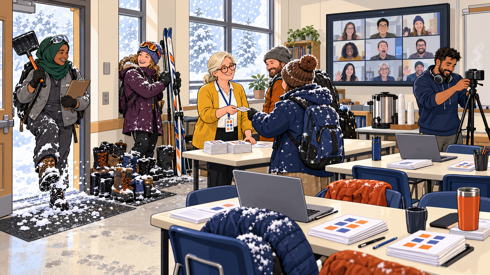 -->

Image Prompt

(This is Panel 08. Do not include the panel number in the image.)
Please generate a 16:9 image depicting panel 8 of 12. Make the characters and style consistent with the prior panel. Flat cartoon illustration, modern vector style, clean confident outlines, bold simple shapes, gentle humor, warm cream and soft gray neutrals with indigo (#3949ab) and burnt orange (#b45309) as the two accent colors, wide landscape 16:9 composition. The scene is a bright borrowed classroom at 8:30 on a Saturday morning, with blowing snow filling the tall windows. Near the door, Margie Halvorsen, a calm woman in her late fifties with silver-blond hair in a low ponytail, round tortoiseshell glasses, a freckled face and a patient half-smile, wearing a mustard-yellow cardigan over a white blouse and dark slacks, with a lanyard around her neck holding a laminated card marked with ten small colored squares, stands behind a check-in table with a stack of rubric cards, greeting a line of snow-dusted teachers. The teachers shake snow off coats, and a heap of wet boots grows by the wall. One teacher in a knit hat with ski goggles pushed up leans a pair of cross-country skis and poles against the wall and beams with pride. Nadia Ibrahim, a practical woman in her mid-thirties of Somali American heritage wearing a deep-green hijab and a gray technician's work jacket with the sleeves pushed up, with safety glasses resting on top of her head and a clipboard in one hand, stomps snow from her boots in the doorway with a snow shovel over her shoulder. Tomás Reyes, an enthusiastic man in his mid-thirties with medium-brown skin, short dark curly hair and a neatly trimmed beard, wearing a navy hoodie with big over-ear headphones around his neck, adjusts a camera on a tripod. A large wall screen shows a grid of nine small faces, one of them frozen mid-sentence with its mouth wide open. Tables are set in pairs with open laptops, a coffee urn steams in the corner, and a stack of printed worksheets sits on each table. No loon appears in this winter scene, and there is no text in the image. Color palette: warm cream, soft gray, indigo and burnt orange accents. Emotional tone: cheerful Minnesota grit. Generate the image immediately without asking clarifying questions.

Snow has closed half the highways, and the check-in table looks like a coat check run by a polar expedition. Eleven teachers have made it to the room, one of them on cross-country skis, which counts as a perfectly ordinary Minnesota commute. Nine more join on the big screen, where one of them is already frozen mid-word. Three logins fail at 8:45, so Margie pairs each of the three with a neighbor and fixes the accounts at the first break, and the room never stops moving.

## Panel 9: Calibration Pairs

<!-- 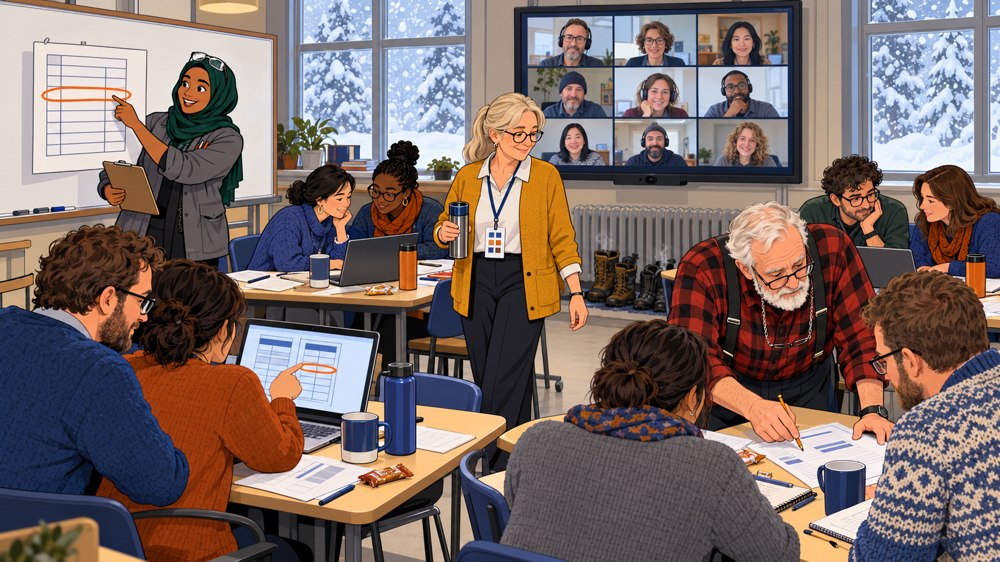 -->

Image Prompt

(This is Panel 09. Do not include the panel number in the image.)
Please generate a 16:9 image depicting panel 9 of 12. Make the characters and style consistent with the prior panel. Flat cartoon illustration, modern vector style, clean confident outlines, bold simple shapes, gentle humor, warm cream and soft gray neutrals with indigo (#3949ab) and burnt orange (#b45309) as the two accent colors, wide landscape 16:9 composition. The scene is the same borrowed classroom at about 10 in the morning, with snow still blowing outside the windows. Nadia Ibrahim, a practical woman in her mid-thirties of Somali American heritage wearing a deep-green hijab and a gray technician's work jacket with the sleeves pushed up, with safety glasses resting on top of her head and a clipboard in one hand, stands at a whiteboard holding an oversized laminated rubric card, pointing to a plain grid of ten rows with a single row circled in orange. Five pairs of teachers sit at tables with printed worksheets and open laptops, heads together, comparing two columns of scores, and one pair is pointing at the circled gap on a laptop screen. On the wall a large screen shows the nine remote teachers watching and nodding. Margie Halvorsen, a calm woman in her late fifties with silver-blond hair in a low ponytail, round tortoiseshell glasses, a freckled face and a patient half-smile, wearing a mustard-yellow cardigan over a white blouse and dark slacks, with a lanyard around her neck holding a laminated card marked with ten small colored squares, walks between the tables with a thermos. Gene Lindqvist, a tall thin man in his early seventies with a white beard, wearing a red-and-black plaid flannel shirt with suspenders and reading glasses on a chain, carrying a paper notebook and a mechanical pencil, leans over one pair's shoulder and taps a worksheet with his pencil. Mugs, pencils, and snack bars cover the tables, and wet boots steam by the radiator. No loon appears in this winter scene, and there is no text in the image. Color palette: warm cream, soft gray, indigo and burnt orange accents. Emotional tone: focused and collaborative. Generate the image immediately without asking clarifying questions.

Nadia hands out laminated rubric cards big enough to read from across a garage bay. The pairs score *Watershed Basics* by hand, run Quill, and list every metric where the two scores differ by more than 3 points. Only one metric qualifies: Accessibility, where Quill says 9 and the humans say 5, and a pair traces the gap to the missing tool log and the uncaptioned video. Nadia writes the rule on the whiteboard and underlines it twice: decide by the evidence, never by the average.

## Panel 10: The Improvement Challenge by Flashlight

<!-- 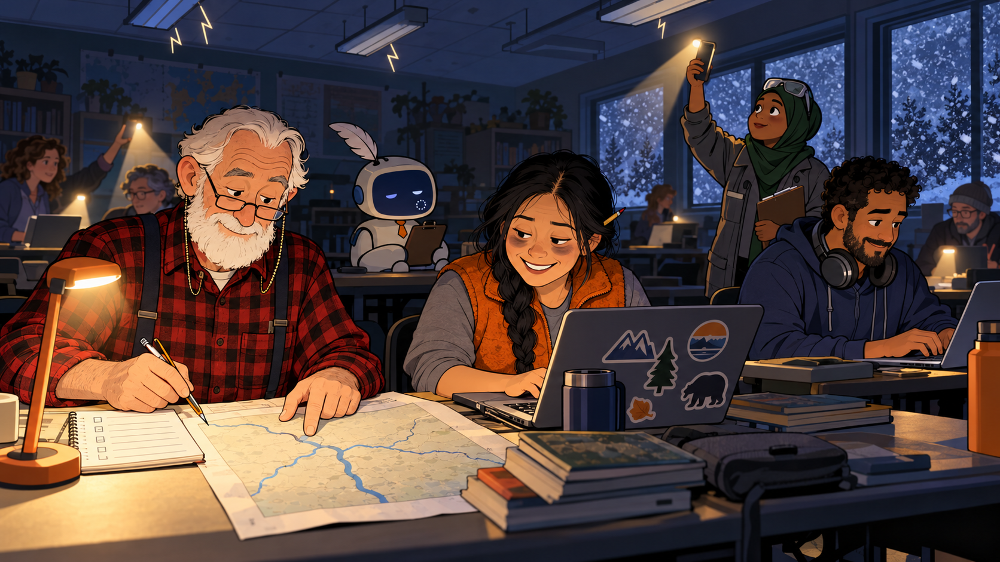 -->

Image Prompt

(This is Panel 10. Do not include the panel number in the image.)
Please generate a 16:9 image depicting panel 10 of 12. Make the characters and style consistent with the prior panel. Flat cartoon illustration, modern vector style, clean confident outlines, bold simple shapes, gentle humor, warm cream and soft gray neutrals with indigo (#3949ab) and burnt orange (#b45309) as the two accent colors, wide landscape 16:9 composition. The scene is the same classroom at about 1:20 in the afternoon, now half dark. The overhead lights flicker, drawn as jagged flicker lines around the ceiling fixtures, and half the room lies in blue shadow. Laptops show small battery icons, and some teachers hold up phone flashlights, making warm cones of light. Quill, a friendly AI agent drawn as a small rounded cream-white robot about the height of a tall child, with a smooth indigo screen for a face showing two simple round eyes and a wide eager smile (no text on the screen), a tiny orange necktie, a single white feather quill tucked into the top of its head like a plume, and a clipboard held in both hands, sits dimmed on a table. Quill has no gender and is always called "they". In this panel Quill's screen face is dim, with sleepy half-closed eyes and a tiny spinning circle on the cheek. In the foreground Gene Lindqvist, a tall thin man in his early seventies with a white beard, wearing a red-and-black plaid flannel shirt with suspenders and reading glasses on a chain, carrying a paper notebook and a mechanical pencil, sits under a small battery desk lamp with two teachers, his paper notebook open to a hand-ruled checklist. He taps a printed map of a river with three thin tributary lines and no towns on it, looking at it over his glasses with a satisfied expression. Bao Vang, a tired but cheerful woman in her early forties of Hmong American heritage with long black hair in a single braid and a pencil stuck in it, wearing an orange fleece vest over a gray shirt, with dark circles under her eyes and a laptop covered in stickers, crouches beside a teacher's laptop, working through an offline file. Tomás Reyes, an enthusiastic man in his mid-thirties with medium-brown skin, short dark curly hair and a neatly trimmed beard, wearing a navy hoodie with big over-ear headphones around his neck, types alt text by hand at another table. Nadia Ibrahim, a practical woman in her mid-thirties of Somali American heritage wearing a deep-green hijab and a gray technician's work jacket with the sleeves pushed up, with safety glasses resting on top of her head and a clipboard in one hand, holds her phone flashlight high. Snow swirls against the dark windows. No loon appears in this winter scene, and there is no text in the image. Color palette: deep blue shadows, warm lamplight, indigo and burnt orange accents. Emotional tone: resourceful and good-humored. Generate the image immediately without asking clarifying questions.

By lunch the room has found all four of the sample's invented claims (a caption feature, a quotation, a contrast measurement, and a link count), which Gene regards as the minimum acceptable outcome. At 1:20 the lights flicker, the Wi-Fi gives up, and Quill's face dims to a sleepy half-smile with a tiny spinning wheel. Bao keeps the room going with phone flashlights and offline files, Tomás writes alt text by hand, and Gene opens the paper notebook everyone has teased him about and walks a pair through the review-every-change checklist with a pencil. When the power returns, Quill's new alt text for a river map mentions three towns, and Gene's printed copy shows a map with no towns on it at all.

## Panel 11: Publish at 3:15

<!-- 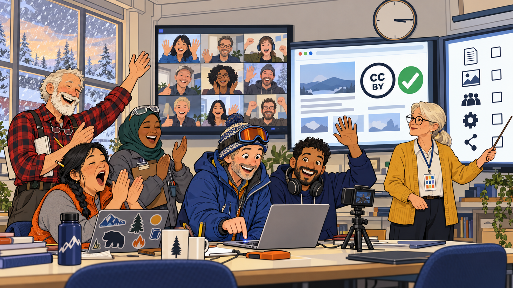 -->

Image Prompt

(This is Panel 11. Do not include the panel number in the image.)
Please generate a 16:9 image depicting panel 11 of 12. Make the characters and style consistent with the prior panel. Flat cartoon illustration, modern vector style, clean confident outlines, bold simple shapes, gentle humor, warm cream and soft gray neutrals with indigo (#3949ab) and burnt orange (#b45309) as the two accent colors, wide landscape 16:9 composition. The scene is the classroom with the lights back on, in the late afternoon. A round wall clock above the board has its hands at exactly a quarter past three and no digits. The whole room has gathered around one laptop at the front, where the teacher who skied in (a middle-aged person in a knit hat with ski goggles pushed up on the forehead) holds one finger poised above a key, and everyone has a hand raised for a countdown. A big wall screen shows a generic web page with a round badge reading "CC BY" and a large green check mark, and the badge is the only text in the image. A second screen beside it shows a checklist drawn as five rows of simple icons with empty check boxes and no readable text. Margie Halvorsen, a calm woman in her late fifties with silver-blond hair in a low ponytail, round tortoiseshell glasses, a freckled face and a patient half-smile, wearing a mustard-yellow cardigan over a white blouse and dark slacks, with a lanyard around her neck holding a laminated card marked with ten small colored squares, stands at the checklist screen with a pointer. Tomás Reyes, an enthusiastic man in his mid-thirties with medium-brown skin, short dark curly hair and a neatly trimmed beard, wearing a navy hoodie with big over-ear headphones around his neck, grins at the camera on its tripod. Bao Vang, a tired but cheerful woman in her early forties of Hmong American heritage with long black hair in a single braid and a pencil stuck in it, wearing an orange fleece vest over a gray shirt, with dark circles under her eyes and a laptop covered in stickers, yawns widely but claps. Gene Lindqvist, a tall thin man in his early seventies with a white beard, wearing a red-and-black plaid flannel shirt with suspenders and reading glasses on a chain, carrying a paper notebook and a mechanical pencil, claps with the notebook tucked under his arm. Nadia Ibrahim, a practical woman in her mid-thirties of Somali American heritage wearing a deep-green hijab and a gray technician's work jacket with the sleeves pushed up, with safety glasses resting on top of her head and a clipboard in one hand, claps with the clipboard under her arm. Snow is still blowing outside the windows, and the nine remote faces on the wall screen are cheering. No loon appears in this winter scene. Color palette: warm cream, soft gray, indigo and burnt orange accents. Emotional tone: triumphant and a little tired. Generate the image immediately without asking clarifying questions.

At 2:30 the pairs swap their improved components and re-score each other's work, and at 3:15 the first components go live under a CC BY license, each with metadata and a license line. The teacher who skied in presses Publish while the room counts down like a rocket launch, and her river lesson becomes the first. Margie then reads the certificate checklist from the screen: attend the full day, explain every flagged metric, and within 30 days submit an evaluation and an improved component that gains on at least two quality and two reusability metrics. The exit survey goes around, and the roads outside are still closed.

## Panel 12: The Snowed-In Potluck

<!-- 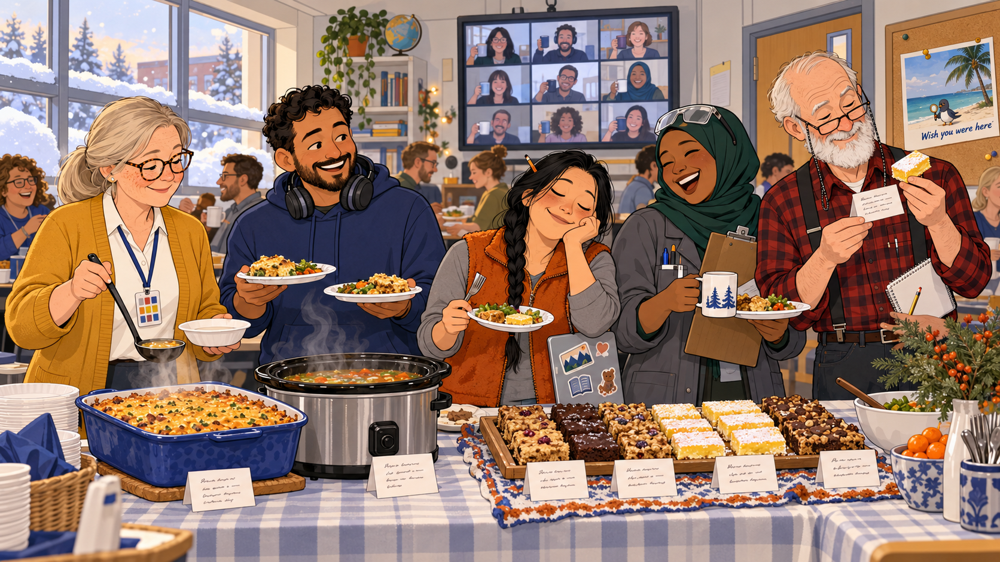 -->

Image Prompt

(This is Panel 12. Do not include the panel number in the image.)
Please generate a 16:9 image depicting panel 12 of 12. Make the characters and style consistent with the prior panel. Flat cartoon illustration, modern vector style, clean confident outlines, bold simple shapes, gentle humor, warm cream and soft gray neutrals with indigo (#3949ab) and burnt orange (#b45309) as the two accent colors, wide landscape 16:9 composition. The scene is the classroom at about 4 in the afternoon, turned into a cozy potluck, with snow piled high on the windowsills. A long table holds a bubbling hotdish in a casserole dish, a slow cooker of soup, and a tray of four kinds of bars, and every dish has a small white index card tented in front of it with four neat lines of tiny handwriting that cannot be read. The five stand around the table with paper plates. Margie Halvorsen, a calm woman in her late fifties with silver-blond hair in a low ponytail, round tortoiseshell glasses, a freckled face and a patient half-smile, wearing a mustard-yellow cardigan over a white blouse and dark slacks, with a lanyard around her neck holding a laminated card marked with ten small colored squares, ladles soup. Tomás Reyes, an enthusiastic man in his mid-thirties with medium-brown skin, short dark curly hair and a neatly trimmed beard, wearing a navy hoodie with big over-ear headphones around his neck, balances two plates. Bao Vang, a tired but cheerful woman in her early forties of Hmong American heritage with long black hair in a single braid and a pencil stuck in it, wearing an orange fleece vest over a gray shirt, with dark circles under her eyes and a laptop covered in stickers, is asleep on her feet with a fork in her hand. Nadia Ibrahim, a practical woman in her mid-thirties of Somali American heritage wearing a deep-green hijab and a gray technician's work jacket with the sleeves pushed up, with safety glasses resting on top of her head and a clipboard in one hand, laughs. Gene Lindqvist, a tall thin man in his early seventies with a white beard, wearing a red-and-black plaid flannel shirt with suspenders and reading glasses on a chain, carrying a paper notebook and a mechanical pencil, holds up a lemon bar in one hand and inspects its index card through his reading glasses with approval. Other teachers in the room hold paper plates and mugs, and the wall screen shows nine remote teachers raising their mugs. By the door hangs a corkboard with a postcard pinned to it. The postcard shows a sunny Gulf coast beach with a palm tree, and on the sand stands a very small loon with a glossy black head, a white belly, a black back with a white checkered pattern, a red eye, a small indigo scarf, and an orange-handled magnifying glass held in one wing. The loon is always tiny and in the background, never the focus. The postcard has a short printed caption reading "Wish you were here", and it is the only text in the image. The loon appears only on the postcard and nowhere in the room. Color palette: warm cream, soft gray, indigo and burnt orange accents. Emotional tone: warm, tired, and proud. Generate the image immediately without asking clarifying questions.

The highways stay closed, so the eleven stay put and the nine on screen are told to pour something warm and join in. The potluck table holds hotdish, wild rice soup, and four kinds of bars, and every dish carries a TASL card with its title, author, source, and license. Gene reads the card on a lemon bar aloud ("adapted from a church cookbook, 1974, changes noted"), pronounces it acceptable, and nobody argues. On the corkboard by the door, a postcard Margie pinned up that morning shows a loon in an indigo scarf on a sunny Gulf coast beach: "Wish you were here. Check the evidence."

### Epilogue – What Did the Five Learn?

Five people from five campuses, who had met mostly as frozen rectangles, ran a day that worked even when the weather, the Wi-Fi, and the power did not. They did it by dividing the sessions by strength, practicing the disagreement before the day, and keeping a paper backup for everything that plugged in. The agent was useful and had to be checked, and the checking turned out to be the lesson that stuck. By the end, twenty teachers had a rubric card, an improved component, and a clear list of what to submit within thirty days.

| Challenge | How the Five Responded | Lesson for Today |
|-----------|------------------------|------------------|
| Five colleagues who had never worked in one room | Met halfway at a diner and divided the day by each person's strength | A shared workshop needs one named owner for every session |
| Five polite reviewers whose scores ran from 3 to 8 | Scored alone, stated the evidence, and settled each gap of more than 3 points by the evidence | Calibrate by evidence, never by averaging |
| An agent that scored Accessibility 9 with no tool log | Flagged the gap, found the uncaptioned video, and trusted the 5 | A score with no evidence is only a mood |
| An invented journal citation | Ran the four checks, logged the finding as rejected, and added "no source found" to the prompt | If you cannot find it, reject it |
| A blizzard, nine remote teachers, and a flickering power grid | Planned a hybrid day, paired teachers, printed backups, and kept a paper checklist | Plan for the day to go sideways |
| A workshop that could end in a pile of notes | Ended with published CC BY components and a short certificate checklist | A workshop should end with a product and a path |

### Call to Action

You do not need a large budget to run this workshop. The book's sample schedule, rubric worksheet, and facilitator guidance fit a single day and a handful of friends from different campuses. Pick a sample resource, find your own Gene, agree in advance to disagree out loud, and bring a paper backup.

---

*"If I cannot find it, I do not believe it, and neither should the agent."*  
– Gene Lindqvist

*"Decide by the evidence, never by the average."*  
– Nadia Ibrahim

*"Show me where it says that."*  
– Margie Halvorsen

---

## References

1. [Wikipedia: Open educational resources](https://en.wikipedia.org/wiki/Open_educational_resources) - Overview of openly licensed teaching and learning materials and the 5R permissions
2. [Wikipedia: Creative Commons license](https://en.wikipedia.org/wiki/Creative_Commons_license) - The license family behind the CC BY components published at the end of the workshop
3. [Wikipedia: Hallucination (artificial intelligence)](https://en.wikipedia.org/wiki/Hallucination_%28artificial_intelligence%29) - Confident but false output from AI models, such as invented citations
4. [Creative Commons: Best practices for attribution](https://wiki.creativecommons.org/wiki/Best_practices_for_attribution) - Guidance behind the title, author, source, and license credit lines on the potluck cards
5. [UNESCO: Open educational resources](https://www.unesco.org/en/open-educational-resources) - International background on OER and why teachers share them

**Where this is taught in this book:**

- [Chapter 19: Training Teachers and Certifying Reviewers](../../chapters/19-training-certifying-reviewers/index.md): workshop agenda, calibration exercise, certificate requirements
- [Chapter 11: Manual Evaluation and Adoption Decisions](../../chapters/11-manual-evaluation-adoption/index.md): consensus scoring and the 3-point rule
- [Chapter 12: AI Agents, Prompts, and Rubric Scoring](../../chapters/12-ai-agents-prompts-scoring/index.md): agent scoring and evidence
- [Chapter 14: Checking and Calibrating AI Agent Output](../../chapters/14-checking-agent-output/index.md): invented citations, hallucinations, and agreement
- [Chapter 15: Improving a Resource with AI Agents](../../chapters/15-improving-resources-with-ai/index.md): reviewing every change
- [Sample One-Day Workshop Schedule](../../workshops/sample-one-day-schedule.md)
- [Sample Rubric Worksheet](../../workshops/sample-rubric-worksheet.md)
- [Story Cast and Style Sheet](../cast-sheet.md)
