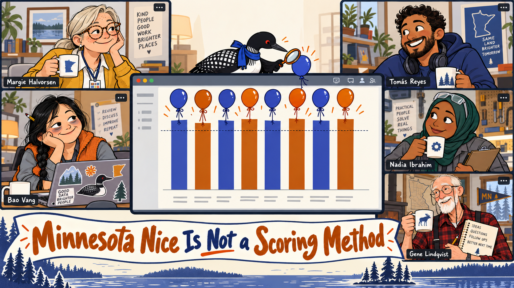
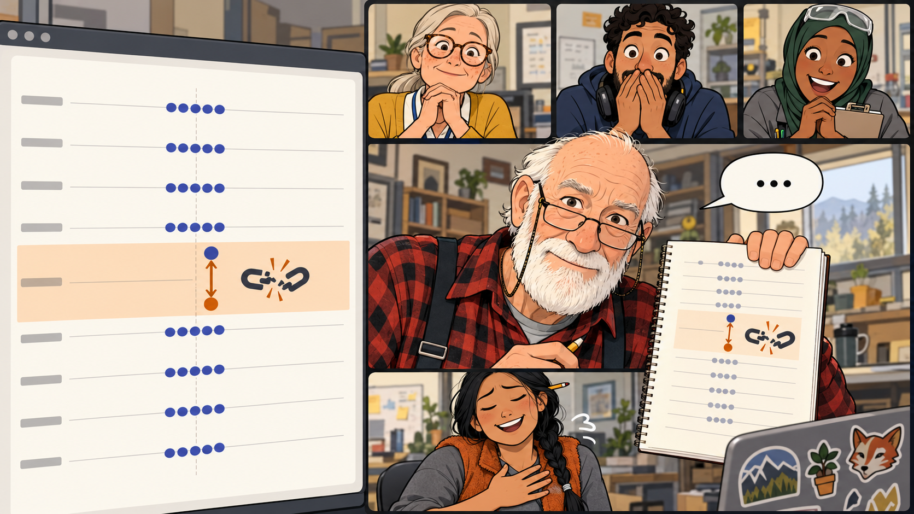

# Minnesota Nice Is Not a Scoring Method

Cover Image Prompt

(This is the Cover Image. Do not include this label in the image.)
Please generate a wide-landscape 16:9 cover image for a lighthearted graphic-novel story. Flat cartoon illustration, modern vector style, clean confident outlines, bold simple shapes, gentle humor, warm cream and soft gray neutrals with indigo (#3949ab) and burnt orange (#b45309) as the two accent colors, wide landscape 16:9 composition. The scene is a statewide video call drawn as a grid of five rectangular video windows arranged around a larger shared-document window in the center. Each window holds one very polite reviewer with a coffee mug, all five smiling pleasantly. The five reviewers are: Margie Halvorsen, a calm woman in her late fifties with silver-blond hair in a low ponytail, round tortoiseshell glasses, a freckled face and a patient half-smile, wearing a mustard-yellow cardigan over a white blouse and dark slacks, with a lanyard around her neck holding a laminated card marked with ten small colored squares. Tomás Reyes, an enthusiastic man in his mid-thirties with medium-brown skin, short dark curly hair and a neatly trimmed beard, wearing a navy hoodie with big over-ear headphones around his neck. Bao Vang, a tired but cheerful woman in her early forties of Hmong American heritage with long black hair in a single braid and a pencil stuck in it, wearing an orange fleece vest over a gray shirt, with dark circles under her eyes and a laptop covered in stickers. Nadia Ibrahim, a practical woman in her mid-thirties of Somali American heritage wearing a deep-green hijab and a gray technician's work jacket with the sleeves pushed up, with safety glasses resting on top of her head and a clipboard in one hand. Gene Lindqvist, a tall thin man in his early seventies with a white beard, wearing a red-and-black plaid flannel shirt with suspenders and reading glasses on a chain, carrying a paper notebook and a mechanical pencil. The shared document in the middle shows a bar chart of ten bars of almost identical tall height, with no readable numbers, all rising cheerfully above a dotted horizontal line. Five round helium balloons in indigo and orange are tied to the tops of the bars by ribbons and are lifting them even higher. A tiny loon with a glossy black head, a white belly, a black back with a white checkered pattern, a red eye, a small indigo scarf, and an orange-handled magnifying glass held in one wing perches on the top edge of the shared-document window and inspects one balloon. Across the bottom, a bold hand-lettered banner in burnt orange and indigo reads exactly: "Minnesota Nice Is Not a Scoring Method". Color palette: cream, soft gray, indigo, and burnt orange. Emotional tone: warm, gently comic, and politely tense. Generate the image immediately without asking clarifying questions.

Narrative Prompt

This is a fictional workplace comedy for OER evangelists, librarians, instructional designers, and professors. It is the first story in the book's Minnesota series, and it leads into "The Lake Effect Workshop". The setting is a statewide video call in the present day. Five reviewers from five different kinds of campus meet to calibrate their scoring before they teach others: Margie Halvorsen (a librarian at a Minnesota State university), Tomás Reyes (an instructional designer at a private liberal arts college), Bao Vang (a math instructor at a community college), Nadia Ibrahim (a faculty member at a technical college), and Gene Lindqvist (a professor at the state's flagship university). No real campus is named. All five characters are invented and drawn the same way in every panel, as described in the Cast and Style Sheet.

The sample resource is a made-up earth science textbook called Soil and Sky. Every score, count, and page number in this story is illustrative and was invented for the story: the first-round scores (every one between 7 and 9, averaging a total of 84), the 14 figures without alt text, the six dead links, the page 41 citation, the disputed metric (Bao's 8 against Gene's 3), the consensus score of 4 for that metric, and the evidence-based total of 58. The rules and terms are not invented. They come from Chapter 3 (reviewer bias, evidence for a score, the 100-point total and its bands), Chapter 11 (calibration, the rule to discuss only metrics that differ by more than 3 points, consensus by evidence and never by averaging, the Revise decision at a total of at least 50 when the adopt rule is not met), and Chapter 14 (score inflation and bias as the average of the signed differences).

The humor is affectionate. It comes from the situation, in which everyone is too kind to say a number out loud, and never from the characters' backgrounds. The "subtitles" are the main joke: they translate a polite phrase into the score it really means. Keep the style flat, warm, and clean, with indigo and burnt orange accents. Keep readable text inside the images to a minimum. Echo the Loon appears tiny in the background of at least one panel.

### Prologue – The Complete Sentence

In Minnesota, "That's different" is a complete sentence, and everyone in the room knows it means "no". This works beautifully at a church potluck. On a scoring rubric it is a problem, because a rubric asks for a number, and a number has no way of being nice. Five OER evangelists from five campuses are about to find out what happens when the nicest people in the state are asked to score the same textbook.

## Panel 1: You First, No, You First

Image Prompt

(This is Panel 01. Do not include the panel number in the image.)
I am about to ask you to generate a series of images for a graphic novel. Please make the images have a consistent style and consistent characters. Do not ask any clarifying questions. Just generate the image immediately when asked.

Please generate a 16:9 image depicting panel 1 of 7. Flat cartoon illustration, modern vector style, clean confident outlines, bold simple shapes, gentle humor, warm cream and soft gray neutrals with indigo (#3949ab) and burnt orange (#b45309) as the two accent colors, wide landscape 16:9 composition. The scene is a statewide video call on a weekday afternoon, drawn as a screen holding five rectangular video windows around a larger shared-document window that shows an empty grid with ten blank rows and no readable text. Each window shows one reviewer in their own workplace, and in every window the reviewer has one hand half raised toward a small generic microphone icon with a slash through it, while the other hand makes an open-palm "after you" gesture toward another window. Top left: Margie Halvorsen, a calm woman in her late fifties with silver-blond hair in a low ponytail, round tortoiseshell glasses, a freckled face and a patient half-smile, wearing a mustard-yellow cardigan over a white blouse and dark slacks, with a lanyard around her neck holding a laminated card marked with ten small colored squares, sitting in a tidy library office with a poster of a lake behind her. Top middle: Tomás Reyes, an enthusiastic man in his mid-thirties with medium-brown skin, short dark curly hair and a neatly trimmed beard, wearing a navy hoodie with big over-ear headphones around his neck, in a bright home office with a plant. Top right: Bao Vang, a tired but cheerful woman in her early forties of Hmong American heritage with long black hair in a single braid and a pencil stuck in it, wearing an orange fleece vest over a gray shirt, with dark circles under her eyes and a laptop covered in stickers, in a cluttered math office with equations scribbled on a whiteboard. Bottom left: Nadia Ibrahim, a practical woman in her mid-thirties of Somali American heritage wearing a deep-green hijab and a gray technician's work jacket with the sleeves pushed up, with safety glasses resting on top of her head and a clipboard in one hand, standing in a workshop bay with an engine on a stand behind her. Bottom right: Gene Lindqvist, a tall thin man in his early seventies with a white beard, wearing a red-and-black plaid flannel shirt with suspenders and reading glasses on a chain, carrying a paper notebook and a mechanical pencil, in a book-lined study with a large wall clock behind him. Every person has a coffee mug on the desk in front of them, and everyone is smiling with identical, patient politeness. Warm afternoon light. Color palette: cream, soft gray, indigo, and burnt orange. Emotional tone: gentle, comic stalemate. Generate the image immediately without asking clarifying questions.

The call starts six minutes late, because every participant is waiting politely for every other participant to unmute first. When the five windows finally fill, Margie Halvorsen (a librarian at a Minnesota State university) welcomes Tomás Reyes (an instructional designer at a private liberal arts college), Bao Vang (a math instructor at a community college), Nadia Ibrahim (a technical college faculty member), and Gene Lindqvist (a professor at the state's flagship university). She shares a rubric worksheet and a sample textbook called *Soil and Sky*, and explains the job: everyone scores it on the ten metrics so the group can calibrate before it teaches anyone else. "Who would like to go first?" she asks, and four people say, "Oh, you go ahead."

## Panel 2: A Remarkably Cheerful Column of Numbers

Image Prompt

(This is Panel 02. Do not include the panel number in the image.)
Please generate a 16:9 image depicting panel 2 of 7. Make the characters and style consistent with the prior panel. Flat cartoon illustration, modern vector style, clean confident outlines, bold simple shapes, gentle humor, warm cream and soft gray neutrals with indigo (#3949ab) and burnt orange (#b45309) as the two accent colors, wide landscape 16:9 composition. The shared-document window fills the left two-thirds of the screen and shows a score sheet with ten rows. In every row five small colored dots, one for each reviewer, sit tightly clustered high in the upper band of the row, with no readable numerals anywhere. A dotted horizontal line runs below them, and a cheerful green rubber stamp with a checkmark hovers over the sheet. The right third of the screen stacks the five small video windows. In the top window is Margie Halvorsen, a calm woman in her late fifties with silver-blond hair in a low ponytail, round tortoiseshell glasses, a freckled face and a patient half-smile, wearing a mustard-yellow cardigan over a white blouse and dark slacks, with a lanyard around her neck holding a laminated card marked with ten small colored squares. She has one eyebrow lifted and holds up a small tablet showing a checklist made only of red cross icons. Below her are the other four reviewers, all pleased and relaxed. Tomás Reyes, an enthusiastic man in his mid-thirties with medium-brown skin, short dark curly hair and a neatly trimmed beard, wearing a navy hoodie with big over-ear headphones around his neck, gives a thumbs-up. Bao Vang, a tired but cheerful woman in her early forties of Hmong American heritage with long black hair in a single braid and a pencil stuck in it, wearing an orange fleece vest over a gray shirt, with dark circles under her eyes and a laptop covered in stickers, sips her coffee. Nadia Ibrahim, a practical woman in her mid-thirties of Somali American heritage wearing a deep-green hijab and a gray technician's work jacket with the sleeves pushed up, with safety glasses resting on top of her head and a clipboard in one hand, nods contentedly. Gene Lindqvist, a tall thin man in his early seventies with a white beard, wearing a red-and-black plaid flannel shirt with suspenders and reading glasses on a chain, carrying a paper notebook and a mechanical pencil, smiles serenely. Color palette: cream, soft gray, indigo, and burnt orange. Emotional tone: too good to be true, with one person quietly worried. Generate the image immediately without asking clarifying questions.

The sheets come back, and every score is between 7 and 9. The totals average 84 of 100, which is the Good band, and above the 75 line in the adoption rule. If this were a real review, the department would adopt *Soil and Sky* by Friday. Margie ran the link checker and the accessibility scan before the call, so she knows it has 14 figures with no alt text, six dead links, and a currency table from 2009, and the lack of a single harsh remark is how she knows something is wrong.

## Panel 3: The Subtitles

Image Prompt

(This is Panel 03. Do not include the panel number in the image.)
Please generate a 16:9 image depicting panel 3 of 7. Make the characters and style consistent with the prior panel. Flat cartoon illustration, modern vector style, clean confident outlines, bold simple shapes, gentle humor, warm cream and soft gray neutrals with indigo (#3949ab) and burnt orange (#b45309) as the two accent colors, wide landscape 16:9 composition. The screen shows the five video windows in an even row and grid, and above each person's head floats a small speech bubble containing only an ellipsis of three dots. Across the bottom of the screen runs a plain subtitle bar, a dark indigo strip with a single large burnt-orange numeral 3 at its center and no other text. Top left: Nadia Ibrahim, a practical woman in her mid-thirties of Somali American heritage wearing a deep-green hijab and a gray technician's work jacket with the sleeves pushed up, with safety glasses resting on top of her head and a clipboard in one hand, tilting her head diplomatically with a tight pleasant smile. Top middle: Gene Lindqvist, a tall thin man in his early seventies with a white beard, wearing a red-and-black plaid flannel shirt with suspenders and reading glasses on a chain, carrying a paper notebook and a mechanical pencil, wearing a kind, patient expression and holding a small covered casserole dish out toward the camera. Top right: Tomás Reyes, an enthusiastic man in his mid-thirties with medium-brown skin, short dark curly hair and a neatly trimmed beard, wearing a navy hoodie with big over-ear headphones around his neck, giving a bright thumbs-up that does not match his eyebrows. Bottom left: Bao Vang, a tired but cheerful woman in her early forties of Hmong American heritage with long black hair in a single braid and a pencil stuck in it, wearing an orange fleece vest over a gray shirt, with dark circles under her eyes and a laptop covered in stickers, with hopeful hands clasped. Bottom right: Margie Halvorsen, a calm woman in her late fifties with silver-blond hair in a low ponytail, round tortoiseshell glasses, a freckled face and a patient half-smile, wearing a mustard-yellow cardigan over a white blouse and dark slacks, with a lanyard around her neck holding a laminated card marked with ten small colored squares, one finger resting on a generic captions-toggle icon and a sly smile. Color palette: cream, soft gray, indigo, and burnt orange. Emotional tone: dry comic reveal. Generate the image immediately without asking clarifying questions.

Margie asks for comments and receives the most courteous peer review in history. Nadia says, "That's... different." Gene says, "I'm sure the author tried." Tomás says, "Interesting!" Bao says, "It has a lot of... content. And I think it has potential." Margie switches on the subtitles: *different, a 3; the author tried, a 3, with a casserole attached; interesting, a 3; a lot of content and potential, a 4.* The subtitles say 3 and 4, and the sheet says 8.

## Panel 4: Name the Bias

Image Prompt

(This is Panel 04. Do not include the panel number in the image.)
Please generate a 16:9 image depicting panel 4 of 7. Make the characters and style consistent with the prior panel. Flat cartoon illustration, modern vector style, clean confident outlines, bold simple shapes, gentle humor, warm cream and soft gray neutrals with indigo (#3949ab) and burnt orange (#b45309) as the two accent colors, wide landscape 16:9 composition. The foreground shows Margie Halvorsen, a calm woman in her late fifties with silver-blond hair in a low ponytail, round tortoiseshell glasses, a freckled face and a patient half-smile, wearing a mustard-yellow cardigan over a white blouse and dark slacks, with a lanyard around her neck holding a laminated card marked with ten small colored squares. She is large in her video window and holds the laminated card up to the camera with a patient, friendly smile. Behind her on a second screen is a table of six rows made only of small icons and colored bars with no readable words, and the third row is highlighted in burnt orange. The shared-document window beside her shows the same cluster of ten bars from before. A dotted line crosses it low down, and a bunch of indigo and orange helium balloons tied to the bars is carrying them up well above that line, to picture score inflation. Four smaller windows along the top edge show the other reviewers looking thoughtfully caught: Tomás Reyes, an enthusiastic man in his mid-thirties with medium-brown skin, short dark curly hair and a neatly trimmed beard, wearing a navy hoodie with big over-ear headphones around his neck. Bao Vang, a tired but cheerful woman in her early forties of Hmong American heritage with long black hair in a single braid and a pencil stuck in it, wearing an orange fleece vest over a gray shirt, with dark circles under her eyes and a laptop covered in stickers. Nadia Ibrahim, a practical woman in her mid-thirties of Somali American heritage wearing a deep-green hijab and a gray technician's work jacket with the sleeves pushed up, with safety glasses resting on top of her head and a clipboard in one hand. Gene Lindqvist, a tall thin man in his early seventies with a white beard, wearing a red-and-black plaid flannel shirt with suspenders and reading glasses on a chain, carrying a paper notebook and a mechanical pencil. Color palette: cream, soft gray, indigo, and burnt orange. Emotional tone: kind, light-bulb moment. Generate the image immediately without asking clarifying questions.

Margie puts up the table of six common reviewer biases from Chapter 3 and points at the third one, leniency, which means scoring generously because the author worked hard. The defense is printed on her lanyard card: score against the descriptors, not against the effort. This is the same drift an overconfident AI agent shows when it hands out 9s on thin evidence, a pattern that Chapter 14 calls score inflation. "Nobody here is wrong," Margie says. "You're all just very, very nice."

## Panel 5: One Quiet Minute

Image Prompt

(This is Panel 05. Do not include the panel number in the image.)
Please generate a 16:9 image depicting panel 5 of 7. Make the characters and style consistent with the prior panel. Flat cartoon illustration, modern vector style, clean confident outlines, bold simple shapes, gentle humor, warm cream and soft gray neutrals with indigo (#3949ab) and burnt orange (#b45309) as the two accent colors, wide landscape 16:9 composition. The screen shows five video windows in a calm even grid and a sixth window, the shared document, now covered by a closed-folder icon with a padlock so that nobody can see anyone else's numbers. Everyone is working alone in silence and writing carefully. Top left: Margie Halvorsen, a calm woman in her late fifties with silver-blond hair in a low ponytail, round tortoiseshell glasses, a freckled face and a patient half-smile, wearing a mustard-yellow cardigan over a white blouse and dark slacks, with a lanyard around her neck holding a laminated card marked with ten small colored squares, reading a printed page with a pencil. Top middle: Tomás Reyes, an enthusiastic man in his mid-thirties with medium-brown skin, short dark curly hair and a neatly trimmed beard, wearing a navy hoodie with big over-ear headphones around his neck, with the headphones on, nodding as he listens to the chapter. Top right: Bao Vang, a tired but cheerful woman in her early forties of Hmong American heritage with long black hair in a single braid and a pencil stuck in it, wearing an orange fleece vest over a gray shirt, with dark circles under her eyes and a laptop covered in stickers, chewing her pencil as she squints at a laptop. Bottom left: Nadia Ibrahim, a practical woman in her mid-thirties of Somali American heritage wearing a deep-green hijab and a gray technician's work jacket with the sleeves pushed up, with safety glasses resting on top of her head and a clipboard in one hand, ticking items on the clipboard. Bottom right: Gene Lindqvist, a tall thin man in his early seventies with a white beard, wearing a red-and-black plaid flannel shirt with suspenders and reading glasses on a chain, carrying a paper notebook and a mechanical pencil, writing slowly in his paper notebook. Hidden in the scene, a tiny loon with a glossy black head, a white belly, a black back with a white checkered pattern, a red eye, a small indigo scarf, and an orange-handled magnifying glass held in one wing perches on the top edge of Gene's video window and peers through its magnifying glass at his notebook. Tiny pencil-scratch lines and small wavy sound lines suggest the quiet. Color palette: cream, soft gray, indigo, and burnt orange. Emotional tone: calm, focused, and a little comic in its silence. Generate the image immediately without asking clarifying questions.

Margie sets the rules, in the voice of someone who has done this before. Everyone rescores alone, with the shared sheet hidden so nobody anchors on a colleague's number, and every score gets evidence in three parts: where you looked, what you saw, and the rule you compared it with. The group goes quiet for a full twenty minutes. The silence is so complete that Gene's wall clock can be heard in all five windows.

## Panel 6: Respectfully, With Evidence

Image Prompt

(This is Panel 06. Do not include the panel number in the image.)
Please generate a 16:9 image depicting panel 6 of 7. Make the characters and style consistent with the prior panel. Flat cartoon illustration, modern vector style, clean confident outlines, bold simple shapes, gentle humor, warm cream and soft gray neutrals with indigo (#3949ab) and burnt orange (#b45309) as the two accent colors, wide landscape 16:9 composition. The shared sheet is open again on the left. Nine rows show five dots tightly clustered in the middle band. One row, highlighted in burnt orange, shows one tall indigo dot at the very top and one low orange dot near the bottom, joined by a double-headed arrow, and beside the row floats a cartoon icon of a broken chain link. On the right, Gene Lindqvist, a tall thin man in his early seventies with a white beard, wearing a red-and-black plaid flannel shirt with suspenders and reading glasses on a chain, carrying a paper notebook and a mechanical pencil, fills the largest window. He leans toward the camera, holding up his open paper notebook with a firm, kind expression and a speech bubble containing only an ellipsis. Below him, Bao Vang, a tired but cheerful woman in her early forties of Hmong American heritage with long black hair in a single braid and a pencil stuck in it, wearing an orange fleece vest over a gray shirt, with dark circles under her eyes and a laptop covered in stickers, slumps in visible relief with one hand over her heart. Along the top edge, three small windows show the others leaning in with wide eyes: Margie Halvorsen, a calm woman in her late fifties with silver-blond hair in a low ponytail, round tortoiseshell glasses, a freckled face and a patient half-smile, wearing a mustard-yellow cardigan over a white blouse and dark slacks, with a lanyard around her neck holding a laminated card marked with ten small colored squares, who has a proud small smile. Tomás Reyes, an enthusiastic man in his mid-thirties with medium-brown skin, short dark curly hair and a neatly trimmed beard, wearing a navy hoodie with big over-ear headphones around his neck, with his hands over his mouth. Nadia Ibrahim, a practical woman in her mid-thirties of Somali American heritage wearing a deep-green hijab and a gray technician's work jacket with the sleeves pushed up, with safety glasses resting on top of her head and a clipboard in one hand, with a delighted grin. Color palette: cream, soft gray, indigo, and burnt orange. Emotional tone: the tension of a historic first, resolving into relief. Generate the image immediately without asking clarifying questions.

Margie unhides the sheets and applies the rule from Chapter 11: discuss only the metrics that differ by more than 3 points. Nine of the ten are within 3 points, which beats the chapter's goal of 8 of 10, and the tenth, accuracy and currency, is Bao's 8 against Gene's 3. The whole state goes quiet until Gene, who has not disagreed out loud since a faculty meeting in 1994, says, "I... respectfully... disagree," and reads his evidence: page 41, a link to a page that no longer exists, and a table that does not match the source it cites. Bao slumps with relief and admits she wrote the dead link in her own evidence column and gave an 8 anyway, so the group opens the link together, finds it dead, and settles on a 4, because averaging 8 and 3 would give a 5.5 that neither of them would defend.

## Panel 7: The Eleven-Minute Goodbye

Image Prompt

(This is Panel 07. Do not include the panel number in the image.)
Please generate a 16:9 image depicting panel 7 of 7. Make the characters and style consistent with the prior panel. Flat cartoon illustration, modern vector style, clean confident outlines, bold simple shapes, gentle humor, warm cream and soft gray neutrals with indigo (#3949ab) and burnt orange (#b45309) as the two accent colors, wide landscape 16:9 composition. The shared-document window in the center now shows a calm bar chart of ten bars of varied honest heights, sitting in the middle band with the balloons gone, and a small orange pencil-and-paper icon beside it marks the decision to revise. Around it the five video windows show everyone still waving, long past the point of ending the call. Top left: Margie Halvorsen, a calm woman in her late fifties with silver-blond hair in a low ponytail, round tortoiseshell glasses, a freckled face and a patient half-smile, wearing a mustard-yellow cardigan over a white blouse and dark slacks, with a lanyard around her neck holding a laminated card marked with ten small colored squares, waving with one hand while the other hovers over the leave-call button, and a sticky note on her monitor carries eleven tally marks. Top right: Tomás Reyes, an enthusiastic man in his mid-thirties with medium-brown skin, short dark curly hair and a neatly trimmed beard, wearing a navy hoodie with big over-ear headphones around his neck, still waving cheerfully. Middle left: Bao Vang, a tired but cheerful woman in her early forties of Hmong American heritage with long black hair in a single braid and a pencil stuck in it, wearing an orange fleece vest over a gray shirt, with dark circles under her eyes and a laptop covered in stickers, waving while holding up a winter coat. Bottom left: Nadia Ibrahim, a practical woman in her mid-thirties of Somali American heritage wearing a deep-green hijab and a gray technician's work jacket with the sleeves pushed up, with safety glasses resting on top of her head and a clipboard in one hand, waving with the clipboard. Bottom right: Gene Lindqvist, a tall thin man in his early seventies with a white beard, wearing a red-and-black plaid flannel shirt with suspenders and reading glasses on a chain, carrying a paper notebook and a mechanical pencil, waving, with the large wall clock behind him showing a much later time than in the first panel. A tiny loon with a glossy black head, a white belly, a black back with a white checkered pattern, a red eye, a small indigo scarf, and an orange-handled magnifying glass held in one wing waves a wing from behind the frame of Tomás's window. Color palette: cream, soft gray, indigo, and burnt orange. Emotional tone: warm, affectionate, and endlessly comic. Generate the image immediately without asking clarifying questions.

With the one disputed metric settled, the evidence-based total for *Soil and Sky* is 58 of 100, in the Fair band, and the decision rule says Revise, a long way from the first round's cheerful Adopt. Margie says, "Well, I should let you go." Then the Midwest goodbye begins: "Oh, I've got a minute." "Tell your sister hi." "Drive safe, it's supposed to ice up." "No, you hang up first." The goodbye lasts eleven minutes, longer than it took to settle the only disputed metric, and nobody scores it.

### Epilogue – What Did the Panel Learn?

Five generous people produced a score sheet that would have put a weak textbook into a classroom, and not one of them was careless. The fix was a process, not a personality change: each reviewer scored alone, wrote down the evidence, and discussed only the gaps that mattered. The result was a lower number, a more useful report, and an author who now knows exactly which link to repair.

| Challenge | How the Panel Responded | Lesson for Today |
|-----------|--------------------------|------------------|
| Every first-round score fell between 7 and 9 although the comments implied 3s and 4s, so the group total of 84 would have meant Adopt | Margie named leniency, one of the six biases in Chapter 3 | Score against the descriptors, not against the effort |
| Everyone saw the same cluster of numbers at once, which anchors the next score | Each reviewer rescored alone with the sheet hidden | Finish your own ten scores before you look at anyone else's |
| The scores had no evidence behind them | Each score now named where the reviewer looked, what they saw, and the rule they compared it with | A score with no evidence cannot be repeated or discussed |
| The first round averaged 84 and the evidence-based total was 58, a bias of 2.6 points per metric (illustrative) | The group compared the sheets and discussed only metrics more than 3 points apart | Treat consistent upward drift as score inflation, in people as well as in agents |
| Nobody wanted to be the first to disagree | Gene disagreed "respectfully" and brought evidence, and the group repeated the check together | Decide by evidence, never by averaging, and remember that disagreeing with a score is not disagreeing with a person |

### Call to Action

Before your next review panel, ask everyone to score alone, write the evidence in three parts, and agree in advance that a disagreement about a number is a kindness to the author. An author can fix "the link on page 41" and cannot fix "that's different". Then try the same discipline on an AI agent, because a polite machine inflates scores exactly as a polite colleague does. Practice spotting both with the [Reviewer Bias Spotter](../../sims/reviewer-bias-spotter/index.md) and the [Inter-Rater Agreement Explorer](../../sims/inter-rater-agreement-explorer/index.md).

---

*"A score without evidence is just a feeling with a number on it."*  
– Margie Halvorsen

*"I... respectfully... disagree."*  
– Gene Lindqvist

*"I wrote the dead link in my evidence column and still gave it an 8."*  
– Bao Vang

---

## References

1. [Wikipedia: Minnesota nice](https://en.wikipedia.org/wiki/Minnesota_nice) - The Upper Midwest politeness norms that this story gently teases
2. [Wikipedia: Inter-rater reliability](https://en.wikipedia.org/wiki/Inter-rater_reliability) - How much different reviewers agree when they score the same thing
3. [Wikipedia: Anchoring effect](https://en.wikipedia.org/wiki/Anchoring_effect) - Why the first number you see pulls the later ones toward it
4. [Open Textbook Library, University of Minnesota](https://open.umn.edu/opentextbooks/) - A Minnesota-based catalog of open textbooks that publishes reviews of them
5. [Yuan and Recker (2015), Not all rubrics are equal](https://doi.org/10.19173/irrodl.v16i5.2389) - The review of 14 OER quality rubrics behind this book's rubric design

**Where this is taught in this book**

- [Chapter 3: The Ten-Metric Rubric and Scoring](../../chapters/03-ten-metric-rubric-scoring/index.md) covers reviewer bias, evidence for a score, and inter-rater agreement.
- [Chapter 11: Manual Evaluation and Adoption Decisions](../../chapters/11-manual-evaluation-adoption/index.md) covers calibration sessions, consensus scoring, and score reconciliation.
- [Chapter 14: Checking and Calibrating AI Agent Output](../../chapters/14-checking-agent-output/index.md) covers score inflation, bias, and agreement with human reviewers.
