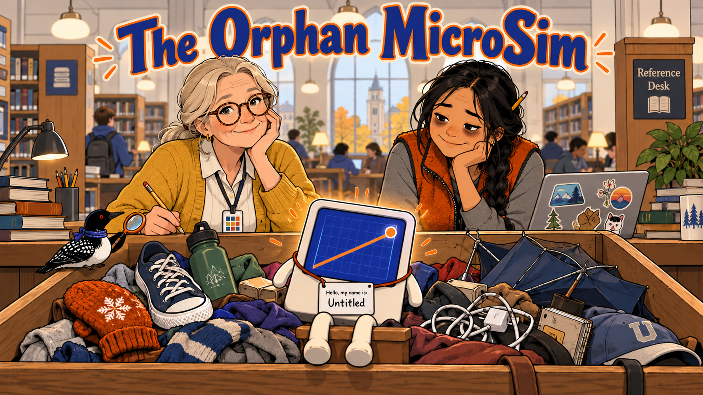
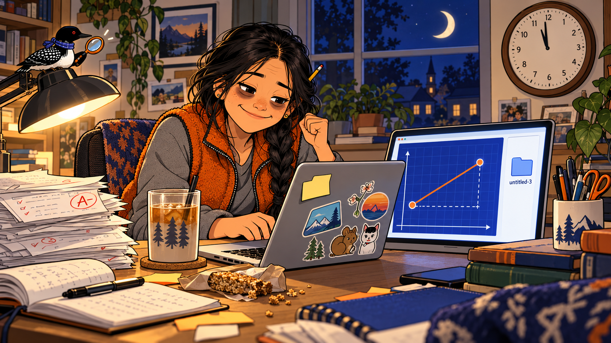
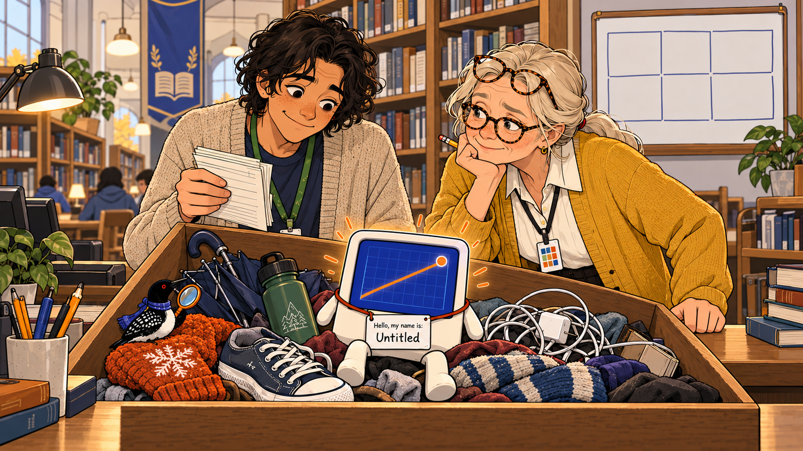
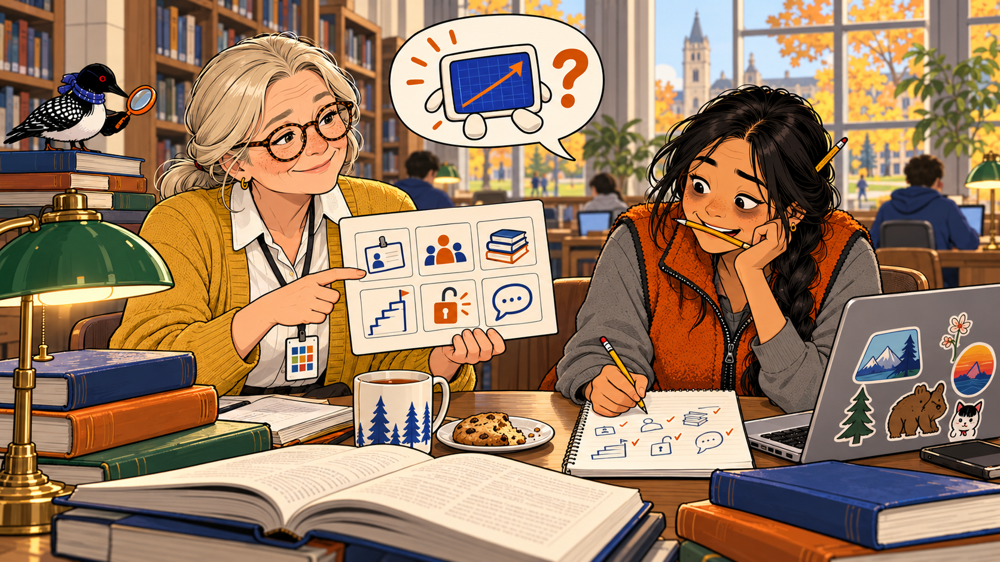
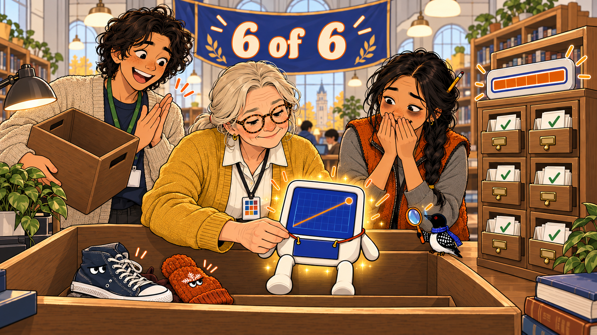

# The Orphan MicroSim

*You can't reuse what you can't find.*

Cover Image Prompt

(This is the Cover Image. Do not include this label in the image.)
Please generate a wide-landscape 16:9 cover image for a graphic-novel comedy titled "The Orphan MicroSim". Flat cartoon illustration, modern vector style, clean confident outlines, bold simple shapes, gentle humor, warm cream and soft gray neutrals with indigo (#3949ab) and burnt orange (#b45309) as the two accent colors, wide landscape 16:9 composition. Lost-and-found costume: the scene is a big wooden lost-and-found bin at a university library reference desk, overflowing with sad little objects such as a single mitten, an umbrella with a bent rib, a lone sneaker, a water bottle and a tangled phone charger. Sitting in the middle of the bin, with its feet dangling, is a small glowing tablet-shaped computer screen with a face-less rounded body that shows a bright indigo graph with a rising orange line and a draggable orange dot; around its neck hangs a paper name tag that says exactly "Hello, my name is: Untitled", which is the only text apart from the title. Behind the bin stands Margie Halvorsen, a calm woman in her late fifties with silver-blond hair in a low ponytail, round tortoiseshell glasses, a freckled face and a patient half-smile, wearing a mustard-yellow cardigan over a white blouse and dark slacks, with a lanyard around her neck holding a laminated card marked with ten small colored squares; she leans on the reference desk and looks kindly over her glasses at the viewer, holding a pencil. Beside her stands Bao Vang, a tired but cheerful woman in her early forties of Hmong American heritage with long black hair in a single braid and a pencil stuck in it, wearing an orange fleece vest over a gray shirt, with dark circles under her eyes and a laptop covered in stickers, who looks down at the little screen in the bin with a guilty, tender smile. The title "The Orphan MicroSim" is rendered across the top in bold, friendly poster lettering in indigo with orange outlines. Hidden cameo: a very small loon with a glossy black head, a white belly, a black back with a white checkered pattern, a red eye, a small indigo scarf, and an orange-handled magnifying glass held in one wing perches on the rim of the bin next to the lone sneaker, tiny and easy to miss. Color palette: cream, soft gray, indigo, burnt orange, a touch of warm wood brown. Emotional tone: wry, tender, and inviting. Generate the image immediately without asking clarifying questions.

Narrative Prompt

This is a fictional comedy for adult readers: OER evangelists, librarians, instructional designers, and the professors and teachers who choose textbooks. It is set in a university library and a pair of math offices. The central idea comes from Chapter 9 of the book: a resource that cannot be found cannot be reused, so metadata comes before reusability. A resource is described by six core fields in this book (title, author, subject, grade level, license, and description), which map onto Dublin Core, and metadata completeness is the share of those six fields that are filled with valid values. In the story, Bao's simulation has none of the six, so its completeness is 0 of 6, or 0 percent. After Margie fills in all six, it is 6 of 6, or 100 percent. The numbers are illustrative.

Characters: Bao Vang is a community college math instructor who builds MicroSims at midnight and forgets to label them. Luis Ortega is an invented math instructor at a college in another state who needs an interactive slope simulation for Monday. Margie Halvorsen is the campus librarian and OER evangelist. Devon is the library student worker who runs the lost-and-found bin. Echo the Loon is a tiny background cameo in several panels.

The simulation is a generic slope explorer: a coordinate grid, a line, and two draggable points that update the slope as they move. No brand names, logos, or real interface screenshots appear. The "four seconds" search is compressed for comedy. The value is a mood, not a measurement.

Visual language: the flat vector house style with indigo and burnt orange accents. The recurring gag is the paper name tag: first it says "Untitled", and at the end it is replaced by a real title. Keep every character's look identical across panels.

### Prologue – Three Words in a Folder Name

Bao Vang built the best slope simulation she has ever made, and then she saved it in a folder called `untitled-3`. It was midnight, and she meant to come back and label it in the morning. This is the story of what happened in the three years before morning.

## Panel 1: The Midnight Build

Image Prompt

(This is Panel 01. Do not include the panel number in the image.)
I am about to ask you to generate a series of images for a graphic novel. Please make the images have a consistent style and consistent characters. Do not ask any clarifying questions. Just generate the image immediately when asked.

Please generate a 16:9 image in a lost-and-found comic style depicting panel 1 of 7. Flat cartoon illustration, modern vector style, clean confident outlines, bold simple shapes, gentle humor, warm cream and soft gray neutrals with indigo (#3949ab) and burnt orange (#b45309) as the two accent colors, wide landscape 16:9 composition. The scene is a small cluttered home office at midnight, lit only by a desk lamp and the glow of a laptop. Bao Vang, a tired but cheerful woman in her early forties of Hmong American heritage with long black hair in a single braid and a pencil stuck in it, wearing an orange fleece vest over a gray shirt, with dark circles under her eyes and a laptop covered in stickers, sits hunched at the desk with a cup of cold tea, typing with a triumphant grin. On the laptop screen a bright indigo coordinate grid shows a rising orange line with two draggable orange dots, and a small triangle of dashed lines marks the rise and the run. On the wall behind her a clock shows nearly midnight, and a window shows a dark sky with a crescent moon. On the laptop, a file-folder icon with a plain gray label reads exactly "untitled-3", which is the only text in the image. A sticky note on the monitor is blank. A pile of student quiz papers and a half-eaten granola bar sit on the desk. Hidden cameo: a very small loon with a glossy black head, a white belly, a black back with a white checkered pattern, a red eye, a small indigo scarf, and an orange-handled magnifying glass held in one wing perches on top of the desk lamp, tiny and in the background. Color palette: deep indigo night, warm lamp yellow, cream, burnt orange. Emotional tone: proud, sleepy, and a little too confident about tomorrow. Generate the image immediately without asking clarifying questions.

It is midnight in 2022, and Bao has just finished an interactive slope simulation: two draggable points, a line, and a slope that updates as you move them. It is clear, accurate, and a joy to use. She saves it in a folder called `untitled-3`, tells herself "I'll fill in the details tomorrow," and closes the laptop. The details do not get filled in tomorrow, or the tomorrow after that.

## Panel 2: One Hour of "Interactive Slope"

Image Prompt

(This is Panel 02. Do not include the panel number in the image.)
Please generate a 16:9 image in a lost-and-found comic style depicting panel 2 of 7. Make the characters and style consistent with the prior panel. Flat cartoon illustration, modern vector style, clean confident outlines, bold simple shapes, gentle humor, warm cream and soft gray neutrals with indigo (#3949ab) and burnt orange (#b45309) as the two accent colors, wide landscape 16:9 composition. The scene is the office of Luis Ortega, a math instructor at a college in another state, on a Friday afternoon. Luis Ortega is a wiry, earnest man in his late thirties with warm brown skin, short black hair, a rolled-up sleeve on a pale blue button-down shirt and a lanyard with a college ID badge, who sits at a cluttered desk with his chin in his hand and a look of exhausted patience. His desktop monitor shows a long scroll of search results as a stack of gray bars with no readable text, and a small search box at the top contains exactly "interactive slope", which is the only text in the image. Around him are signs of a long search: an empty coffee mug, three crumpled sticky notes, a wall clock showing nearly five, a stack of open browser tabs drawn as a row of little rectangles across the top of the screen, and a calendar on the wall with Monday circled in orange. A speech bubble above his head holds only a tiny drawn picture of a line on a grid with a question mark. Hidden cameo: a very small loon with a glossy black head, a white belly, a black back with a white checkered pattern, a red eye, a small indigo scarf, and an orange-handled magnifying glass held in one wing peeks out from behind the monitor, tiny and in the background. Color palette: cool gray, cream, indigo, a splash of burnt orange on the Monday circle. Emotional tone: tired, patient, and relatably doomed. Generate the image immediately without asking clarifying questions.

Three years later and one state away, Luis Ortega needs an interactive slope simulation for Monday's class. He types "interactive slope" and gets a hundred results: videos, worksheets, a sales page for a ski resort. He tries "slope simulation open license" and "free slope applet." An hour in, he has fourteen open tabs and nothing he can legally embed. Somewhere on a hard drive 900 miles away, the exact thing he needs is waiting under the name `untitled-3`.

## Panel 3: The Lost-and-Found Bin

Image Prompt

(This is Panel 03. Do not include the panel number in the image.)
Please generate a 16:9 image in a lost-and-found comic style depicting panel 3 of 7. Make the characters and style consistent with the prior panel. Flat cartoon illustration, modern vector style, clean confident outlines, bold simple shapes, gentle humor, warm cream and soft gray neutrals with indigo (#3949ab) and burnt orange (#b45309) as the two accent colors, wide landscape 16:9 composition. The scene is the reference desk of a university library, with tall bookshelves behind it, a hanging indigo banner and a big wooden lost-and-found bin on the counter. Devon, a lanky library student worker in their early twenties with tousled dark curls, a green staff lanyard and a baggy oatmeal cardigan, carrying a stack of paper call slips, tips the bin toward the viewer to show its contents: a single mitten, a bent umbrella, a lone sneaker, a water bottle, a tangled charger, and, in the middle, a small glowing laptop screen with a bright indigo graph, a rising orange line and a draggable orange dot, around which hangs a paper name tag reading exactly "Hello, my name is: Untitled", which is the only text in the image. Margie Halvorsen, a calm woman in her late fifties with silver-blond hair in a low ponytail, round tortoiseshell glasses, a freckled face and a patient half-smile, wearing a mustard-yellow cardigan over a white blouse and dark slacks, with a lanyard around her neck holding a laminated card marked with ten small colored squares, leans over the bin with her glasses pushed up on her forehead and a pencil in her hand, studying the screen with one raised eyebrow. A small whiteboard on the wall behind them has a hand-drawn six-box grid, empty. Hidden cameo: a very small loon with a glossy black head, a white belly, a black back with a white checkered pattern, a red eye, a small indigo scarf, and an orange-handled magnifying glass held in one wing sits inside the bin on top of the mitten, tiny and in the background. Color palette: cream, warm wood brown, soft gray, indigo, burnt orange. Emotional tone: curious, tender, and mildly amused. Generate the image immediately without asking clarifying questions.

Bao, meanwhile, has brought the simulation to the library because a colleague told her "Margie fixes this kind of thing." Devon, who runs the lost-and-found bin, files it with the mittens. The simulation looks lovely and has no idea who it is. "Hello, my name is: Untitled." Margie counts the fields of its record, and finds that the answer is the same for all six. Title: none. Author: none. Subject: none. Grade level: none. License: none. Description: none. "Completeness," says Margie, "is zero out of six."

## Panel 4: Six Questions

Image Prompt

(This is Panel 04. Do not include the panel number in the image.)
Please generate a 16:9 image in a lost-and-found comic style depicting panel 4 of 7. Make the characters and style consistent with the prior panel. Flat cartoon illustration, modern vector style, clean confident outlines, bold simple shapes, gentle humor, warm cream and soft gray neutrals with indigo (#3949ab) and burnt orange (#b45309) as the two accent colors, wide landscape 16:9 composition. The scene is a quiet corner table in the university library, with a green-shaded banker's lamp, a stack of books and a window onto a campus quad. Margie Halvorsen, a calm woman in her late fifties with silver-blond hair in a low ponytail, round tortoiseshell glasses, a freckled face and a patient half-smile, wearing a mustard-yellow cardigan over a white blouse and dark slacks, with a lanyard around her neck holding a laminated card marked with ten small colored squares, sits across from Bao Vang, a tired but cheerful woman in her early forties of Hmong American heritage with long black hair in a single braid and a pencil stuck in it, wearing an orange fleece vest over a gray shirt, with dark circles under her eyes and a laptop covered in stickers. Margie holds up a large index card with six empty boxes arranged in two rows of three, each box with a tiny icon and no words: a name tag, a person, a stack of books, a ladder of grade steps, an open padlock, and a speech balloon. Bao, with her pencil in her mouth, scribbles an answer on a paper notepad, looking surprised at how easy each one is. Floating above the table, a small version of the glowing slope simulation sits in a speech balloon with a question mark. On the table next to the laptop is a cup of tea and a partly eaten cookie. Hidden cameo: a very small loon with a glossy black head, a white belly, a black back with a white checkered pattern, a red eye, a small indigo scarf, and an orange-handled magnifying glass held in one wing stands on the stack of books, tiny and in the background. Color palette: cream, warm lamp green, indigo, burnt orange. Emotional tone: calm, collaborative, and quietly funny. There is no text in this image. Generate the image immediately without asking clarifying questions.

Margie asks six questions, and Bao realizes she can answer every one of them in under a minute. What should it be called? *Slope Explorer: Two Points and a Line.* Who made it? *Vang, Bao.* What is it about? *Slope; Linear functions; Algebra.* Who is it for? *Grades 8 to 10, or an introductory college algebra course.* What may people do with it? *CC BY: share it, change it, credit Bao.* What does it do? *Drag two points on a grid and watch the slope update.* "That took four minutes," says Bao. "And it cost three years," says Margie, kindly.

## Panel 5: The Name Tag Changes

Image Prompt

(This is Panel 05. Do not include the panel number in the image.)
Please generate a 16:9 image in a lost-and-found comic style depicting panel 5 of 7. Make the characters and style consistent with the prior panel. Flat cartoon illustration, modern vector style, clean confident outlines, bold simple shapes, gentle humor, warm cream and soft gray neutrals with indigo (#3949ab) and burnt orange (#b45309) as the two accent colors, wide landscape 16:9 composition. The scene is the library reference desk, in a warm celebratory moment. Margie Halvorsen, a calm woman in her late fifties with silver-blond hair in a low ponytail, round tortoiseshell glasses, a freckled face and a patient half-smile, wearing a mustard-yellow cardigan over a white blouse and dark slacks, with a lanyard around her neck holding a laminated card marked with ten small colored squares, gently peels the old paper name tag off the glowing slope simulation and hangs a crisp new indigo name tag in its place. Devon, a lanky library student worker in their early twenties with tousled dark curls, a green staff lanyard and a baggy oatmeal cardigan, carrying a stack of paper call slips, holds the empty lost-and-found bin and applauds with one hand, grinning. Bao Vang, a tired but cheerful woman in her early forties of Hmong American heritage with long black hair in a single braid and a pencil stuck in it, wearing an orange fleece vest over a gray shirt, with dark circles under her eyes and a laptop covered in stickers, stands on the other side with both hands over her mouth in happy disbelief. Next to the simulation stands a tall card catalog-style display with six small drawers, each one pulled open and showing a small green checkmark, and a tidy progress bar above it filled all the way to the right. A banner above the desk reads exactly "6 of 6", which is the only text in the image. The small glowing screen now wears a warm halo, and the lone sneaker and mitten in the bin look jealous. Hidden cameo: a very small loon with a glossy black head, a white belly, a black back with a white checkered pattern, a red eye, a small indigo scarf, and an orange-handled magnifying glass held in one wing sits on the edge of the empty bin holding up its tiny magnifying glass to the new name tag, tiny and in the background. Color palette: cream, warm wood brown, indigo, burnt orange, a touch of green for the checkmarks. Emotional tone: joyful, warm, and a little silly. Generate the image immediately without asking clarifying questions.

Margie types the six answers into the record, and the paper tag comes off. The lost-and-found simulation gets a real name, a real author, a license, and a description a stranger can read in ten seconds. Metadata completeness goes from 0 of 6 (0%) to 6 of 6 (100%). Devon declares the bin empty of anything important and files the mitten under "unclaimed."

## Panel 6: Four Seconds

Image Prompt

(This is Panel 06. Do not include the panel number in the image.)
Please generate a 16:9 image in a lost-and-found comic style depicting panel 6 of 7. Make the characters and style consistent with the prior panel. Flat cartoon illustration, modern vector style, clean confident outlines, bold simple shapes, gentle humor, warm cream and soft gray neutrals with indigo (#3949ab) and burnt orange (#b45309) as the two accent colors, wide landscape 16:9 composition. The scene is the office of Luis Ortega, the same cluttered desk as before, now on a calm Saturday morning with sunlight in the window. Luis Ortega, a wiry, earnest man in his late thirties with warm brown skin, short black hair, a rolled-up sleeve on a pale blue button-down shirt and a lanyard with a college ID badge, sits upright with a fresh cup of coffee and his mouth open in delighted astonishment. On his monitor, a search box contains exactly "interactive slope", and right below it a single bright result card glows at the top of the list, showing a tiny thumbnail of the indigo graph with the rising orange line and a row of six small green tags. A large analog stopwatch sits on the desk, its hand just passing the four-second mark, with a tiny confetti burst above it. The three crumpled sticky notes from the earlier panel are now in the trash can. The calendar on the wall still has Monday circled in orange, but beside it a small relaxed smiley sticker. Hidden cameo: a very small loon with a glossy black head, a white belly, a black back with a white checkered pattern, a red eye, a small indigo scarf, and an orange-handled magnifying glass held in one wing sits on the top edge of the monitor, tiny and in the background. Color palette: sunny cream, soft gray, indigo, burnt orange, a touch of warm yellow. Emotional tone: relief and surprise. Generate the image immediately without asking clarifying questions.

On Saturday morning, Luis types the same two words, "interactive slope," and the first result is a simulation with a clear title, a grade range, a subject, and a license that says he may embed it. It takes about four seconds, which is generous, compared with the hour. He reads the description, drags both points, watches the slope change, and thinks, "That's the one."

## Panel 7: Embedded, and Credited

Image Prompt

(This is Panel 07. Do not include the panel number in the image.)
Please generate a 16:9 image in a lost-and-found comic style depicting panel 7 of 7. Make the characters and style consistent with the prior panel. Flat cartoon illustration, modern vector style, clean confident outlines, bold simple shapes, gentle humor, warm cream and soft gray neutrals with indigo (#3949ab) and burnt orange (#b45309) as the two accent colors, wide landscape 16:9 composition. The scene is a split view on a bright background. On the left, a large generic course web page in a plain gray browser frame shows a lesson with a heading bar and a text paragraph drawn as gray lines, and in the middle of the page the glowing slope simulation is embedded, with its rising orange line and two draggable orange dots. Under the simulation, a small credit card in the TASL style reads exactly "Slope Explorer by Vang - CC BY", which is the only text in the image. On the right, Bao Vang, a tired but cheerful woman in her early forties of Hmong American heritage with long black hair in a single braid and a pencil stuck in it, wearing an orange fleece vest over a gray shirt, with dark circles under her eyes and a laptop covered in stickers, sits at her own desk and looks at a phone showing a small notification with a heart icon; she is beaming, and a mug beside her reads nothing. In the center bottom, a smiling Margie Halvorsen, a calm woman in her late fifties with silver-blond hair in a low ponytail, round tortoiseshell glasses, a freckled face and a patient half-smile, wearing a mustard-yellow cardigan over a white blouse and dark slacks, with a lanyard around her neck holding a laminated card marked with ten small colored squares, holds a laminated card of her own and gives a small thumbs-up. A faint dotted line curves from Bao's desk, across a stylized map of two states, to the course page, suggesting the distance. Hidden cameo: a very small loon with a glossy black head, a white belly, a black back with a white checkered pattern, a red eye, a small indigo scarf, and an orange-handled magnifying glass held in one wing floats in a tiny canoe on the dotted line over the map, holding its magnifying glass up toward the page, tiny and in the background. Color palette: cream, soft gray, indigo, burnt orange, warm gold. Emotional tone: satisfied, generous, and complete. Generate the image immediately without asking clarifying questions.

By Monday, Luis's course page has the simulation embedded, with a credit line that names Bao and the license. A notification pings on Bao's phone: *"Your resource was reused."* She texts Margie a photo of the page. Margie answers with a single word, "Findable," and a drawing of a mitten.

### Epilogue – What Did Margie Learn?

The simulation was never the problem. It was good before the metadata and just as good after. What changed was that a stranger could now find it, judge it in ten seconds, and know what they were allowed to do with it. You cannot reuse what you cannot find, so findable comes first.

| Challenge | How Margie Responded | Lesson for Today |
|-----------|----------------------|------------------|
| A great simulation in a folder called `untitled-3` | Counted the six core fields and found none filled | A file name is not a title. Name the resource in words a searcher would type. |
| Luis searched for an hour and found nothing usable | Asked Bao six short questions: title, author, subject, grade level, license, and description | Six fields take minutes to write, and they decide whether anyone ever finds the resource. |
| A resource with no license | Recorded CC BY in the license field | If the license is missing, a stranger must assume all rights reserved and walk away. |
| Completeness of 0 of 6 | Filled all six with valid values, reaching 6 of 6 (100%) | Completeness counts filled and valid fields. A guess or "TBD" is worse than a blank. |
| The reuse notification on Saturday | Waited for the credit line to appear on a stranger's course page | Good metadata leads to reuse, and reuse brings credit back to the author. |

### Call to Action

Open the folder where your best resource lives and read its name aloud. If it sounds like `untitled-3` or `final_v2`, give it six fields before you do anything else. Add a title a stranger would search for, your name, a subject, a grade level, a license, and a description of what it does. Then check whether you can find it using nothing but those words.

---

*"A file name is not a title. It's a hiding place."*  
– Margie Halvorsen

*"I'll label it tomorrow. I've been saying that since 2022."*  
– Bao Vang

*"The mitten is unclaimed. The simulation has been claimed. That's progress."*  
– Devon

*You can't reuse what you can't find.*

---

## References

1. [Search MicroSims](https://dmccreary.github.io/search-microsims/search/) - A faceted search of over 5,000 MicroSims, showing how good metadata lets a stranger find a simulation in seconds
2. [Wikipedia: Metadata](https://en.wikipedia.org/wiki/Metadata) - Overview of data that describes other data, including descriptive metadata used to find resources
3. [Wikipedia: Dublin Core](https://en.wikipedia.org/wiki/Dublin_Core) - The standard vocabulary of 15 elements for describing resources
4. [Wikipedia: Findability](https://en.wikipedia.org/wiki/Findability) - How easily information or a resource can be located
5. [Dublin Core Metadata Initiative: DCMI Metadata Terms](https://www.dublincore.org/specifications/dublin-core/dcmi-terms/) - The maintaining organization's own definitions of the elements and terms
6. [Creative Commons: About CC Licenses](https://creativecommons.org/share-your-work/cclicenses/) - The organization's guide to the license named in Panel 4

Where this is taught in this book:

- [Chapter 9: Modularity and Metadata](../../chapters/09-modularity-metadata/index.md) covers the six core fields, the Dublin Core mapping, and metadata completeness.
- [Chapter 2: Open Licenses and Attribution](../../chapters/02-open-licenses-attribution/index.md) covers the CC BY license and the credit line in Panel 7.
- [Can't Reuse What You Can't Find](../../sims/cant-reuse-what-you-cant-find/index.md) lets you try the search from Panels 2 and 6 yourself.
