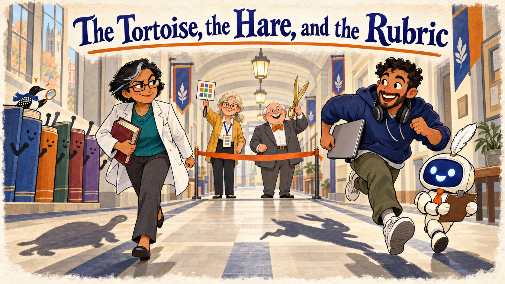
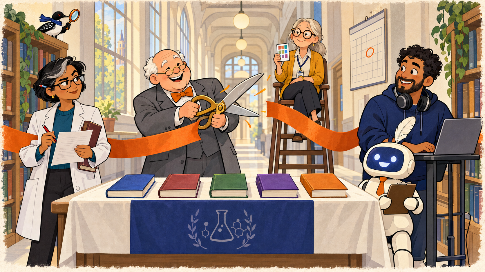
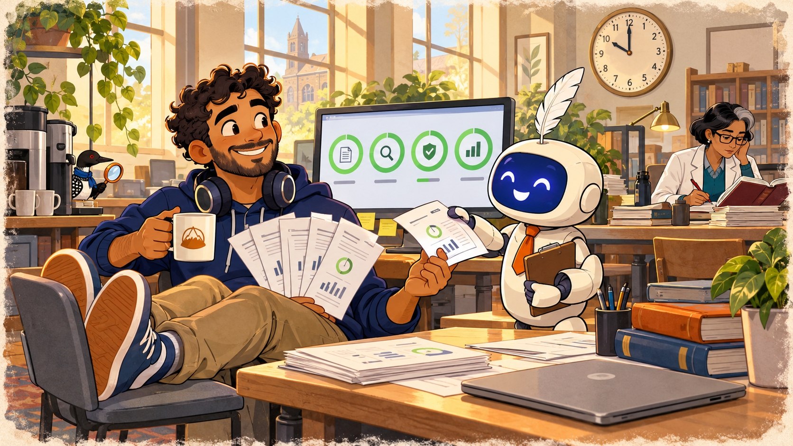
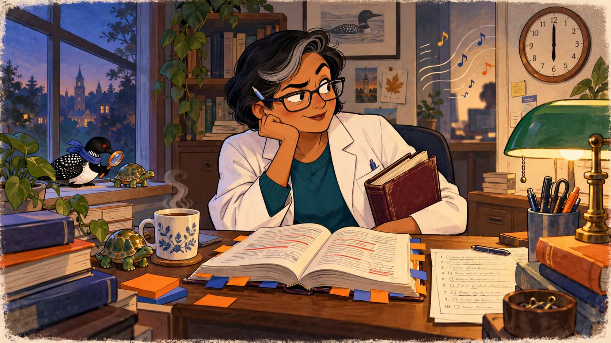
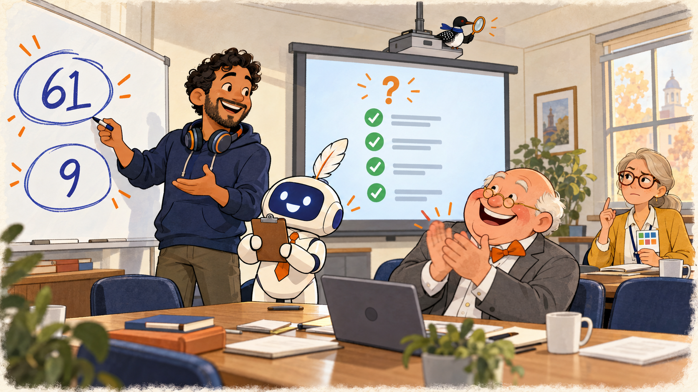
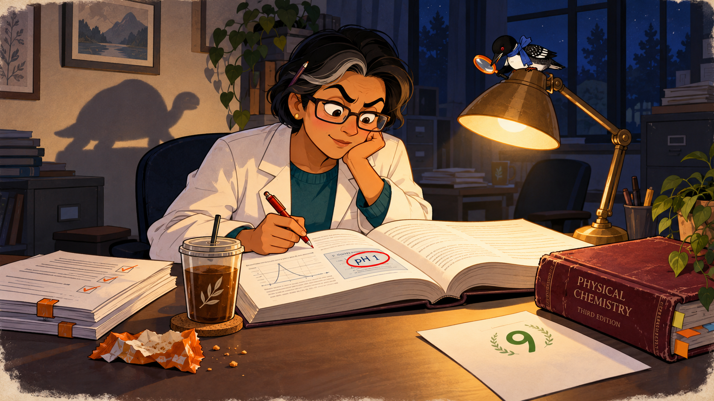
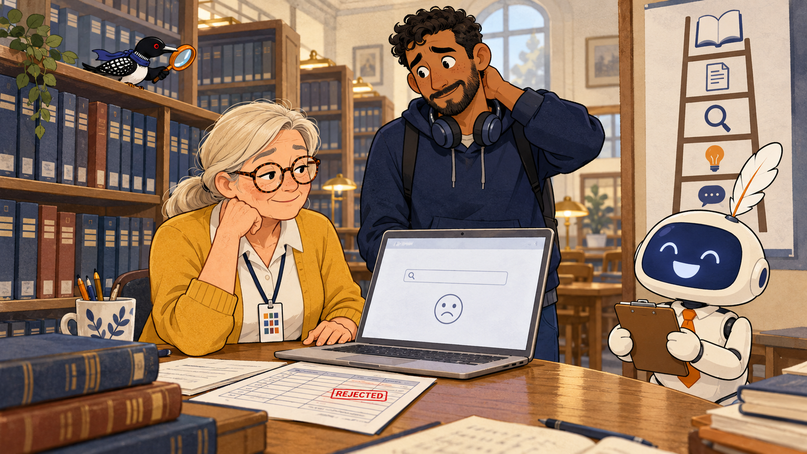
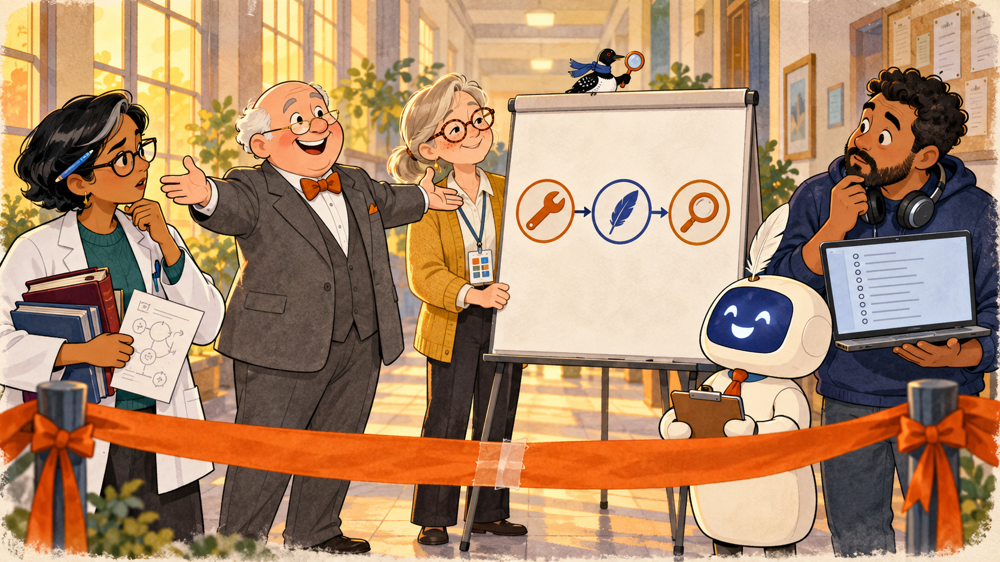
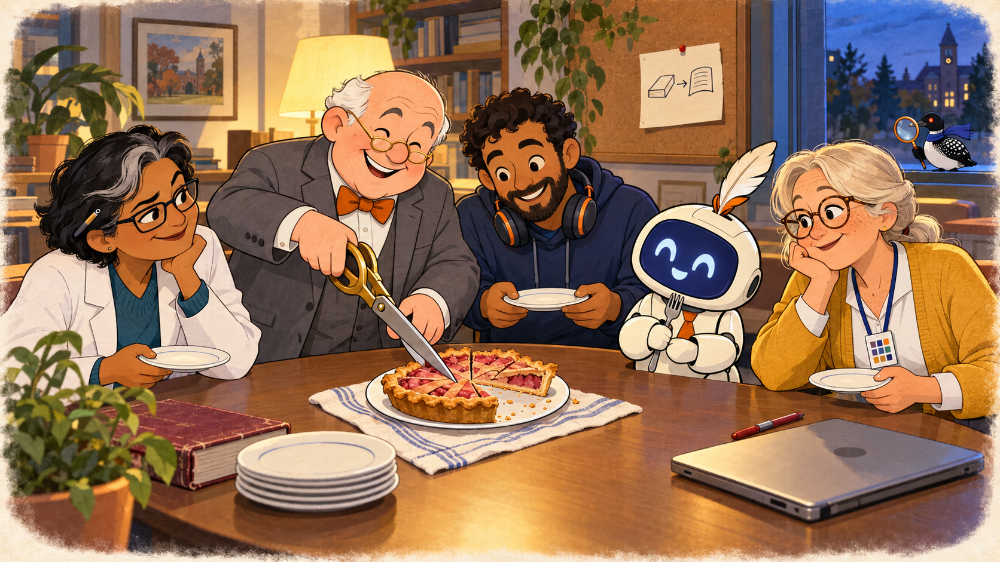

# The Tortoise, the Hare, and the Rubric

Cover Image Prompt

(This is the Cover Image. Do not include this label in the image.)
Please generate a wide-landscape 16:9 cover image for this story in a storybook fable style. Flat cartoon illustration, modern vector style, clean confident outlines, bold simple shapes, gentle humor, warm cream and soft gray neutrals with indigo (#3949ab) and burnt orange (#b45309) as the two accent colors, wide landscape 16:9 composition. Storybook fable costume: soft watercolor edges and a faint paper texture around the frame, with a wry fable-narrator mood.

Characters in this image (use these exact designs):
Dr. Priya Raman, a brisk woman in her late forties of South Asian descent with short black hair that has one streak of gray at the front, rectangular dark-framed glasses and one permanently arched eyebrow, wearing a white lab coat over a teal sweater, with a pen behind her ear and a thick battered maroon textbook under her arm.
Tomás Reyes, an enthusiastic man in his mid-thirties with medium-brown skin, short dark curly hair and a neatly trimmed beard, wearing a navy hoodie with big over-ear headphones around his neck.
Quill, a friendly AI agent drawn as a small rounded cream-white robot about the height of a tall child, with a smooth indigo screen for a face showing two simple round eyes and a wide eager smile (no text on the screen), a tiny orange necktie, a single white feather quill tucked into the top of its head like a plume, and a clipboard held in both hands. Quill has no gender and is always called "they".
Margie Halvorsen, a calm woman in her late fifties with silver-blond hair in a low ponytail, round tortoiseshell glasses, a freckled face and a patient half-smile, wearing a mustard-yellow cardigan over a white blouse and dark slacks, with a lanyard around her neck holding a laminated card marked with ten small colored squares.
Dean Pemberton, a cheerful round-faced man in his sixties with a white fringe of hair around a bald head and tiny gold-rimmed half-moon glasses, wearing a gray suit with an orange bow tie, always grinning and often holding an oversized pair of ceremonial scissors or a rolled-up banner.

Scene: A long university hallway turned into a racetrack, seen from the finish line. At the left, Dr. Priya Raman walks steadily with a determined small smile and a tortoise-shaped shadow on the floor behind her. At the right, Tomás Reyes sprints with a laptop under one arm and a hare-shaped shadow stretching behind him, with Quill trotting beside him holding the clipboard high. At the far end of the hallway Margie Halvorsen stands behind a ribbon stretched across the floor, holding her rubric lanyard card up like a referee's flag, with Dean Pemberton beside her raising the ceremonial scissors. Five thick textbooks in five different cover colors (no readable titles) stand along the wall like cheering spectators. The title text "The Tortoise, the Hare, and the Rubric" is rendered across the top in a warm storybook serif typeface in indigo with a thin orange underline. No other text.

Color palette: cream and soft gray background, indigo and burnt orange accents, a touch of watercolor teal.
Emotional tone: playful, warm, and wry.
Echo cameo: Echo the Loon: a very small loon with a glossy black head, a white belly, a black back with a white checkered pattern, a red eye, a small indigo scarf, and an orange-handled magnifying glass held in one wing. Echo is always tiny and in the background, never the focus. Echo is perched on the spine of the last textbook in the row, holding up the magnifying glass.
Generate the image immediately without asking clarifying questions.

Narrative Prompt

This is a fictional case-study fable set in a university chemistry department in the present day. It retells "The Tortoise and the Hare" with two colleagues who must choose one of five open chemistry textbooks by Friday. Dr. Priya Raman (the Tortoise) scores by hand with the ten-metric rubric. Tomás Reyes (the Hare) uses Quill, an AI agent, plus four automated checks: a link checker, an accessibility scan, license detection, and a readability scan. Margie Halvorsen referees. Dean Pemberton sets the deadline and applauds everything.

Both racers are competent and neither is a fool. The Hare's speed is real and the Tortoise's judgment is real, and the story is fair to both. The point is the protocol Margie draws at the end: automate what a tool can check, use the agent for a first pass, and keep a person in the loop for judgment and for verifying the claims that decide the outcome.

Terms and rules follow Chapters 11 to 14: human in the loop, risk-matched oversight, the limits of each automated check, the verification ladder (asking the agent whether it is sure proves nothing), spot check, source verification, and accept, correct, or reject. The invented citation is an agent error of the citation type. The chemistry error is real chemistry: the pH of a 0.01 molar solution of a strong monoprotic acid is 2, not 1.

Illustrative figures invented for this story: the 61 missing alt texts, the 9 dead links, about three hours per book for a hand review, and three books finished by hand. The invented journal citation in book five is fictional. No real textbook, publisher, or tool is named or depicted.

Visual style: contemporary flat cartoon in the house style from the Story Cast and Style Sheet, with a storybook fable costume of soft watercolor edges and a wry narrator. Keep each character's design identical in every panel, and hide Echo the Loon somewhere small in the background of every image.

### Prologue – A Race Nobody Entered

Once upon a semester, in a chemistry department with a tight budget and a very loud printer, the Dean announced a contest that nobody had entered. Five open textbooks wanted to be the course book, and the course started in three weeks. One reviewer trusted her red pen. Another trusted his AI agent. A librarian trusted neither until she had seen the evidence.

## Panel 1: The Ribbon Across the Hallway

Image Prompt

(This is Panel 01. Do not include the panel number in the image.)
I am about to ask you to generate a series of images for a graphic novel.
Please make the images have a consistent style and consistent characters.
Do not ask any clarifying questions. Just generate the image immediately
when asked.

Please generate a 16:9 image in a storybook fable style depicting panel 1 of 8. Flat cartoon illustration, modern vector style, clean confident outlines, bold simple shapes, gentle humor, warm cream and soft gray neutrals with indigo (#3949ab) and burnt orange (#b45309) as the two accent colors, wide landscape 16:9 composition. Storybook fable costume: soft watercolor edges and a faint paper texture around the frame, with a wry fable-narrator mood.

Characters in this image (use these exact designs):
Dean Pemberton, a cheerful round-faced man in his sixties with a white fringe of hair around a bald head and tiny gold-rimmed half-moon glasses, wearing a gray suit with an orange bow tie, always grinning and often holding an oversized pair of ceremonial scissors or a rolled-up banner.
Dr. Priya Raman, a brisk woman in her late forties of South Asian descent with short black hair that has one streak of gray at the front, rectangular dark-framed glasses and one permanently arched eyebrow, wearing a white lab coat over a teal sweater, with a pen behind her ear and a thick battered maroon textbook under her arm.
Tomás Reyes, an enthusiastic man in his mid-thirties with medium-brown skin, short dark curly hair and a neatly trimmed beard, wearing a navy hoodie with big over-ear headphones around his neck.
Quill, a friendly AI agent drawn as a small rounded cream-white robot about the height of a tall child, with a smooth indigo screen for a face showing two simple round eyes and a wide eager smile (no text on the screen), a tiny orange necktie, a single white feather quill tucked into the top of its head like a plume, and a clipboard held in both hands. Quill has no gender and is always called "they".
Margie Halvorsen, a calm woman in her late fifties with silver-blond hair in a low ponytail, round tortoiseshell glasses, a freckled face and a patient half-smile, wearing a mustard-yellow cardigan over a white blouse and dark slacks, with a lanyard around her neck holding a laminated card marked with ten small colored squares.

Scene: The hallway of a university chemistry building on a bright Monday morning, tall windows on one side. A ribbon is strung across the hall between two bookcases, and Dean Pemberton is mid-snip with the oversized ceremonial scissors, the two ribbon halves flying. A long table holds five textbooks in a row, each a different cover color with no readable titles. At the left Dr. Priya Raman holds a red pen and a printed worksheet with an arched eyebrow. At the right Tomás Reyes stands beside a laptop on a stand, with Quill next to him holding the clipboard. In the back center Margie Halvorsen sits on a tall library stool like a referee's chair, lanyard card raised. A wall calendar behind them has one date circled in orange (no readable text).

Color palette: Warm cream hallway, indigo shadows, burnt orange ribbon and accents, a hint of watercolor green on the bookcases.
Emotional tone: Festive, a little ceremonial, with a hint of mischief.
Echo cameo: Echo the Loon: a very small loon with a glossy black head, a white belly, a black back with a white checkered pattern, a red eye, a small indigo scarf, and an orange-handled magnifying glass held in one wing. Echo is always tiny and in the background, never the focus. Echo perches on top of the tallest bookcase, magnifying glass raised.
Generate the image immediately without asking clarifying questions.

Dean Pemberton snipped a ribbon across the department hallway with his ceremonial scissors and announced that the department would choose a chemistry textbook by Friday. Five candidates waited on the table, and two colleagues stepped forward. Dr. Raman, whose red pen had never once run dry, would score the books by hand. Tomás Reyes would use Quill and every automated check he could find, and Margie took the referee's stool and said only, "Show me where it says that."

## Panel 2: The Hare Bolts

Image Prompt

(This is Panel 02. Do not include the panel number in the image.)
Please generate a 16:9 image in a storybook fable style depicting panel 2 of 8. Make the characters and style consistent with the prior panel. Flat cartoon illustration, modern vector style, clean confident outlines, bold simple shapes, gentle humor, warm cream and soft gray neutrals with indigo (#3949ab) and burnt orange (#b45309) as the two accent colors, wide landscape 16:9 composition. Storybook fable costume: soft watercolor edges and a faint paper texture around the frame, with a wry fable-narrator mood.

Characters in this image (use these exact designs):
Tomás Reyes, an enthusiastic man in his mid-thirties with medium-brown skin, short dark curly hair and a neatly trimmed beard, wearing a navy hoodie with big over-ear headphones around his neck.
Quill, a friendly AI agent drawn as a small rounded cream-white robot about the height of a tall child, with a smooth indigo screen for a face showing two simple round eyes and a wide eager smile (no text on the screen), a tiny orange necktie, a single white feather quill tucked into the top of its head like a plume, and a clipboard held in both hands. Quill has no gender and is always called "they".
Dr. Priya Raman, a brisk woman in her late forties of South Asian descent with short black hair that has one streak of gray at the front, rectangular dark-framed glasses and one permanently arched eyebrow, wearing a white lab coat over a teal sweater, with a pen behind her ear and a thick battered maroon textbook under her arm.

Scene: A sunny open-plan library workroom on Tuesday morning. In the foreground Tomás Reyes sits tipped back in a chair with his feet on a second chair, holding a coffee mug in one hand and a fan of five neat printed report sheets in the other like a hand of cards. Quill stands beside him and hands over one more sheet, smiling eagerly. Behind them a large monitor shows four small progress dials glowing green, one for each automated check (no text). Far in the background, small and sharp, Dr. Priya Raman sits at a desk bent over a single open textbook with her red pen, not looking up. A wall clock shows ten o'clock.

Color palette: Sunny cream and pale yellow, green dial glows, indigo and orange accents on clothing and props.
Emotional tone: Breezy and confident, with a faint sense that speed will cost something.
Echo cameo: Echo the Loon: a very small loon with a glossy black head, a white belly, a black back with a white checkered pattern, a red eye, a small indigo scarf, and an orange-handled magnifying glass held in one wing. Echo is always tiny and in the background, never the focus. Echo peeks out from behind the coffee machine on a side table.
Generate the image immediately without asking clarifying questions.

Tomás loaded the books into Quill before the ribbon touched the floor. By Tuesday morning the link checker, the accessibility scan, the license detection tool, and the readability scan had all run on every book, and Quill had returned five tidy reports with ten scores each. In the fable this is the part where the Hare takes a nap, but Tomás used the time to read the reports. Across the room Dr. Raman was on page 40 of book one, and she had not looked up.

## Panel 3: The Tortoise Takes Notes

Image Prompt

(This is Panel 03. Do not include the panel number in the image.)
Please generate a 16:9 image in a storybook fable style depicting panel 3 of 8. Make the characters and style consistent with the prior panel. Flat cartoon illustration, modern vector style, clean confident outlines, bold simple shapes, gentle humor, warm cream and soft gray neutrals with indigo (#3949ab) and burnt orange (#b45309) as the two accent colors, wide landscape 16:9 composition. Storybook fable costume: soft watercolor edges and a faint paper texture around the frame, with a wry fable-narrator mood.

Characters in this image (use these exact designs):
Dr. Priya Raman, a brisk woman in her late forties of South Asian descent with short black hair that has one streak of gray at the front, rectangular dark-framed glasses and one permanently arched eyebrow, wearing a white lab coat over a teal sweater, with a pen behind her ear and a thick battered maroon textbook under her arm.

Scene: Dr. Priya Raman's cluttered office desk on Wednesday evening under a green-shaded lamp. An open textbook lies flat with several lines underlined in red, and beside it a printed worksheet has ten rows filled with tiny handwriting (no readable text). Indigo and orange sticky notes fringe the book like feathers. A mug of tea steams next to a tiny ceramic tortoise figurine on the desk. Through the wall behind her, faint curly lines and little music-note shapes suggest the cheerful clatter of a fast keyboard from the next room, and she glances at the wall with her arched eyebrow. A wall clock shows six.

Color palette: Warm lamp gold, cream paper, deep indigo shadows, burnt orange sticky notes.
Emotional tone: Patient and stubborn, quietly amused.
Echo cameo: Echo the Loon: a very small loon with a glossy black head, a white belly, a black back with a white checkered pattern, a red eye, a small indigo scarf, and an orange-handled magnifying glass held in one wing. Echo is always tiny and in the background, never the focus. Echo sits on the windowsill beside the desk, looking at the tortoise figurine.
Generate the image immediately without asking clarifying questions.

Dr. Raman did not hurry, because she had learned long ago that a score without evidence is only an opinion. She read each chapter with the rubric beside her, quoted the line behind every score on her worksheet, and fringed the margins with sticky notes. A book took her about three hours (an illustrative figure), so by Wednesday evening she had finished book one, started book two, and listened to a fast keyboard through the wall for two days.

## Panel 4: The Hare's Haul

Image Prompt

(This is Panel 04. Do not include the panel number in the image.)
Please generate a 16:9 image in a storybook fable style depicting panel 4 of 8. Make the characters and style consistent with the prior panel. Flat cartoon illustration, modern vector style, clean confident outlines, bold simple shapes, gentle humor, warm cream and soft gray neutrals with indigo (#3949ab) and burnt orange (#b45309) as the two accent colors, wide landscape 16:9 composition. Storybook fable costume: soft watercolor edges and a faint paper texture around the frame, with a wry fable-narrator mood.

Characters in this image (use these exact designs):
Tomás Reyes, an enthusiastic man in his mid-thirties with medium-brown skin, short dark curly hair and a neatly trimmed beard, wearing a navy hoodie with big over-ear headphones around his neck.
Quill, a friendly AI agent drawn as a small rounded cream-white robot about the height of a tall child, with a smooth indigo screen for a face showing two simple round eyes and a wide eager smile (no text on the screen), a tiny orange necktie, a single white feather quill tucked into the top of its head like a plume, and a clipboard held in both hands. Quill has no gender and is always called "they".
Dean Pemberton, a cheerful round-faced man in his sixties with a white fringe of hair around a bald head and tiny gold-rimmed half-moon glasses, wearing a gray suit with an orange bow tie, always grinning and often holding an oversized pair of ceremonial scissors or a rolled-up banner.
Margie Halvorsen, a calm woman in her late fifties with silver-blond hair in a low ponytail, round tortoiseshell glasses, a freckled face and a patient half-smile, wearing a mustard-yellow cardigan over a white blouse and dark slacks, with a lanyard around her neck holding a laminated card marked with ten small colored squares.

Scene: A department meeting room on Wednesday afternoon. Tomás Reyes stands proudly beside a whiteboard that shows two large numerals, "61" and "9", each circled (no other text), with Quill next to him holding the clipboard high with a proud smile. Behind them a projector screen shows a tidy list of green check marks with one orange question mark floating above it. Dean Pemberton applauds so hard that his orange bow tie has twisted sideways. At the back of the room Margie Halvorsen sits with her rubric card in one hand and one eyebrow lifted, a finger half raised as if to ask a question.

Color palette: Cream room, bright whiteboard white, green check marks, indigo and orange accents.
Emotional tone: Triumphant on the surface, with a tilt of doubt in the back row.
Echo cameo: Echo the Loon: a very small loon with a glossy black head, a white belly, a black back with a white checkered pattern, a red eye, a small indigo scarf, and an orange-handled magnifying glass held in one wing. Echo is always tiny and in the background, never the focus. Echo perches on top of the projector.
Generate the image immediately without asking clarifying questions.

On Wednesday Tomás presented his haul: all five books reviewed, 61 missing alt texts and 9 dead links (illustrative counts), each one listed by page. Dean Pemberton applauded until his bow tie spun. Margie waited for the clapping to fade, then asked what the scans could not see. A link checker can tell that a link works but not that it leads to the right page, she said, and a clean accessibility scan is a starting point and not a pass.

## Panel 5: Page 212

Image Prompt

(This is Panel 05. Do not include the panel number in the image.)
Please generate a 16:9 image in a storybook fable style depicting panel 5 of 8. Make the characters and style consistent with the prior panel. Flat cartoon illustration, modern vector style, clean confident outlines, bold simple shapes, gentle humor, warm cream and soft gray neutrals with indigo (#3949ab) and burnt orange (#b45309) as the two accent colors, wide landscape 16:9 composition. Storybook fable costume: soft watercolor edges and a faint paper texture around the frame, with a wry fable-narrator mood.

Characters in this image (use these exact designs):
Dr. Priya Raman, a brisk woman in her late forties of South Asian descent with short black hair that has one streak of gray at the front, rectangular dark-framed glasses and one permanently arched eyebrow, wearing a white lab coat over a teal sweater, with a pen behind her ear and a thick battered maroon textbook under her arm.

Scene: Thursday night in the empty department office, one lamp on and the windows dark. Dr. Priya Raman sits at her desk deep in the third textbook, her red pen frozen above the page and her arched eyebrow higher than ever. A small worked-example box on the open page has a short label "pH 1" circled in red ink. Beside the book lies a printed report sheet with a large friendly green "9" at the top (no other text). A cold cup of tea, a stack of two finished worksheets, and an empty snack wrapper show how long she has been reading. Her shadow on the wall looks like a tortoise.

Color palette: Night blue and indigo, a warm pool of lamp gold, red pen circle and burnt orange accents.
Emotional tone: Quiet, suspenseful, and a little triumphant.
Echo cameo: Echo the Loon: a very small loon with a glossy black head, a white belly, a black back with a white checkered pattern, a red eye, a small indigo scarf, and an orange-handled magnifying glass held in one wing. Echo is always tiny and in the background, never the focus. Echo is perched on the lamp shade, peering down at the circled label.
Generate the image immediately without asking clarifying questions.

On Thursday night, deep in book three, Dr. Raman stopped. A worked example reported a pH of 1 for a 0.01 molar solution of a strong acid, and the correct answer is 2. The sentences around it were fluent and confident, and no scan, no checker, and no reader without a chemistry degree would have blinked. Quill's report had given that same book a 9 for accuracy, with no source and no tool log behind it.

## Panel 6: The Referee Checks the Hare

Image Prompt

(This is Panel 06. Do not include the panel number in the image.)
Please generate a 16:9 image in a storybook fable style depicting panel 6 of 8. Make the characters and style consistent with the prior panel. Flat cartoon illustration, modern vector style, clean confident outlines, bold simple shapes, gentle humor, warm cream and soft gray neutrals with indigo (#3949ab) and burnt orange (#b45309) as the two accent colors, wide landscape 16:9 composition. Storybook fable costume: soft watercolor edges and a faint paper texture around the frame, with a wry fable-narrator mood.

Characters in this image (use these exact designs):
Margie Halvorsen, a calm woman in her late fifties with silver-blond hair in a low ponytail, round tortoiseshell glasses, a freckled face and a patient half-smile, wearing a mustard-yellow cardigan over a white blouse and dark slacks, with a lanyard around her neck holding a laminated card marked with ten small colored squares.
Tomás Reyes, an enthusiastic man in his mid-thirties with medium-brown skin, short dark curly hair and a neatly trimmed beard, wearing a navy hoodie with big over-ear headphones around his neck.
Quill, a friendly AI agent drawn as a small rounded cream-white robot about the height of a tall child, with a smooth indigo screen for a face showing two simple round eyes and a wide eager smile (no text on the screen), a tiny orange necktie, a single white feather quill tucked into the top of its head like a plume, and a clipboard held in both hands. Quill has no gender and is always called "they".

Scene: A library table on Friday morning, with tall shelves of bound journals in the background. Margie Halvorsen sits with a laptop open to a plain search page that shows no results, only a small sad-face icon (no text). A printed findings log lies beside her with a red stamp reading "REJECTED" pressed on one line. Behind her a poster shows a ladder with five rungs, drawn as icons with no text, ranging from a speech bubble at the bottom to an open book at the top. Tomás Reyes stands sheepishly rubbing the back of his neck. Quill beams with a huge confident smile, clipboard held tight.

Color palette: Library wood tones, cream paper, indigo shelves, a single red stamp mark, burnt orange accents.
Emotional tone: Gently comic detective work, calm and unhurried.
Echo cameo: Echo the Loon: a very small loon with a glossy black head, a white belly, a black back with a white checkered pattern, a red eye, a small indigo scarf, and an orange-handled magnifying glass held in one wing. Echo is always tiny and in the background, never the focus. Echo stands on a high journal shelf, holding the magnifying glass toward the laptop.
Generate the image immediately without asking clarifying questions.

Margie carried Tomás's report to the library table and verified it, starting with the claims that decided the outcome. When she asked Quill whether they were sure, Quill said yes with great enthusiasm, which proved nothing, because the same model answers again. A reference Quill had used to support a score on book five pointed to a journal that no catalog, index, or shelf had ever heard of. Tomás groaned and logged the citation as rejected, and he accepted the link counts, which came with a tool log.

## Panel 7: Photo Finish

Image Prompt

(This is Panel 07. Do not include the panel number in the image.)
Please generate a 16:9 image in a storybook fable style depicting panel 7 of 8. Make the characters and style consistent with the prior panel. Flat cartoon illustration, modern vector style, clean confident outlines, bold simple shapes, gentle humor, warm cream and soft gray neutrals with indigo (#3949ab) and burnt orange (#b45309) as the two accent colors, wide landscape 16:9 composition. Storybook fable costume: soft watercolor edges and a faint paper texture around the frame, with a wry fable-narrator mood.

Characters in this image (use these exact designs):
Dean Pemberton, a cheerful round-faced man in his sixties with a white fringe of hair around a bald head and tiny gold-rimmed half-moon glasses, wearing a gray suit with an orange bow tie, always grinning and often holding an oversized pair of ceremonial scissors or a rolled-up banner.
Dr. Priya Raman, a brisk woman in her late forties of South Asian descent with short black hair that has one streak of gray at the front, rectangular dark-framed glasses and one permanently arched eyebrow, wearing a white lab coat over a teal sweater, with a pen behind her ear and a thick battered maroon textbook under her arm.
Tomás Reyes, an enthusiastic man in his mid-thirties with medium-brown skin, short dark curly hair and a neatly trimmed beard, wearing a navy hoodie with big over-ear headphones around his neck.
Quill, a friendly AI agent drawn as a small rounded cream-white robot about the height of a tall child, with a smooth indigo screen for a face showing two simple round eyes and a wide eager smile (no text on the screen), a tiny orange necktie, a single white feather quill tucked into the top of its head like a plume, and a clipboard held in both hands. Quill has no gender and is always called "they".
Margie Halvorsen, a calm woman in her late fifties with silver-blond hair in a low ponytail, round tortoiseshell glasses, a freckled face and a patient half-smile, wearing a mustard-yellow cardigan over a white blouse and dark slacks, with a lanyard around her neck holding a laminated card marked with ten small colored squares.

Scene: Friday late afternoon in the department hallway, golden light through the tall windows. The ribbon has been taped back together with a visible strip of tape. Dean Pemberton stands in the center with arms spread wide, asking who won. At the left Dr. Priya Raman holds three textbooks and a worksheet; at the right Tomás Reyes holds a laptop showing a long list, with Quill beside him. Margie Halvorsen has turned over a flip chart that shows three simple icons in a row connected by arrows: a wrench, a feather quill, and a magnifying glass (no text). Both racers are looking at the chart rather than at each other, and each looks quietly surprised.

Color palette: Golden afternoon cream, indigo and burnt orange accents, a touch of watercolor green.
Emotional tone: Reflective and good-humored, a draw that nobody minds.
Echo cameo: Echo the Loon: a very small loon with a glossy black head, a white belly, a black back with a white checkered pattern, a red eye, a small indigo scarf, and an orange-handled magnifying glass held in one wing. Echo is always tiny and in the background, never the focus. Echo sits on the top edge of the flip chart.
Generate the image immediately without asking clarifying questions.

On Friday the Dean stood at the finish line, the ribbon taped back together, and asked who had won. Dr. Raman had finished three books and found the error that mattered. Tomás had covered all five and counted problems she could never have counted by hand, though he had missed the pH error and trusted one invented citation. Margie turned over the flip chart: tools for what can be checked, the agent for a first pass, and a person for judgment and for verifying the claims that decide the outcome.

## Panel 8: The Last Slice

Image Prompt

(This is Panel 08. Do not include the panel number in the image.)
Please generate a 16:9 image in a storybook fable style depicting panel 8 of 8. Make the characters and style consistent with the prior panel. Flat cartoon illustration, modern vector style, clean confident outlines, bold simple shapes, gentle humor, warm cream and soft gray neutrals with indigo (#3949ab) and burnt orange (#b45309) as the two accent colors, wide landscape 16:9 composition. Storybook fable costume: soft watercolor edges and a faint paper texture around the frame, with a wry fable-narrator mood.

Characters in this image (use these exact designs):
Dean Pemberton, a cheerful round-faced man in his sixties with a white fringe of hair around a bald head and tiny gold-rimmed half-moon glasses, wearing a gray suit with an orange bow tie, always grinning and often holding an oversized pair of ceremonial scissors or a rolled-up banner.
Dr. Priya Raman, a brisk woman in her late forties of South Asian descent with short black hair that has one streak of gray at the front, rectangular dark-framed glasses and one permanently arched eyebrow, wearing a white lab coat over a teal sweater, with a pen behind her ear and a thick battered maroon textbook under her arm.
Tomás Reyes, an enthusiastic man in his mid-thirties with medium-brown skin, short dark curly hair and a neatly trimmed beard, wearing a navy hoodie with big over-ear headphones around his neck.
Quill, a friendly AI agent drawn as a small rounded cream-white robot about the height of a tall child, with a smooth indigo screen for a face showing two simple round eyes and a wide eager smile (no text on the screen), a tiny orange necktie, a single white feather quill tucked into the top of its head like a plume, and a clipboard held in both hands. Quill has no gender and is always called "they".
Margie Halvorsen, a calm woman in her late fifties with silver-blond hair in a low ponytail, round tortoiseshell glasses, a freckled face and a patient half-smile, wearing a mustard-yellow cardigan over a white blouse and dark slacks, with a lanyard around her neck holding a laminated card marked with ten small colored squares.

Scene: The department commons on Friday evening, soft lamplight and a window going blue. On a round table sits the last rhubarb pie slice on a plate. Dean Pemberton is cutting it into five thin pieces with the oversized ceremonial scissors, grinning. Dr. Priya Raman, Tomás Reyes, and Margie Halvorsen lean in around the table with small plates, and Quill holds a fork and tilts their head at the pie, curious. On the corkboard behind them a single note is pinned, a correction for the textbook's authors (no readable text). A red pen and a laptop lie side by side at one end of the table.

Color palette: Warm lamplight, cream and soft gray, rhubarb pink pie, indigo and burnt orange accents.
Emotional tone: Cozy, contented, and gently funny.
Echo cameo: Echo the Loon: a very small loon with a glossy black head, a white belly, a black back with a white checkered pattern, a red eye, a small indigo scarf, and an orange-handled magnifying glass held in one wing. Echo is always tiny and in the background, never the focus. Echo stands on the windowsill outside the glass, looking in, magnifying glass near the pie.
Generate the image immediately without asking clarifying questions.

They shared the last slice of pie, because nobody had won alone. Dean Pemberton cut it with the ceremonial scissors, which was not their intended use and worked fine. The department ranked the five books on the verified scores, and Dr. Raman filed the pH correction with the book's authors as a pull request, which the open license made easy. Quill asked whether pie could be scored on ten metrics, and three people said no at the same moment.

### Epilogue – What Did the Race Teach?

The race ended in a photo finish, because the race had been the wrong shape. The Hare was fast at everything a tool can see, and the Tortoise was sharp at everything that takes a chemist. Neither alone would have chosen well, and together they chose well by Friday. The moral of this fable: automation gives you breadth, people give you judgment, and the best review uses both.

| Challenge | How They Responded | Lesson for Today |
|-----------|--------------------|------------------|
| Five books and one week | Tomás ran an agent and four automated checks; Dr. Raman scored by hand | Tools and agents cover many resources quickly, and a careful reader covers fewer resources more deeply. |
| A clean-looking scan | Margie asked what the scans could not see | A link checker cannot tell whether a working link leads to the right page, and a clean accessibility scan is a starting point and not a pass. |
| A confident accuracy score of 9 with no source | Dr. Raman read the worked examples and found a wrong pH | A claim that rests on the agent's own memory needs every claim checked, and subject expertise cannot be automated. |
| A reference that reads perfectly | Margie went to the source and could not find the journal | An invented source cannot be opened, so source verification is the strongest check. Asking the agent whether it is sure proves nothing. |
| Who gets the credit | Margie drew the combined protocol on a flip chart | Keep a person in the loop for judgment and for the claims that decide the outcome. The agent cannot take responsibility for the decision. |

### Call to Action

Before your next adoption deadline, split the work the way Margie did. Let the tools count what can be counted, let an agent make the first pass with its evidence attached, and give a person the claims that decide the outcome. Then find the one error that matters, fix it, and share the fix.

---

*"A fast answer is a good start. It is not yet a good answer."*  
– Margie Halvorsen

*"I did not find more errors than the tools did. I found the one that mattered."*  
– Dr. Priya Raman

*"Five books by Tuesday felt like winning. Friday taught me what winning needed."*  
– Tomás Reyes

---

## References

1. [Wikipedia: The Tortoise and the Hare](https://en.wikipedia.org/wiki/The_Tortoise_and_the_Hare) - The fable that this story retells
2. [Wikipedia: Human-in-the-loop](https://en.wikipedia.org/wiki/Human-in-the-loop) - Systems in which a person reviews or corrects an automated process
3. [Wikipedia: Hallucination (artificial intelligence)](https://en.wikipedia.org/wiki/Hallucination_%28artificial_intelligence%29) - Confident but false output from AI models, including invented citations
4. [W3C Web Accessibility Initiative: Evaluating Web Accessibility](https://www.w3.org/WAI/test-evaluate/) - Guidance on combining automated tools with human review
5. [DOI Foundation: What is a DOI?](https://www.doi.org/the-identifier/what-is-a-doi/) - How a persistent identifier helps check that a cited source exists

Where this is taught in this book:

- [Chapter 11: Manual Evaluation and Adoption Decisions](../../chapters/11-manual-evaluation-adoption/index.md) - scoring by hand and recording evidence
- [Chapter 12: AI Agents, Prompts, and Rubric Scoring](../../chapters/12-ai-agents-prompts-scoring/index.md) - what an agent is and how it returns scores with evidence
- [Chapter 13: Automated Checks, Cost, and Student Privacy](../../chapters/13-automated-checks-cost-privacy/index.md) - the four automated checks, what each cannot find, and human in the loop
- [Chapter 14: Checking and Calibrating AI Agent Output](../../chapters/14-checking-agent-output/index.md) - invented citations, verification steps, and accept, correct, or reject
