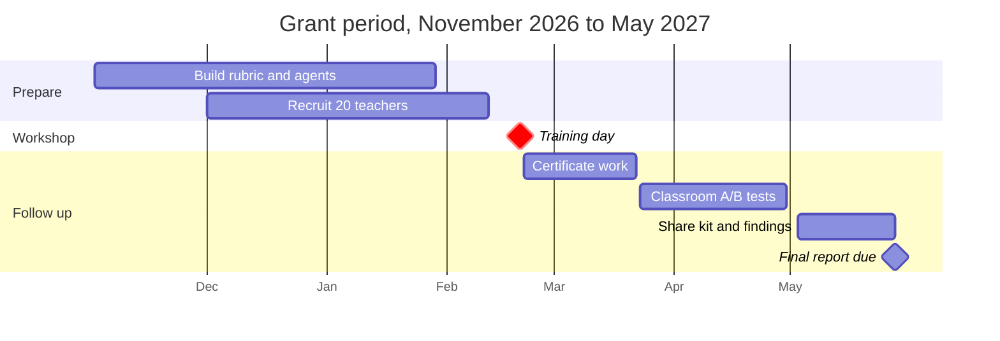

# Grant-Period Timeline

A training day on Saturday, February 20, 2027 leaves 14 weeks before the
final report to certify teachers and share results. Building and recruiting
fill the first three months; everything after the training day is
certificate work, classroom testing, and sharing.

These are sample dates for a grant period of November 2, 2026 to May 28,
2027. The day itself is laid out in the
[Sample One-Day Workshop Schedule](sample-one-day-schedule.md).

| Phase | Dates |
| --- | --- |
| Build the rubric and AI agents, and pilot them with two or three teachers | Nov 2, 2026 to Jan 29, 2027 |
| Recruit 20 teachers | Dec 1, 2026 to Feb 12, 2027 |
| **Training day in Minneapolis** | **Feb 20, 2027** |
| Certificate work (30 days) | Feb 21 to Mar 22, 2027 |
| Optional classroom A/B tests comparing the original and improved OER | Mar 23 to Apr 30, 2027 |
| Share the training kit and findings | May 3 to May 28, 2027 |
| Final report due | May 28, 2027 |
